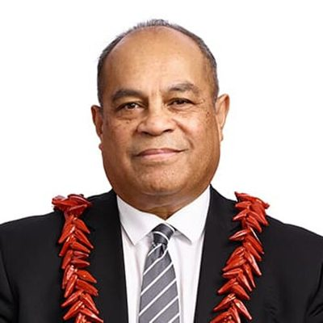

# Aupito William Sio

| | |
|---|---|
| **Party** | Labour |
| **Status (Oct 2026)** | Former MP |
| **Born** | 1960 — Samoa |
| **Electorate(s) held** | Māngere |
| **Parliaments** | 48, 49, 50, 51, 52, 53 |
| **First elected** | 2008 |
| **Key roles** | 10th Minister for Courts (2020–2023) 13th Minister for Pacific Peoples (2017–2023) |
| **Wikipedia** | [William Sio](https://en.wikipedia.org/wiki/William_Sio) |

## Current status

Sio retired at the 2023 election, saying the job was "all-consuming and relentless" and citing family and matai duties ([1News](https://www.1news.co.nz/2022/12/13/six-labour-mps-including-david-clark-to-retire-at-election/)); Lemauga Lydia Sosene succeeded him in Māngere. No reliable source was found for his activities since.

## Biography

Born in Samoa in 1960, Sio came to New Zealand in 1969 and holds the matai title Aupito of Matatufu, Lotofaga ([Stuff](http://www.stuff.co.nz/auckland/local-news/manukau-courier/86731887/sua-william-sio-a-man-of-many-titles)). He is a Latter-day Saint who has served as a bishop. His family experienced a police dawn raid in the 1970s. He was a Manukau City councillor from 2001 and the city's first Pasifika deputy mayor (2007).

## Political career

### Parliamentary terms

| Parliament | Years | Electorate | List position | Party |
|---|---|---|---|---|
| 48th | 2008– | List | 47 | Labour |
| 49th | 2008–2011 | Māngere | 24 | Labour |
| 50th | 2011–2014 | Māngere | 17 | Labour |
| 51st | 2014–2017 | Māngere | 14 | Labour |
| 52nd | 2017–2020 | Māngere | 16 | Labour |
| 53rd | 2020–2023 | Māngere | 20 | Labour |

_Source: Wikipedia parliamentary-term table._

### Offices held

| Office | From | To | Prime Minister at the time |
|---|---|---|---|
| 10th Minister for Courts | 6 November 2020 | 1 February 2023 | Jacinda Ardern; Chris Hipkins |
| 13th Minister for Pacific Peoples | 26 October 2017 | 1 February 2023 | Jacinda Ardern; Chris Hipkins |

_Source: Wikipedia infobox._

### Career summary

- List MP from April 2008; **Māngere MP 2008–2023**, defeating independent Taito Phillip Field in 2008; majorities around 15,000 in 2011/2014, 14,597 in 2017 and 19,396 in 2020 ([2020](https://www.electionresults.govt.nz/electionresults_2020/electorate-details-21.html)).
- **Minister (outside Cabinet) 2017–2023:** Pacific Peoples throughout; Courts (2020–2023); associate justice, foreign affairs, education and health (Pacific).

## Record & notable actions

- Gave an emotional account of his family's dawn raid when the government's 2021 apology for the Dawn Raids was announced ([TVNZ](https://www.tvnz.co.nz/one-news/new-zealand/government-minister-aupito-william-sio-in-tears-he-recalls-family-being-subjected-dawn-raid)).
- **Conscience votes:** one of four Labour MPs to vote against marriage equality (2013), citing the views of his Pacific constituents; by 2019 he supported Pasifika Pink Shirt Day, and in his 2023 valedictory told rainbow Pacific youth it was OK to be different ([NZ Herald](http://www.nzherald.co.nz/nz/news/article.cfm?c_id=1&objectid=10843389)).

## 2026 candidacy

Not listed as a Labour candidate for the 2026 election on policy.nz (Oct 2026).

## Sources

- https://en.wikipedia.org/wiki/William_Sio
- https://www.1news.co.nz/2022/12/13/six-labour-mps-including-david-clark-to-retire-at-election/
- http://www.stuff.co.nz/auckland/local-news/manukau-courier/86731887/sua-william-sio-a-man-of-many-titles
- https://www.electionresults.govt.nz/electionresults_2020/electorate-details-21.html
- https://www.tvnz.co.nz/one-news/new-zealand/government-minister-aupito-william-sio-in-tears-he-recalls-family-being-subjected-dawn-raid
- http://www.nzherald.co.nz/nz/news/article.cfm?c_id=1&objectid=10843389

_Profile compiled 2026-10-23 from the sources above; Wikipedia tables parsed by tools/people_labour_build.py._
