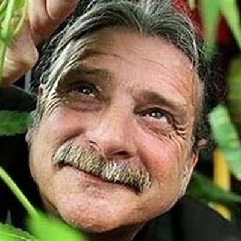
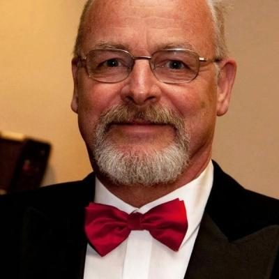

# Aotearoa Legalise Cannabis Party — people

Profiles of 12 people associated with Aotearoa Legalise Cannabis Party: MPs who served in the 50th–54th Parliaments (2011–2026) and every 2026 candidate listed on policy.nz. Status is as of 23 October 2026 (election day 7 November 2026). Each person sits under their current or most recent party. Click a name for the full profile.

## 2026 candidates (12)

| | Name | Status | 2026 electorate | 2026 list # | Roles / notes |
|---|---|---|---|---|---|
|  | [Maki Herbert](maki-herbert/README.md) | 2026 candidate | Te Tai Tokerau | 1 |  |
|  | [Michael Appleby](michael-appleby/README.md) | 2026 candidate | Wellington North | 2 | Leader, Aotearoa Legalise Cannabis Party (1996–2013); Member, Terawhiti Licensing Trust (elected 1998); Human rights lawyer |
|  | [Jeffrey LYE](jeffrey-lye/README.md) | 2026 candidate | Northland | 3 |  |
|  | [Paula Lambert](paula-lambert/README.md) | 2026 candidate | Christchurch East | 4 |  |
|  | [Christopher Manaia](christopher-manaia/README.md) | 2026 candidate | Auckland Central | 5 | Before politics: Cannabis Analyst |
|  | [Anntwinette Grumball](anntwinette-grumball/README.md) | 2026 candidate | Invercargill | 6 | Before politics: Truck driver |
|  | [Blair Anderson](blair-anderson/README.md) | 2026 candidate | Christchurch Central | 7 |  |
|  | [Tania Henare](tania-henare/README.md) | 2026 candidate | Te Tai Tonga | 8 | Before politics: Chef |
|  | [Romana Manning](romana-manning/README.md) | 2026 candidate | Tukituki | 9 |  |
|  | [Adrian McDermott](adrian-mcdermott/README.md) | 2026 candidate | Dunedin | 10 | Before politics: Engineer |
|  | [Irinka Britnell](irinka-britnell/README.md) | 2026 candidate |  | 11 |  |
|  | [Russell Haynes](russell-haynes/README.md) | 2026 candidate |  | 12 | Before politics: Pilot driver |

_Built by `tools/people_others_index.py` from each profile's `person.json`. Candidate details come from policy.nz; MP histories from Wikipedia and the sources cited in each profile._
