# New Zealand National Party — people

This index lists every National MP who sat at any time in the 50th–54th Parliaments (2011–2026), and every National candidate at the 7 November 2026 general election. Each person has a folder with `README.md` (profile), `person.json` (structured data) and, where available, `photo.jpg`. Status is as at **23 October 2026**.

**Counts:** 48 current MPs (43 standing again, 5 retiring); 29 2026 candidates who are not sitting MPs (one, Agnes Loheni, is a former MP); 70 former MPs from 2011–2026, 2 of them deceased. 147 people in total.

**List ranks:** the "2026 list #" column uses the Electoral Commission's official National Party list ([vote.nz](https://vote.nz/2026-general-election/voting-in-the-election/party-lists)). policy.nz (quoted in each profile's generated "2026 candidacy" section) numbers candidates from #14 down one place lower. Its list appears to still include Chris Penk at #14; he withdrew after the August 2026 leadership challenge. Example: Penny Simmonds is officially #14, but #15 on policy.nz. Jessica Rowe, who replaced Penk in Kaipara ki Mahurangi, is officially #68.

**Moved to other parties:** some former National MPs now belong to other parties.
- Parmjeet Parmar is an ACT MP: see [`../../act/people/parmjeet-parmar`](../../act/people/parmjeet-parmar/).
- Alfred Ngaro and Harete Hipango are NZ First 2026 candidates: see [`../../nz-first/people/alfred-ngaro`](../../nz-first/people/alfred-ngaro/) and [`../../nz-first/people/harete-hipango-brownlie`](../../nz-first/people/harete-hipango-brownlie/).
- Jami-Lee Ross was later an independent and Advance NZ co-leader; Matt King founded DemocracyNZ; Jackie Blue joined TOP in 2026.

Their profiles stay in this folder because they served as National MPs.

## Current MPs (54th Parliament)

Sorted by 2026 list rank, with unranked (retiring) MPs last.

| Photo | Name | Status | Electorate | 2026 list # | Roles |
|---|---|---|---|---|---|
| 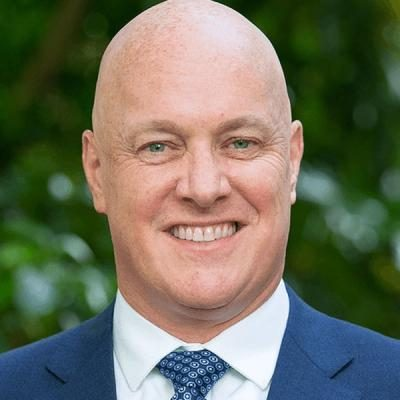 | [Christopher Luxon](christopher-luxon/) | MP, standing 2026 | Botany | 1 | Prime Minister of New Zealand (2023–); Minister for National Security and Intelligence (2023–); Minister Responsible for Ministerial Services (2023–) … |
| 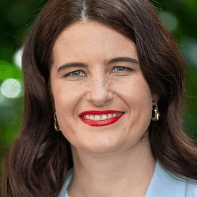 | [Nicola Willis](nicola-willis/) | MP, standing 2026 | List | 2 | Minister of Finance (2023–); Minister for Social Investment (2023–); Minister for Economic Growth (2025–) … |
|  | [Chris Bishop](chris-bishop/) | MP, standing 2026 | Hutt South | 3 | Attorney-General (2026–); Minister of Transport (2025–); Minister for Housing (2023–) … |
|  | [Simeon Brown](simeon-brown/) | MP, standing 2026 | Pakuranga | 4 | Minister of Health (2025–); Minister for State Owned Enterprises (2025–); Minister for Energy (2023–2025, 2026–) … |
|  | [Erica Stanford](erica-stanford/) | MP, standing 2026 | East Coast Bays | 5 | Minister of Education (2023–); Minister of Immigration (2023–); Minister Responsible for the Government Response to the Royal Commission of Inquiry into Abuse in Care (2024–) … |
| 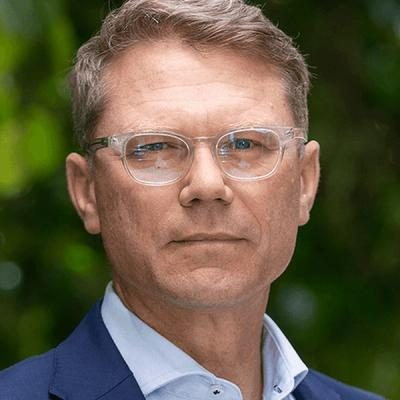 | [Paul Goldsmith](paul-goldsmith/) | MP, standing 2026 | List (2026: Epsom) | 6 | Minister of Justice (2023–); Minister for Treaty of Waitangi Negotiations (2023–); Minister for Arts, Culture and Heritage (2023–) … |
|  | [Louise Upston](louise-upston/) | MP, standing 2026 | Taupō | 7 | Leader of the House (2026–); Deputy Leader of the House (2023–2026); Minister for Social Development and Employment (2023–) … |
| 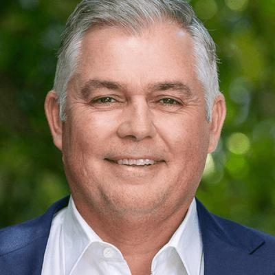 | [Mark Mitchell](mark-mitchell/) | MP, standing 2026 | Whangaparāoa | 8 | Minister of Police (2023–); Minister of Corrections (2023–); Minister for Emergency Management and Recovery (2023–) … |
| 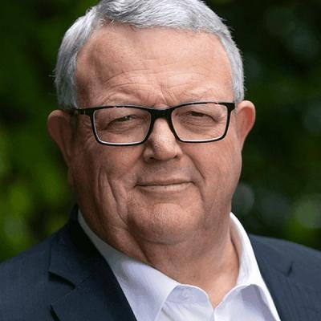 | [Gerry Brownlee](gerry-brownlee/) | MP, standing 2026 | List | 9 | Speaker of the House of Representatives (2023–); Father of the House (2022–); Deputy Leader of the National Party (2003–2006; Jul–Nov 2020) … |
|  | [Todd McClay](todd-mcclay/) | MP, standing 2026 | Rotorua | 10 | Minister for Trade and Investment (2023–); Minister of Agriculture (2023–); Minister of Forestry (2023–) … |
|  | [Tama Potaka](tama-potaka/) | MP, standing 2026 | Hamilton West | 11 | Minister of Conservation (2023–); Minister for Māori Development (2023–); Minister for Māori Crown Relations: Te Arawhiti (2023–) … |
|  | [Matt Doocey](matt-doocey/) | MP, standing 2026 | Waimakariri | 12 | Minister for Mental Health (2023–); Associate Minister of Health (2023–); Associate Minister of Transport (appointed 2023) … |
|  | [Simon Watts](simon-watts/) | MP, standing 2026 | North Shore | 13 | Minister of Climate Change (2023–); Minister of Revenue (2023–); Minister of Local Government (2025–) … |
|  | [Penny Simmonds](penny-simmonds/) | MP, standing 2026 | Invercargill | 14 | Minister of Science, Innovation and Technology (2026–); Minister for Tertiary Education (and Skills) (2023–); Minister for the Environment (2023–2026) … |
|  | [Nancy Lu](nancy-lu/) | MP, standing 2026 | List | 15 | List MP (2023–); Deputy Chair, Regulations Review Committee (2025–); Member, Finance and Expenditure Committee |
|  | [Nicola Grigg](nicola-grigg/) | MP, standing 2026 | Selwyn | 16 | Minister for the Environment (2026–); Minister for Women (2023–); Minister of State for Trade and Investment (2023–) … |
|  | [James Meager](james-meager/) | MP, standing 2026 | Rangitata | 17 | Minister for Youth (2025–); Minister for Hunting and Fishing (2025–); Minister for the South Island (2025–) … |
|  | [Scott Simpson](scott-simpson/) | MP, standing 2026 | Coromandel | 18 | Minister for ACC (2025–); Minister of Statistics (2017; 2026–); Deputy Leader of the House (2026–) … |
|  | [Cameron Brewer](cameron-brewer/) | MP, standing 2026 | Upper Harbour | 19 | Minister of Commerce and Consumer Affairs (2026–); Minister for Small Business and Manufacturing (2026–); Associate Minister of Immigration (2026–) … |
|  | [Mike Butterick](mike-butterick/) | MP, standing 2026 | Wairarapa | 20 | Minister for Land Information (2026–); Associate Minister of Agriculture (2026–); MP for Wairarapa (2023–) |
|  | [Stuart Smith](stuart-smith/) | MP, standing 2026 | Kaikōura | 21 | Chief Government Whip / National Senior Whip (2025–); Chair, Finance and Expenditure Committee (2023–2025); National spokesperson for civil defence, EQC, immigration, viticulture, climate change, energy (various, 2017–2023) … |
|  | [Katie Nimon](katie-nimon/) | MP, standing 2026 | Napier | 26 | MP for Napier (2023–) |
|  | [Tom Rutherford](tom-rutherford/) | MP, standing 2026 | Bay of Plenty (2026: Mt Maunganui) | 27 | MP for Bay of Plenty (2023–) |
|  | [Carl Bates](carl-bates/) | MP, standing 2026 | Whanganui | 28 | MP for Whanganui (2023–) |
|  | [Melissa Lee](melissa-lee/) | MP, standing 2026 | List (2026: Mt Albert) | 29 | Minister for Economic Development (2023–2025); Minister for Ethnic Communities (2023–2025); Minister for Media and Communications (2023–2024) … |
|  | [Dan Bidois](dan-bidois/) | MP, standing 2026 | Northcote | 30 | MP for Northcote (2018–2020, 2023–); Chair, Māori Affairs Committee (54th Parliament, earlier in the term); Deputy Chair, Transport and Infrastructure Committee … |
|  | [Suze Redmayne](suze-redmayne/) | MP, standing 2026 | Rangitīkei | 31 | MP for Rangitīkei (2023–); National Junior Whip |
|  | [Dana Kirkpatrick](dana-kirkpatrick/) | MP, standing 2026 | East Coast (2026: East Cape) | 32 | MP for East Coast (2023–); CEO, Equestrian Sports New Zealand (2014–2021) |
|  | [Carlos Cheung](carlos-cheung/) | MP, standing 2026 | Mount Roskill (2026: Mt Roskill) | 33 | MP for Mount Roskill (2023–) |
|  | [Grant McCallum](grant-mccallum/) | MP, standing 2026 | Northland | 34 | MP for Northland (2023–); National Party board member (2005–2015); Executive, National's BlueGreens (since 2001) |
|  | [Ryan Hamilton](ryan-hamilton/) | MP, standing 2026 | Hamilton East | 35 | MP for Hamilton East (2023–); Hamilton City Councillor, East Ward (2018–2023) |
|  | [Catherine Wedd](catherine-wedd/) | MP, standing 2026 | Tukituki | 36 | MP for Tukituki (2023–); Chair, Environment Committee; Parliamentary Private Secretary (Cyclone Recovery) … |
|  | [Tim Costley](tim-costley/) | MP, standing 2026 | Ōtaki (2026: Kapiti) | 37 | MP for Ōtaki (2023–); RNZAF pilot from 2001, retired as Wing Commander |
|  | [Vanessa Weenink](vanessa-weenink/) | MP, standing 2026 | Banks Peninsula | 38 | MP for Banks Peninsula (2023–); Deputy Chair, NZ Medical Association; Chair, NZMA GP Council (c.2019–2022) |
|  | [Barbara Kuriger](barbara-kuriger/) | MP, standing 2026 | Taranaki-King Country | 42 | Deputy Speaker of the House (2023–); Senior Whip, National Party (2018–2020); Junior Whip (2014–2017) … |
|  | [Greg Fleming](greg-fleming/) | MP, standing 2026 | Maungakiekie | 43 | MP for Maungakiekie (2023–); CEO, Maxim Institute (2005–c.2013); CEO, The Parenting Place (2015–2020) |
|  | [Rima Nakhle](rima-nakhle/) | MP, standing 2026 | Takanini | 44 | MP for Takanini (2023–); Deputy Chair, Māori Affairs Committee; Executive manager, Te Mahia Community Village |
|  | [David MacLeod](david-macleod/) | MP, standing 2026 | New Plymouth | 45 | MP for New Plymouth (2023–); Chair, Environment Committee (Dec 2023–May 2024); Chair, Taranaki Regional Council (2007–2022) … |
|  | [Miles Anderson](miles-anderson/) | MP, standing 2026 | Waitaki | 46 | MP for Waitaki (2023–); National chair, Federated Farmers Meat & Wool (2017–2020) |
|  | [Hamish Campbell](hamish-campbell/) | MP, standing 2026 | Ilam | 47 | MP for Ilam (2023–) |
|  | [Tim van de Molen](tim-van-de-molen/) | MP, standing 2026 | Waikato | 48 | MP for Waikato (2017–); Chair, Foreign Affairs, Defence and Trade Committee (2023–); National third whip (2018) … |
|  | [Joseph Mooney](joseph-mooney/) | MP, standing 2026 | Southland | 49 | MP for Southland (2020–); National spokesperson for Treaty of Waitangi negotiations, water, space; associate defence (2020–2023) |
|  | [Sam Uffindell](sam-uffindell/) | MP, standing 2026 | Tauranga | 50 | MP for Tauranga (2022–); National associate spokesperson for research, science and innovation; economic and regional development (2022–2023) |
|  | [Andrew Bayly](andrew-bayly/) | MP, retiring 2026 | Port Waikato |  | Minister of Commerce and Consumer Affairs (2023–2025); Minister for ACC (Jan–Feb 2025); Minister for Small Business and Manufacturing (2023–2025) … |
| 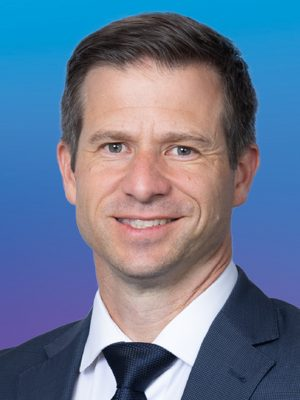 | [Chris Penk](chris-penk/) | MP, retiring 2026 | Kaipara ki Mahurangi |  | Minister of Defence (Apr–Aug 2026); Minister Responsible for the GCSB and NZSIS; Minister for Space (Apr–Aug 2026); Associate Minister for Emergency Management and Recovery (2026) … |
|  | [Maureen Pugh](maureen-pugh/) | MP, retiring 2026 | West Coast-Tasman |  | Assistant Speaker of the House (2023–); Junior Whip, National Party (2020–2023); MP for West Coast-Tasman (2023–2026) … |
|  | [Paulo Garcia](paulo-garcia/) | MP, retiring 2026 | New Lynn |  | MP for New Lynn (2023–2026); List MP (2019–2020); Honorary Consul of the Philippines in Auckland (from 2012) |
|  | [Shane Reti](shane-reti/) | MP, retiring 2026 | Whangārei |  | Minister of Health (2023–2025); Minister for Pacific Peoples (2023–2026); Minister of Science, Innovation and Technology (2025–2026) … |

## 2026 candidates (not sitting MPs), by list rank

| Photo | Name | Status | Electorate | 2026 list # | Roles |
|---|---|---|---|---|---|
|  | [Dale Stephens](dale-stephens/) | 2026 candidate | Christchurch Central | 22 |  |
|  | [Mahesh Muralidhar](mahesh-muralidhar/) | 2026 candidate | Tāmaki | 23 | Before politics: Startup executive and investor |
|  | [Katie Milne](katie-milne/) | 2026 candidate | West Coast-Tasman | 24 |  |
|  | [Angee Nicholas](angee-nicholas/) | 2026 candidate | Henderson | 25 |  |
|  | [Rosemary Bourke](rosemary-bourke/) | 2026 candidate | Māngere | 39 | Before politics: Operations Scheduler |
|  | [Blair Cameron](blair-cameron/) | 2026 candidate | Nelson | 40 |  |
|  | [Kristine Asuncion](kristine-asuncion/) | 2026 candidate | Dunedin | 41 | Before politics: People and Culture Advisor |
|  | [Emma Chatterton](emma-chatterton/) | 2026 candidate | Papakura | 51 |  |
|  | [Ankit Bansal](ankit-bansal/) | 2026 candidate | Palmerston North | 52 |  |
|  | [Matthew French](matthew-french/) | 2026 candidate | Taieri | 53 | Before politics: Branch Manager wills/estate |
|  | [Candace Kinser](candace-kinser/) | 2026 candidate | Auckland Central | 54 |  |
|  | [Coral Raukawa](coral-raukawa/) | 2026 candidate | Te Tai Hauāuru | 55 |  |
|  | [Tracy Summerfield](tracy-summerfield/) | 2026 candidate | Wigram | 56 |  |
|  | [Agnes Loheni](agnes-loheni/) | 2026 candidate (former MP 2019–20) | Waitākere | 57 | List MP (2019–2020); Associate spokesperson, small business and Pacific peoples (2019–2020) |
|  | [Lalit Arya](lalit-arya/) | 2026 candidate | Ōtāhuhu | 58 |  |
|  | [Matthew Evetts](matthew-evetts/) | 2026 candidate | Kenepuru | 59 | Before politics: Business & Technology Leader |
|  | [Lloyd Budd](lloyd-budd/) | 2026 candidate | Whangārei | 60 | Before politics: CEO Real Estate |
|  | [Matthew Paul](matthew-paul/) | 2026 candidate | Port Waikato | 61 | Before politics: Environmental Consultant |
|  | [Sunil Kumar](sunil-kumar/) | 2026 candidate | Glendene | 62 |  |
|  | [Karunā Muthu](karuna-muthu/) | 2026 candidate | Wellington Bays | 63 |  |
|  | [Alexandra Davids](alexandra-davids/) | 2026 candidate | Christchurch East | 64 |  |
| 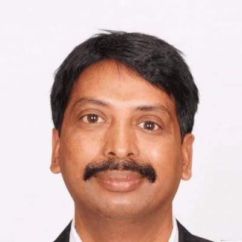 | [Ghouse Majeed](ghouse-majeed/) | 2026 candidate | Manurewa | 65 |  |
|  | [Jonathan Pitts](jonathan-pitts/) | 2026 candidate | Wellington North | 66 |  |
|  | [Zabeen Lateef](zabeen-lateef/) | 2026 candidate | Remutaka | 67 | Before politics: Senior Strategic Adviser |
|  | [Jessica Rowe](jessica-rowe/) | 2026 candidate | Kaipara ki Mahurangi | 68 | Before politics: Foreign Affairs |
|  | [Troy Elliott](troy-elliott/) | 2026 candidate | List only | 69 |  |
|  | [Robin Atwall](robin-atwall/) | 2026 candidate | List only | 70 |  |
|  | [Ash Nayyar](ash-nayyar/) | 2026 candidate | List only | 71 |  |
|  | [Maria Sanson](maria-sanson/) | 2026 candidate | List only | 72 |  |

## Former MPs who served 2011–2026

Includes MPs who left before or during the 50th–54th Parliaments. Sorted by surname.

| Photo | Name | Status | Electorate | 2026 list # | Roles |
|---|---|---|---|---|---|
|  | [Amy Adams](amy-adams/) | Former MP | List |  | Minister of Justice; Courts (2014–2017); Minister for Social Housing; Social Investment; Associate Finance (2016–2017); Minister for the Environment (2012–2014) … |
|  | [Shane Ardern](shane-ardern/) | Former MP | Taranaki-King Country |  | MP for Taranaki-King Country (1998–2014); Chair, Primary Production Committee (2008–2014) |
|  | [Chris Auchinvole](chris-auchinvole/) | Former MP | West Coast-Tasman |  | MP for West Coast-Tasman (2008–2011); List MP (2005–2008, 2011–2014) |
|  | [Kanwaljit Singh Bakshi](kanwal-singh-bakshi/) | Former MP | List |  | List MP (2008–2020); Chair, Law and Order Committee (2015–2017); National spokesperson for internal affairs (2017–2020); ethnic communities (2020) |
|  | [Todd Barclay](todd-barclay/) | Former MP | Clutha-Southland |  | MP for Clutha-Southland (2014–2017) |
|  | [Maggie Barry](maggie-barry/) | Former MP | List |  | Minister of Conservation (2014–2017); Minister for Arts, Culture and Heritage (2014–2017); Minister for Senior Citizens (2014–2017) … |
|  | [David Bennett](david-bennett/) | Former MP | Hamilton East |  | Minister for Food Safety; Veterans' Affairs; Racing (2016–2017); Associate Minister of Transport (2016–2017); Chair, Finance and Expenditure Committee (2015–2017); Transport and Industrial Relations Committee (2011–2014) … |
|  | [Paula Bennett](paula-bennett/) | Former MP | Waitakere, Upper Harbour |  | Deputy Prime Minister (2016–2017); Deputy Leader of the National Party (2016–2020); Minister of Police; Women; Tourism (2016–2017) … |
|  | [Jackie Blue](jackie-blue/) | Former MP — now TOP | List |  | List MP (2005–2013); Equal Employment Opportunities Commissioner, Human Rights Commission (2013–2018) |
|  | [Chester Borrows](chester-borrows/) | Deceased | Whanganui |  | Deputy Speaker (2014–2017); Minister for Courts (2011–2014); Associate Minister of Justice; Social Development (2011–2014) … |
|  | [Simon Bridges](simon-bridges/) | Former MP | Tauranga |  | Leader of the National Party and Leader of the Opposition (2018–2020); Leader of the House (May–Oct 2017); Minister of Transport (2014–2017) … |
|  | [Cam Calder](cam-calder/) | Former MP | List |  | List MP (2009–2014); Chair, Education and Science Committee (2013–2014) |
|  | [David Carter](david-carter/) | Former MP | List |  | Speaker of the House (2013–2017); Minister for Primary Industries (2011–2013); Minister of Agriculture; Biosecurity; Forestry (2008–2011) … |
|  | [Jonathan Coleman](jonathan-coleman/) | Former MP | Northcote |  | Minister of Health (2014–2017); Minister for Sport and Recreation (2014–2017); Minister of Defence (2011–2014) … |
| 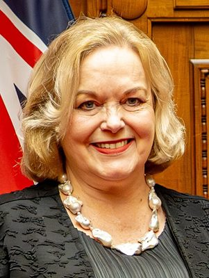 | [Judith Collins](judith-collins/) | Former MP | Clevedon, Papakura |  | Attorney-General (2023–2026); Minister of Defence (2023–2026) — first woman in the role; Minister Responsible for the GCSB and NZSIS (2023–2026) … |
|  | [Jacqui Dean](jacqui-dean/) | Former MP | Otago, Waitaki |  | Assistant Speaker (2020–2023); Minister of Commerce and Consumer Affairs; Small Business (2016–2017); Parliamentary Private Secretary (2014–2016) … |
|  | [Sarah Dowie](sarah-dowie/) | Former MP | Invercargill |  | MP for Invercargill (2014–2020); National spokesperson for conservation (2018–2020); Chair, Justice and Electoral Committee (2014–2017) |
|  | [Bill English](bill-english/) | Former MP | Wallace, Clutha-Southland |  | Prime Minister of New Zealand (2016–2017); Leader of the National Party (2001–2003; 2016–2018); Leader of the Opposition (2001–2003; 2017–2018) … |
|  | [Andrew Falloon](andrew-falloon/) | Former MP | Rangitata |  | MP for Rangitata (2017–2020); National spokesperson for biosecurity; South Island regional development |
| 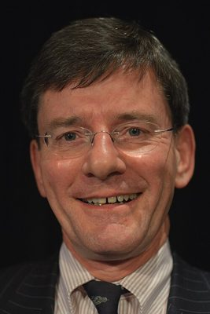 | [Chris Finlayson](chris-finlayson/) | Former MP | List |  | Attorney-General (2008–2017); Minister for Treaty of Waitangi Negotiations (2008–2017); Minister for Arts, Culture and Heritage (2008–2014) … |
|  | [Craig Foss](craig-foss/) | Former MP | Tukituki |  | Minister of Commerce; Broadcasting (2011–2014); Minister of Consumer Affairs (2013–2014); Minister for Small Business; Statistics; Veterans' Affairs (2014–2016) … |
|  | [Paul Foster-Bell](paul-foster-bell/) | Former MP | List |  | List MP (2013–2017); Deputy Chair, Justice and Electoral; Education and Science; Government Administration Committees; MFAT diplomat (deputy high commissioner to Pakistan; deputy head of mission, Saudi Arabia) |
|  | [Aaron Gilmore](aaron-gilmore/) | Former MP | List |  | List MP (2008–2011; Feb–May 2013) |
|  | [Jo Goodhew](jo-goodhew/) | Former MP | Aoraki, Rangitata |  | Minister for the Community and Voluntary Sector (2011–2016); Minister for Food Safety (2014–2016); Minister for Senior Citizens; Women's Affairs (2011–2014) … |
|  | [Tim Groser](tim-groser/) | Former MP | List |  | Minister of Trade (2008–2015); Minister for Climate Change Issues (2011–2015); Minister of Conservation (2008–2010) … |
|  | [Nathan Guy](nathan-guy/) | Former MP | Ōtaki |  | Minister for Primary Industries (2013–2017); Minister of Immigration (2011–2013); Minister for Racing; Veterans' Affairs (2011–2013) … |
|  | [Claudette Hauiti](claudette-hauiti/) | Former MP | List |  | List MP (May 2013–2014) |
|  | [Jo Hayes](jo-hayes/) | Former MP | List |  | List MP (2014–2020); Chair, Social Services Committee (2014–2017); Third Whip (51st Parliament) … |
|  | [John Hayes](john-hayes/) | Former MP | Wairarapa |  | MP for Wairarapa (2005–2014); Chair, Foreign Affairs, Defence and Trade Committee (2008–2014); Parliamentary Private Secretary to the Minister of Foreign Affairs (2011–2014) … |
|  | [Phil Heatley](phil-heatley/) | Former MP | Whangarei |  | Minister of Housing (2008–2013); Minister of Fisheries / Fisheries and Aquaculture (2008–2011); Minister of Energy and Resources (2011–2013) … |
|  | [Tau Henare](tau-henare/) | Former MP | Northern Maori, Te Tai Tokerau |  | Minister of Māori Affairs (1996–1999); Minister of Racing (1996–1998); MP for Northern Māori / Te Tai Tokerau (1993–1999) … |
|  | [Harete Hipango](harete-hipango/) | Former MP — now NZ First | Whanganui |  | MP for Whanganui (2017–2020); List MP (2021–2023) |
|  | [Brett Hudson](brett-hudson/) | Former MP | List |  | List MP (2014–2020); National spokesperson for police; government digital services; commerce and consumer affairs (2018–2020) |
|  | [Paul Hutchison](paul-hutchison/) | Former MP | Port Waikato, Hunua |  | MP for Port Waikato (1999–2008); MP for Hunua (2008–2014); Chair, Health Committee (2009–2014) … |
|  | [Steven Joyce](steven-joyce/) | Former MP | List |  | Minister of Finance; Minister for Infrastructure (2016–2017); Minister for Economic Development (2011–2016); Minister of Science and Innovation (2011–2016) … |
|  | [Nikki Kaye](nikki-kaye/) | Deceased | Auckland Central |  | Deputy Leader of the National Party and Deputy Leader of the Opposition (May–Jul 2020); Interim Leader of the National Party (14 Jul 2020, for several hours); Minister of Education (May–Oct 2017) … |
|  | [John Key](john-key/) | Former MP | Helensville |  | Prime Minister of New Zealand (2008–2016); Leader of the National Party (2006–2016); Leader of the Opposition (2006–2008) … |
|  | [Colin King](colin-king/) | Former MP | List |  | MP for Kaikōura (2005–2014) |
|  | [Matt King](matt-king/) | Former MP — now Independent | Northland |  | MP for Northland (2017–2020); Leader of DemocracyNZ (2022–2024); National spokesperson for regional development (North Island), rural communities, transport (2017–2020) |
|  | [Nuk Korako](nuk-korako/) | Former MP | List |  | List MP (2014–2019); Chair, Māori Affairs Committee (2014–2017); National spokesperson for Māori development; Treaty negotiations (2017–2019) … |
|  | [Denise Lee](denise-lee/) | Former MP | Maungakiekie |  | MP for Maungakiekie (2017–2020); Auckland Councillor, Maungakiekie-Tāmaki ward (2013–2017); President of United Future (c. 2008) |
|  | [Sam Lotu-Iiga](sam-lotu-iiga/) | Former MP | Maungakiekie |  | Minister for Pacific Peoples (2014–2016); Minister of Corrections (2014–2015); Minister of Local Government (2015–2016) … |
|  | [Tim Macindoe](tim-macindoe/) | Former MP | Hamilton West |  | Mayor of Hamilton (2025–); Hamilton City Councillor, East Ward (2024–2025); Minister of Customs (May–Oct 2017) … |
|  | [Murray McCully](murray-mccully/) | Former MP | List |  | Minister of Foreign Affairs (2008–2017); Minister for Sport and Recreation (2008–2014); Minister for the Rugby World Cup (2008–2011) … |
|  | [Ian McKelvie](ian-mckelvie/) | Former MP | Rangitīkei |  | Assistant Speaker (2022–2023); Chair, Primary Production Committee (2014–2017); Governance and Administration Committee (2020–2023); National spokesperson for racing, fisheries, forestry, seniors … |
|  | [Todd Muller](todd-muller/) | Former MP | Bay of Plenty |  | Leader of the National Party and Leader of the Opposition (22 May–14 Jul 2020); Chair, Foreign Affairs, Defence and Trade Committee (2017); National spokesperson for agriculture, climate change, forestry (2017–2020); agriculture & climate change (2023) … |
|  | [Jono Naylor](jono-naylor/) | Former MP | List |  | List MP (2014–2017); Mayor of Palmerston North (2007–2014); Horizons Regional Councillor (2018–) |
|  | [Alfred Ngaro](alfred-ngaro/) | Former MP — now NZ First | List |  | Minister for Pacific Peoples; Community and Voluntary Sector (2016–2017); List MP (2011–2020); Leader of NewZeal (2023–2026) |
|  | [Simon O'Connor](simon-oconnor/) | Former MP | Tāmaki |  | MP for Tāmaki (2011–2023); Chair, Health Committee (2014–2017); Foreign Affairs, Defence and Trade Committee (2017–2020); National spokesperson for corrections (2017–2023), customs, arts, internal affairs … |
| 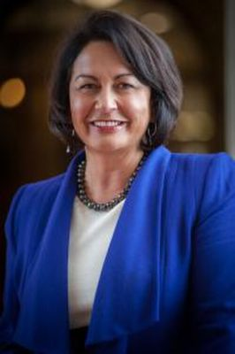 | [Hekia Parata](hekia-parata/) | Former MP | List |  | Minister of Education (2011–2017); Minister of Women's Affairs; Energy and Resources; Ethnic Affairs (2010–2011); Minister of Pacific Island Affairs (2011–2013) … |
|  | [Parmjeet Parmar](parmjeet-parmar/) | Former MP — now ACT | List |  | ACT list MP (2023–); National list MP (2014–2020); Chair, Education and Workforce Committee (2018–2020) … |
|  | [Jami-Lee Ross](jami-lee-ross/) | Former MP — now Independent | Botany |  | Chief Government Whip (May–Oct 2017); Deputy Chief Government Whip (2014–2017); National transport and infrastructure spokesperson (2018) … |
|  | [Eric Roy](eric-roy/) | Former MP | Awarua, Invercargill |  | Deputy Speaker (2011–2014); Assistant Speaker (1998–2002); MP for Invercargill (2005–2014) … |
|  | [Tony Ryall](tony-ryall/) | Former MP | East Cape, Eastern Bay of Plenty, Bay of Plenty |  | Minister of Health (2008–2014); Minister of State Owned Enterprises (2008–2014); Minister of State Services (2008–2011) … |
|  | [Mike Sabin](mike-sabin/) | Former MP | Northland |  | MP for Northland (2011–2015) |
|  | [Alastair Scott](alastair-scott/) | Former MP | Wairarapa |  | MP for Wairarapa (2014–2020) |
|  | [Katrina Shanks](katrina-shanks/) | Former MP | List |  | List MP (2007–2014); Chair, Social Services Committee (2009–2011) |
|  | [Lockwood Smith](lockwood-smith/) | Former MP | Kaipara, Rodney |  | Speaker of the House of Representatives (2008–2013); High Commissioner to the United Kingdom (2013–2017); Minister of Education (1990–1996) … |
|  | [Nick Smith](nick-smith/) | Former MP | Tasman, Nelson |  | Mayor of Nelson (2022–); Minister for the Environment (2008–2012, 2014–2017); Minister for Climate Change Issues (2008–2011) … |
|  | [Lindsay Tisch](lindsay-tisch/) | Former MP | Karapiro, Piako, Waikato |  | Assistant Speaker (2011–2017); Deputy Speaker (2008–2011); Senior Whip (2005–2006); Junior Whip (2002–2005) … |
|  | [Anne Tolley](anne-tolley/) | Former MP | East Coast |  | Deputy Speaker (2017–2020); Minister for Children (2016–2017) — established Oranga Tamariki; Minister of Social Development (2014–2017) … |
|  | [Chris Tremain](chris-tremain/) | Former MP | Napier |  | Minister of Internal Affairs (2012–2014); Minister of Local Government (2012–2013); Minister of Civil Defence; Consumer Affairs (2011–2012) … |
|  | [Nicky Wagner](nicky-wagner/) | Former MP | Christchurch Central |  | Minister for Disability Issues (2014–2017); Minister of Customs (2014–2017); Minister supporting Greater Christchurch Regeneration (2017) … |
|  | [Hamish Walker](hamish-walker/) | Former MP | Clutha-Southland |  | MP for Clutha-Southland (2017–2020); National spokesperson for forestry and land information (May–Jul 2020) |
|  | [Kate Wilkinson](kate-wilkinson/) | Former MP | Waimakariri |  | Minister of Conservation (2010–2013); Minister of Labour (2011–2012); Minister for Food Safety (2008–2013) … |
|  | [Maurice Williamson](maurice-williamson/) | Former MP | Pakuranga |  | Auckland Councillor, Howick ward (2022–); Consul-General in Los Angeles (2017–2021); Minister for Building and Construction; Customs; Land Information; Statistics (2008–2014) … |
|  | [Michael Woodhouse](michael-woodhouse/) | Former MP | List |  | Minister of Immigration (2013–2017); Minister of Police (2014–2015); Minister for Workplace Relations and Safety (2014–2017) … |
|  | [Jian Yang](jian-yang/) | Former MP | National |  | List MP (2011–2020); Chair, Education and Science Committee (2014–2017); Chair, Governance and Administration Committee (2017–2020) … |
| 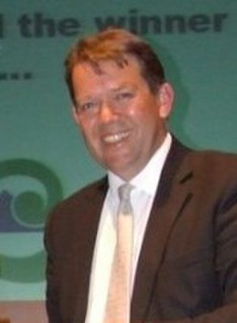 | [Jonathan Young](jonathan-young/) | Former MP | New Plymouth |  | MP for New Plymouth (2008–2020) |
|  | [Lawrence Yule](lawrence-yule/) | Former MP | Tukituki |  | MP for Tukituki (2017–2020); Mayor of Hastings (2001–2017); President, Local Government New Zealand |

---

Built by `tools/people_national_build.py` and `tools/people_national_index.py`, from Wikipedia (infobox and article text, with citations followed through), the Electoral Commission, policy.nz, national.org.nz candidate pages and the news sources cited in each profile. Photos are from Wikimedia Commons (licence recorded per person) or policy.nz candidate photos.
