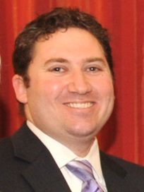

# Aaron Gilmore

| | |
|---|---|
| **Party** | New Zealand National Party |
| **Status** | Former MP |
| **Parliaments** | 49th, 50th |
| **First elected** | 2008 |
| **Born** | 1973-08-26 — Christchurch, New Zealand |
| **Wikipedia** | [Aaron Gilmore](https://en.wikipedia.org/wiki/Aaron_Gilmore) |

## Record & notable actions

**Conscience votes** (recorded third-reading votes):

| Bill | Vote |
|---|---|
| [Marriage (Definition of Marriage) Amendment Bill — third reading, 17 Apr 2013](https://en.wikipedia.org/wiki/Marriage_(Definition_of_Marriage)_Amendment_Act_2013) | for |

## Sources

- <https://en.wikipedia.org/wiki/Aaron_Gilmore>
- Photo: <https://commons.wikimedia.org/wiki/File:Aaron_Gilmore.jpg> — US Embassy — This image has been extracted from another file (Public domain)
