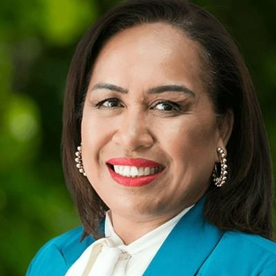

# Agnes Loheni

| | |
|---|---|
| **Party** | New Zealand National Party |
| **Status** | 2026 candidate (not an MP) |
| **Now (Oct 2026)** | Former National list MP (Jan 2019–Oct 2020). 2026 National candidate for Waitākere, #57 on the official 2026 list. |
| **Electorate(s)** | List MP (2019–2020); contested Māngere 2017, 2020; list-only 2023; Waitākere candidate 2026 |
| **Parliaments** | 52nd |
| **First elected** | 2019 (list vacancy) |
| **2026 election** | list #57, standing in Waitākere |
| **Wikipedia** | [Agnes Loheni](https://en.wikipedia.org/wiki/Agnes_Loheni) |

> **List rank note:** policy.nz (in the 2026 candidacy section below) gives #58. The Electoral Commission's official National list gives **#57**. From #14 down, policy.nz's numbering appears to still include Chris Penk, who withdrew. ([Electoral Commission](https://vote.nz/2026-general-election/voting-in-the-election/party-lists))

## Current status

Former MP. National selected her for Waitākere in April 2026, and she is #57 on the official 2026 list. ([Scoop](https://www.scoop.co.nz/stories/PA2604/S00073/national-selects-suite-of-new-auckland-candidates.htm))

## Biography

- **Early life:** Samoan New Zealander, born in Auckland in 1971 or 1972 (sources differ). She grew up in a crowded state house in Mount Albert and attended Marist College.
- **Career:** chemical engineering degree from the University of Auckland. With her mother and sisters she ran the Pasifika fashion label MENA.
- **Personal:** married with five children.

## Political career

- **2017:** contested Māngere, losing to William Sio by 14,597 votes. She was #49 on the list, too low to be elected.
- **List MP (2019):** entered Parliament on 31 January 2019 when Chris Finlayson resigned. She was associate spokesperson for small business and Pacific peoples.
- **Selections:** lost the 2019 Botany selection to Christopher Luxon and missed out on Takanini in 2020.
- **2020:** lost Māngere again, by 19,396 votes. At #28 on the list she lost her seat.
- **2023:** list-only at #25; not elected.

**Roles held:**

- List MP (2019–2020)
- Associate spokesperson, small business and Pacific peoples (2019–2020)

## Record & notable actions

- **Abortion Legislation Committee:** wrote a minority report criticising what she considered a lack of safeguards on late-term abortion. ([RNZ](https://www.rnz.co.nz/news/political/409570/select-committee-delivers-report-on-abortion-bill))
- **Conscience votes:** voted against the End of Life Choice and abortion bills.

**Conscience votes** (recorded third-reading votes):

| Bill | Vote |
|---|---|
| [End of Life Choice Bill — third reading, 13 Nov 2019](https://en.wikipedia.org/wiki/End_of_Life_Choice_Act_2019) | against |
| [Abortion Legislation Bill — third reading, 18 Mar 2020](https://en.wikipedia.org/wiki/Abortion_Legislation_Act_2020) | against |

<!-- GENERATED:2026-candidacy START -->
## 2026 candidacy

- **Electorate:** Waitākere
- **List ranking:** 58
- **Before politics:** Small business owner
- **Residence:** Titirangi
- **Age:** 54
- **Public email:** agnes.loheni@national.org.nz
- **Website:** https://www.national.org.nz/team/agnesloheni
- **Facebook:** https://www.facebook.com/AgnesLoheni1

_Source: candidate questionnaire answers published on [policy.nz](https://policy.nz/2026/party-vote/parties/national-party), retrieved Oct 2026._
<!-- GENERATED:2026-candidacy END -->

## Sources

- <https://www.rnz.co.nz/news/political/409570/select-committee-delivers-report-on-abortion-bill>
- <https://www.electionresults.govt.nz/electionresults_2020/electorate-details-21.html>
- <https://www.scoop.co.nz/stories/PA2604/S00073/national-selects-suite-of-new-auckland-candidates.htm>
- <https://en.wikipedia.org/wiki/Agnes_Loheni>
- <https://policy.nz/2026/party-vote/parties/national-party>
- Photo: <https://cdn.sanity.io/images/ubdwo62y/production/0fd060d5a5d0e5fdf6026cc6546ecdecf7e0f123-1024x1024.jpg> — Supplied to policy.nz by the candidate/party (Not stated (candidate photo supplied to policy.nz; used for identification))
