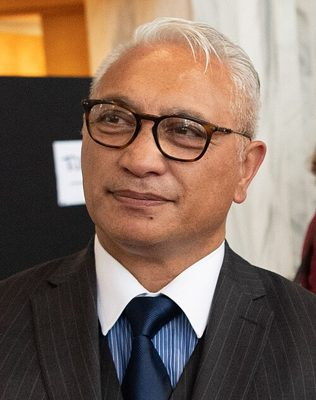

# Alfred Ngaro

| | |
|---|---|
| **Party** | New Zealand National Party |
| **Status** | Former MP |
| **Parliaments** | 50th, 51st, 52nd |
| **First elected** | 2011 |
| **Wikipedia** | [Alfred Ngaro](https://en.wikipedia.org/wiki/Alfred_Ngaro) |

## Political career

**Offices held** (from the Wikipedia infobox; dates are years):

- Leader of NewZeal (2023–2026)

## Record & notable actions

**Conscience votes** (recorded third-reading votes):

| Bill | Vote |
|---|---|
| [Marriage (Definition of Marriage) Amendment Bill — third reading, 17 Apr 2013](https://en.wikipedia.org/wiki/Marriage_(Definition_of_Marriage)_Amendment_Act_2013) | against |
| [End of Life Choice Bill — third reading, 13 Nov 2019](https://en.wikipedia.org/wiki/End_of_Life_Choice_Act_2019) | against |
| [Abortion Legislation Bill — third reading, 18 Mar 2020](https://en.wikipedia.org/wiki/Abortion_Legislation_Act_2020) | against |

## Sources

- <https://en.wikipedia.org/wiki/Alfred_Ngaro>
- Photo: <https://commons.wikimedia.org/wiki/File:Alfred_Ngaro_(49088825797)_(cropped).jpg> — US Embassy from New Zealand — NZ Brewers Association and US Embassy event, 19 November 2019 (Public domain)
