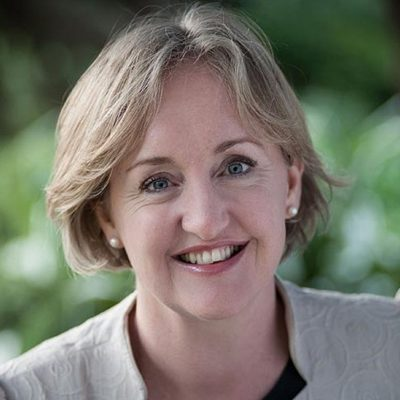

# Amy Adams

| | |
|---|---|
| **Party** | New Zealand National Party |
| **Status** | Former MP |
| **Now (Oct 2026)** | Chancellor of the University of Canterbury (since March 2022; reappointed to council Sept 2025); chair of the Gas Industry Company (since Feb 2025); Crown facilitator at Waitaki District Council for Local Water Done Well (appointed Oct 2025); former Health NZ board member (2021–); volunteer ambulance officer. |
| **Electorate(s)** | Selwyn (2008–2020) |
| **Parliaments** | 49th, 50th, 51st, 52nd |
| **First elected** | 2008 |
| **Born** | 1971-05-19 — Auckland, New Zealand |
| **Wikipedia** | [Amy Adams (politician)](https://en.wikipedia.org/wiki/Amy_Adams_(politician)) |

## Current status

Former MP. She retired at the 2020 election. Her current and recent roles:
- Chancellor of the University of Canterbury since March 2022; reappointed to its council in September 2025.
- Chair of the Gas Industry Company since February 2025.
- Crown facilitator at Waitaki District Council for its Local Water Done Well plan, appointed October 2025.
- Inaugural board member of Health New Zealand (2021).
- Volunteer ambulance officer.

([University of Canterbury](https://www.canterbury.ac.nz/news-and-events/news/new-chancellor-amy-adams-appointed-at-the-university-of-canterbu), [RNZ](https://www.rnz.co.nz/news/political/576548/coalition-appoints-crown-facilitator-at-waitaki-district-council))

## Biography

- **Early life:** born 19 May 1971. She was raised by her mother and attended Rangitoto College, where she was a friend of Louise Upston.
- **Law:** LLB (first-class honours) from the University of Canterbury, and later a partner at Christchurch firm Mortlock McCormack.
- **Farming:** with her husband, Don Adams, she owns sheep and crop farms in Canterbury and a farm in Waikato. Their farming company is a shareholder in Central Plains Water.
- **Personal:** two children.

## Political career

- **Selwyn:** won the seat in 2008 with 60% of the vote, and had over 70% in 2014.
- **Ministerial career:**
  - 2011: entered Cabinet as Minister of Internal Affairs, Communications and IT, and Associate Earthquake Recovery.
  - 2012–14: Minister for the Environment.
  - 2014–17: Minister of Justice and Courts, and Broadcasting/Communications.
  - From 2016: also Social Housing and Social Investment.
- **2018 leadership race:** came second to Simon Bridges, then became finance spokesperson (ranked #3).
- **Retirement and return:**
  - June 2019: announced her retirement.
  - May 2020: briefly came back as COVID-19 Recovery spokesperson under Todd Muller.
  - July 2020: confirmed her departure after Judith Collins became leader. ([RNZ](https://www.rnz.co.nz/news/political/421312/live-updates-nikki-kaye-quitting-politics-amy-adams-follows))

**Roles held:**

- Minister of Justice; Courts (2014–2017)
- Minister for Social Housing; Social Investment; Associate Finance (2016–2017)
- Minister for the Environment (2012–2014)
- Minister of Internal Affairs (2011–2012)
- Minister for Communications and IT / Broadcasting (2011–2017)
- National finance spokesperson (2018–2019); shadow Attorney-General (2019)
- Chair, Finance and Expenditure Committee (2011)
- MP for Selwyn (2008–2020)

## Record & notable actions

- **Member's bill:** her Fair Trading (Soliciting on Behalf of Charities) Amendment Act 2012 requires street fundraisers to disclose the share of donations passed to charities.
- **Expungement and apology (2017):** as Justice Minister she introduced the scheme to expunge convictions for historical homosexual offences. She delivered the government's apology to the men convicted. ([TVNZ](https://www.tvnz.co.nz/one-news/new-zealand/watch-moment-amy-adams-apologises-behalf-government-convicting-gay-men-homosexual-acts-prior-1986))
- **Positions:** described herself as "socially liberal, economically conservative" and a feminist. She was deputy chair of the Abortion Legislation Committee.
- **Conscience votes:** voted for marriage equality, End of Life Choice and abortion reform (see table).

**Conscience votes** (recorded third-reading votes):

| Bill | Vote |
|---|---|
| [Marriage (Definition of Marriage) Amendment Bill — third reading, 17 Apr 2013](https://en.wikipedia.org/wiki/Marriage_(Definition_of_Marriage)_Amendment_Act_2013) | for |
| [End of Life Choice Bill — third reading, 13 Nov 2019](https://en.wikipedia.org/wiki/End_of_Life_Choice_Act_2019) | for |
| [Abortion Legislation Bill — third reading, 18 Mar 2020](https://en.wikipedia.org/wiki/Abortion_Legislation_Act_2020) | for |

## Controversies

- **Conflicts of interest:** questions were raised about possible conflicts between her ministerial roles and her family's irrigation and farming interests (Central Plains Water), and about her brother-in-law's telecommunications role.
- No findings of wrongdoing are recorded in the sources consulted.

## Sources

- <http://electionresults.govt.nz/electionresults_2014/electorate-48.html>
- <https://www.tvnz.co.nz/one-news/new-zealand/watch-moment-amy-adams-apologises-behalf-government-convicting-gay-men-homosexual-acts-prior-1986>
- <https://www.rnz.co.nz/news/political/421312/live-updates-nikki-kaye-quitting-politics-amy-adams-follows>
- <https://www.stuff.co.nz/national/health/126467568/health-new-zealand-and-mori-health-authority-board-members-announced>
- <https://www.canterbury.ac.nz/news-and-events/news/new-chancellor-amy-adams-appointed-at-the-university-of-canterbu>
- <https://www.beehive.govt.nz/release/canterbury-and-waikato-university-appointments>
- <https://www.gasindustry.co.nz/about-us/news-and-publications/news/new-blog-post-2/>
- <https://www.rnz.co.nz/news/political/576548/coalition-appoints-crown-facilitator-at-waitaki-district-council>
- <https://en.wikipedia.org/wiki/Amy_Adams_(politician)>
- Photo: <https://commons.wikimedia.org/wiki/File:Amy_Adams_politician_(cropped).jpg> — New Zealand Government — File:Amy Adams politician.jpg (CC BY 3.0 nz)
