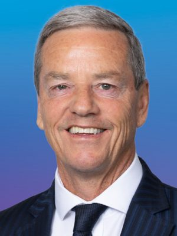

# Andrew Bayly

| | |
|---|---|
| **Party** | New Zealand National Party |
| **Status** | Current MP — retiring at the 2026 election |
| **Now (Oct 2026)** | MP for Port Waikato, retiring at the 2026 election (did not seek the seat or a list place; confirmed 20 Jun 2026; valedictory speech Sept 2026). Former minister (resigned Feb 2025); chair of the Justice Committee from April 2025. |
| **Electorate(s)** | Hunua (2014–2020); Port Waikato (2020–2023, and from the 25 Nov 2023 by-election; briefly a list MP Oct–Nov 2023) |
| **Parliaments** | 51st, 52nd, 53rd, 54th |
| **First elected** | 2014 |
| **Born** | 1962 — Whanganui, New Zealand |
| **Wikipedia** | [Andrew Bayly](https://en.wikipedia.org/wiki/Andrew_Bayly) |

## Current status

MP for Port Waikato, leaving Parliament at the 2026 election.

- **Decision to leave:** in March 2026 he said he would not contest Port Waikato because he was moving to the South Island. On 20 June 2026 he confirmed he would not seek a list place either.
- **Valedictory speech (September 2026):** he spoke about the "brutal" experience of losing his ministerial career, and proposed gradually lifting the superannuation age to 68 by 2065.

([RNZ](https://www.rnz.co.nz/news/political/588488/national-mp-andrew-bayly-not-contesting-port-waikato-seat), [NZ Herald](https://www.nzherald.co.nz/nz/politics/andrew-bayly-leaves-parliament-speaking-on-brutal-experience-of-losing-ministerial-career-that-led-him-to-very-dark-place/4Z7F5RBCH5DO7PXPRSYDPGZXMQ/))

## Biography

- **Early life:** born in 1962 in Whanganui, a twin. He attended Wanganui Collegiate and graduated in accounting and finance from Massey University.
- **Finance career:** merchant banker who co-founded Cranleigh with his brother. Fellow of Chartered Accountants ANZ and other professional bodies, and a former director of Envirofert, among other boards.
- **Military:** Territorial Force officer; also served with the British Parachute Regiment.
- **Adventurer:**
  - Climbed Aoraki/Mt Cook and Vinson Massif.
  - Hauled sledges to the South Pole (2012–13) and the North Pole (2016).
  - Retraced T. E. Lawrence's routes in Jordan by camel (2019).
  - Fellow of the Royal Geographical Society.
- **Personal:** married with three children.

## Political career

- **Hunua:** won the seat in 2014 with a 17,376 majority, the fourth-largest in the country, and held it in 2017 by 19,443.
- **Port Waikato:** won the new seat in 2020 by 4,313.
- **Shadow Treasurer:** Judith Collins' surprise appointment in November 2020, a 14-place promotion. He was later criticised as "invisible".
- **Under Luxon:** demoted to #15 in December 2021, with revenue, commerce and small business.
- **2023:** the death of a candidate turned the Port Waikato vote into a by-election. He sat briefly as a list MP, then won the 25 November 2023 by-election by 11,432 votes over NZ First's Casey Costello.
- **Minister outside Cabinet (from 27 November 2023):** Commerce and Consumer Affairs, Statistics, and Small Business and Manufacturing. He became ACC minister in January 2025.

**Roles held:**

- Minister of Commerce and Consumer Affairs (2023–2025)
- Minister for ACC (Jan–Feb 2025)
- Minister for Small Business and Manufacturing (2023–2025)
- Minister of Statistics (2023–2025)
- Chair, Justice Committee (2025–)
- Shadow Treasurer (2020–2021)
- Chair, Local Government and Environment Committee (2014–2017)
- MP for Hunua (2014–2020)
- MP for Port Waikato (2020–2023; 2023 by-election–2026)

## Record & notable actions

- **Superannuation residency bill:** his New Zealand Superannuation and Retirement Income (Fair Residency) Amendment Act, originally NZ First MP Mark Patterson's bill, passed in November 2021. It raised the residency requirement for NZ Super from 10 to 20 years. ([NZ Herald](https://www.nzherald.co.nz/nz/new-eligibility-rules-for-superannuation-passed-with-delayed-start-date/27TSZQALJUZMYSVKQJWQYLTD3U/))
- **Arbitration:** steered the Arbitration Amendment Bill through Parliament unanimously (51st Parliament).
- **Meth contamination:** his 2016 proposal on methamphetamine contamination in rentals was later reflected in government legislation.
- **Antarctica:** hosted the third Antarctic Parliamentarians Assembly in Wellington (December 2025).
- **Conscience votes:** voted against the End of Life Choice and abortion bills (see table).

**Conscience votes** (recorded third-reading votes):

| Bill | Vote |
|---|---|
| [End of Life Choice Bill — third reading, 13 Nov 2019](https://en.wikipedia.org/wiki/End_of_Life_Choice_Act_2019) | against |
| [Abortion Legislation Bill — third reading, 18 Mar 2020](https://en.wikipedia.org/wiki/Abortion_Legislation_Act_2020) | against |

## Controversies

- **Export business visit (October 2024):** apologised after telling a worker at a business he visited to "take some wine and fuck off" and calling him a "loser". ([Stuff](https://www.stuff.co.nz/politics/350456760/andrew-bayly-apologises-after-calling-export-worker-loser-telling-them-f))
- **Resignation as minister (February 2025):**
  - He resigned after an "animated discussion" in which he put his hand on a staff member's upper arm.
  - Scott Simpson took over his portfolios. ([RNZ](https://www.rnz.co.nz/news/political/542806/commerce-minister-andrew-bayly-resigns-after-putting-hand-on-staffer))
  - In October 2025 he said he had been misled about the allegations, noting no formal complaint was ever made. One witness later disputed the DIA's account. ([NZ Herald](https://www.nzherald.co.nz/nz/politics/national-mp-andrew-bayly-claims-he-was-misled-before-quitting-cabinet-over-staffer-incident/OX63IOPVEBBWZJ5DM4ZADXO3NA/))
- **Everest trek (March 2025):** took two weeks' leave during a sitting period for an Everest base camp trek. ([RNZ](https://www.rnz.co.nz/news/political/544317/embattled-former-minister-andrew-bayly-to-visit-mt-everest))
- **Ejected from the House (2019):** removed during questioning of Housing Minister Megan Woods about Ihumātao.

## Sources

- <https://archive.electionresults.govt.nz/electionresults_2014/electorate-16.html>
- <https://www.electionresults.govt.nz/electionresults_2020/electorate-details-39.html>
- <https://www.electionresults.govt.nz/2023_port_waikato_byelection/index.html>
- <https://www.nzherald.co.nz/nz/new-eligibility-rules-for-superannuation-passed-with-delayed-start-date/27TSZQALJUZMYSVKQJWQYLTD3U/>
- <https://www.stuff.co.nz/politics/350456760/andrew-bayly-apologises-after-calling-export-worker-loser-telling-them-f>
- <https://www.rnz.co.nz/news/political/542806/commerce-minister-andrew-bayly-resigns-after-putting-hand-on-staffer>
- <https://www.stuff.co.nz/politics/360591650/andrew-bayly-resigns-minister>
- <https://www.rnz.co.nz/news/political/544317/embattled-former-minister-andrew-bayly-to-visit-mt-everest>
- <https://www.nzherald.co.nz/nz/politics/national-mp-andrew-bayly-claims-he-was-misled-before-quitting-cabinet-over-staffer-incident/OX63IOPVEBBWZJ5DM4ZADXO3NA/>
- <https://www.rnz.co.nz/news/political/588488/national-mp-andrew-bayly-not-contesting-port-waikato-seat>
- <https://www.nzherald.co.nz/nz/politics/former-national-minister-andrew-bayly-to-leave-parliament-says-he-decided-not-to-seek-list-position/UXANABDU6BELBPTGLMOGMKTO3E/>
- <https://www.nzherald.co.nz/nz/politics/andrew-bayly-leaves-parliament-speaking-on-brutal-experience-of-losing-ministerial-career-that-led-him-to-very-dark-place/4Z7F5RBCH5DO7PXPRSYDPGZXMQ/>
- <https://en.wikipedia.org/wiki/Andrew_Bayly>
- Photo: <https://commons.wikimedia.org/wiki/File:BAYLY,_Andrew_-_Port_Waikato_(cropped).png> — New Zealand National Party — New Zealand National Party, per Ticket:2023090110001204 (CC BY-SA 4.0)
