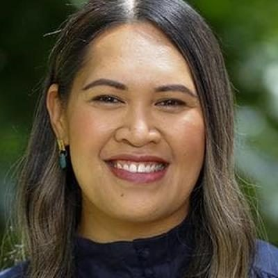

# Angee Nicholas

| | |
|---|---|
| **Party** | New Zealand National Party |
| **Status** | 2026 candidate (not an MP) |
| **Now (Oct 2026)** | National Party 2026 candidate — standing in Henderson; #25 on the official party list. Has not served as an MP. |
| **2026 election** | list #25, standing in Henderson |
| **Wikipedia** | [Angee Nicholas](https://en.wikipedia.org/wiki/Angee_Nicholas) |

> **List rank note:** policy.nz (in the 2026 candidacy section below) gives #26. The Electoral Commission's official National list gives **#25**. From #14 down, policy.nz's numbering appears to still include Chris Penk, who withdrew. ([Electoral Commission](https://vote.nz/2026-general-election/voting-in-the-election/party-lists))

## Current status

Standing for National at the 7 November 2026 election in **Henderson**, ranked **#25** on the party list published by the Electoral Commission. Not a current or former MP.

## Biography

Sources: [National Party candidate profile](https://www.national.org.nz/team/angeenicholas) and [Wikipedia](https://en.wikipedia.org/wiki/Angee_Nicholas). The party profile is self-published, so the details below are as the party describes them.

- **Background:** aged 32. Born in Rarotonga; raised in West Auckland, where she attended Ranui Primary and St Dominic's College.
- **Education:** LLB from AUT.
- **Career:**
  - Family-law barrister.
  - Former in-house lawyer for the Pacific investigation of the Royal Commission of Inquiry into Abuse in Care.
  - Has worked for National MPs' offices, including Nikki Kaye's.
- **2023 election:** led in Te Atatū on election night by 30 votes, but Phil Twyford kept the seat by 131 on final results. At #39 she was not elected from the list.
- **2026:** candidate for the new Henderson electorate.

<!-- GENERATED:2026-candidacy START -->
## 2026 candidacy

- **Electorate:** Henderson
- **List ranking:** 26

_Source: candidate questionnaire answers published on [policy.nz](https://policy.nz/2026/party-vote/parties/national-party), retrieved Oct 2026._
<!-- GENERATED:2026-candidacy END -->

## Sources

- <https://www.national.org.nz/team/angeenicholas>
- <https://en.wikipedia.org/wiki/Angee_Nicholas>
- <https://vote.nz/2026-general-election/voting-in-the-election/party-lists>
- <https://policy.nz/2026/party-vote/parties/national-party>
- Photo: <https://cdn.sanity.io/images/ubdwo62y/production/8e55bcf5d4828f1aa837418e67fb9de5a2caba9d-1024x1024.jpg> — Supplied to policy.nz by the candidate/party (Not stated (candidate photo supplied to policy.nz; used for identification))
