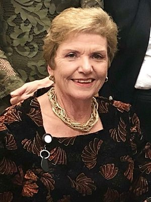

# Anne Tolley

| | |
|---|---|
| **Party** | New Zealand National Party |
| **Status** | Former MP |
| **Now (Oct 2026)** | Retired from Parliament at the 2020 election. Chaired the Crown commission that replaced Tauranga City Council's elected members (appointed Feb 2021; council elections resumed 2024). Current activities not detailed in the sources consulted. |
| **Electorate(s)** | East Coast (2005–2020) |
| **Parliaments** | 46th, 48th, 49th, 50th, 51st, 52nd |
| **First elected** | 1999 |
| **Born** | 1953-03-01 — Wellington, New Zealand |
| **Wikipedia** | [Anne Tolley](https://en.wikipedia.org/wiki/Anne_Tolley) |

## Current status

Former MP. She retired at the 2020 election. In February 2021 she was appointed chair of the Crown commission that took over the governance of Tauranga City Council. Elected councillors returned in 2024. Her current activities are not detailed in the sources consulted. ([Beehive](https://www.beehive.govt.nz/release/commissioners-appointed-tauranga-city-council))

## Biography

- **Early life:** born Anne Hicks on 1 March 1953 in Wellington. She attended Colenso High School in Napier and was a Rotary exchange student in the US.
- **Career:** ran a boutique hotel in Napier with her husband, Allan Tolley.
- **Local government:**
  - Napier City councillor (1986–95) and deputy mayor (1989–95).
  - Hawke's Bay Regional Council (1989–92).
- **Personal:** three children.

## Political career

- **First term:** list MP (1999–2002), during which she promoted a child-pornography bill. She lost her seat in 2002.
- **East Coast:** won the seat in 2005 and held it until 2020.
- **Whip:** National's first woman whip (2006–08).
- **Ministerial career:**
  - First woman Minister of Education (2008–11).
  - Police and Corrections (2011–14).
  - Social Development (2014–17).
  - First Minister for Children (2016–17).
- **Deputy Speaker:** 2017–20.
- **Retirement:** planned to stand list-only in 2020, with a view to becoming Speaker. In June 2020 she announced she would retire instead, having criticised Todd Muller's leadership challenge as "nutty stuff". ([Stuff](https://www.stuff.co.nz/national/politics/300043727/anne-tolley-to-retire-from-parliament-this-year))

**Roles held:**

- Deputy Speaker (2017–2020)
- Minister for Children (2016–2017) — established Oranga Tamariki
- Minister of Social Development (2014–2017)
- Minister of Local Government (2016–2017)
- Minister of Police; Corrections (2011–2014)
- Minister of Education (2008–2011) — first woman in the role
- First woman National Party whip (2006–2008)
- MP for East Coast (2005–2020)
- List MP (1999–2002)
- Deputy Mayor of Napier (1989–1995)

## Record & notable actions

- **National Standards:** introduced National Standards in primary schools, despite principals' boycotts.
- **Corrections:** contracted Serco to build and run Wiri prison (2012).
- **Oranga Tamariki:** created Oranga Tamariki (2017) after a 2015 report found the state had failed children in care.
- **Conscience votes:**
  - Voted against marriage equality and End of Life Choice.
  - Voted for the 2020 abortion bill at third reading (see table).

**Conscience votes** (recorded third-reading votes):

| Bill | Vote |
|---|---|
| [Marriage (Definition of Marriage) Amendment Bill — third reading, 17 Apr 2013](https://en.wikipedia.org/wiki/Marriage_(Definition_of_Marriage)_Amendment_Act_2013) | against |
| [End of Life Choice Bill — third reading, 13 Nov 2019](https://en.wikipedia.org/wiki/End_of_Life_Choice_Act_2019) | against |
| [Abortion Legislation Bill — third reading, 18 Mar 2020](https://en.wikipedia.org/wiki/Abortion_Legislation_Act_2020) | for |

## Controversies

- **Peters superannuation case (2017):** she admitted telling her sister about Winston Peters' superannuation overpayment. The High Court found she had not leaked it to media, and no damages were awarded against her. ([RNZ](https://www.rnz.co.nz/news/political/403234/bennett-tolley-avoid-financial-damages-in-peters-privacy-case))

## Sources

- <https://www.beehive.govt.nz/release/commissioners-appointed-tauranga-city-council>
- <https://www.stuff.co.nz/national/politics/300043727/anne-tolley-to-retire-from-parliament-this-year>
- <https://www.rnz.co.nz/news/political/403234/bennett-tolley-avoid-financial-damages-in-peters-privacy-case>
- <https://www.rnz.co.nz/news/national/402745/anne-tolley-admits-outburst-in-winston-peters-superannuation-case>
- <https://en.wikipedia.org/wiki/Anne_Tolley>
- Photo: <https://commons.wikimedia.org/wiki/File:Anne_Tolley_2019.jpg> — Office of the Clerk of the House of Representatives — https://www.parliament.nz/media/5875/malaysian-speaker-visit-to-new-zealand-june-2019-report.pdf (CC BY 4.0)
