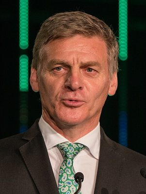

# Bill English

| | |
|---|---|
| **Party** | New Zealand National Party |
| **Status** | Former MP |
| **Now (Oct 2026)** | Retired from politics (left Parliament March 2018). Company director: Wesfarmers board (since 2018); chair of Mount Cook Alpine Salmon, Impact Lab and Manawanui Support; director of The Todd Corporation, The Instillery and the Centre for Independent Studies (per Wesfarmers profile). Led the government's 2023–24 independent review of Kāinga Ora. |
| **Electorate(s)** | Wallace (1990–1996); Clutha-Southland (1996–2014) |
| **Parliaments** | 43th, 44th, 45th, 46th, 47th, 48th, 49th, 50th, 51st, 52nd |
| **First elected** | 1990 |
| **Born** | 1961-12-30 — Lumsden, New Zealand |
| **Wikipedia** | [Bill English](https://en.wikipedia.org/wiki/Bill_English) |

## Current status

Sir Bill English is retired from politics and works as a company director. According to his Wesfarmers profile, his current roles are:
- Wesfarmers board member (since 2018).
- Chair of Mount Cook Alpine Salmon, Impact Lab and Manawanui Support.
- Director of The Todd Corporation, The Instillery and the Centre for Independent Studies.

In December 2023 the coalition government appointed him to lead an independent review of Kāinga Ora. His May 2024 report found the agency had borrowed heavily without fiscal discipline, and the government used it to justify restructuring the agency. He was knighted (KNZM) in 2018. ([Wesfarmers](https://www.wesfarmers.com.au/who-we-are/directors/profile/rt.-hon.-bill-english), [NZ Herald](https://www.nzherald.co.nz/nz/politics/pm-christopher-luxon-announces-kainga-ora-changes-new-board-refresh-kiwbuild-to-be-scrapped/WJJQFZKUTRAUXMHBICWJBK24W4/))

## Biography

- **Early life:** born 30 December 1961 in Lumsden, the 11th of 12 children of a Dipton (Southland) farming family. He was head boy at St Patrick's College, Silverstream.
- **Education:** studied commerce at the University of Otago and took honours in English literature at Victoria University of Wellington.
- **Before politics:** farmed at Dipton, then worked as a Treasury policy analyst (1987–89) during the "Rogernomics" reforms.
- **Personal:**
  - Married to GP Mary Scanlon; six children.
  - A practising Catholic.
  - Holds the Samoan chiefly title Leulua'iali'iotumua.

## Political career

**Early career (1990–1999)**
- Won Wallace in 1990. The seat became Clutha-Southland in 1996, and he held it until 2014.
- Was one of National's 1990 "brat pack" of young MPs.
- Cabinet from 1996, aged 34: Minister of Health (1996–99).
- Minister of Finance and Treasurer in 1999.

**Leader, 2001–2003**
- Became leader in October 2001 after Jenny Shipley stepped down.
- Led National to its worst-ever result in 2002 (about 21% of the vote).
- Was replaced by Don Brash in October 2003.

**Deputy Prime Minister and Minister of Finance, 2008–2016**
- Deputy leader under John Key from 2006.
- As finance minister he:
  - steered the economy through the GFC with deficit reduction;
  - created the National Infrastructure Unit;
  - oversaw the Christchurch rebuild costs;
  - returned the books to surplus in 2015/16.
- Switched to list-only at the 2014 election.

**Prime Minister, December 2016 – October 2017**
- At the 2017 election National won the most votes (44.4%, 56 seats) but lost office when NZ First chose Labour.
- Resigned as leader on 13 February 2018 and left Parliament. ([Guardian](https://www.theguardian.com/world/2018/feb/13/bill-english-former-new-zealand-prime-minister-resign-quits-jacinda-ardern))

**Roles held:**

- Prime Minister of New Zealand (2016–2017)
- Leader of the National Party (2001–2003; 2016–2018)
- Leader of the Opposition (2001–2003; 2017–2018)
- Deputy Prime Minister and Minister of Finance (2008–2016)
- Deputy Leader of the National Party (2001; 2006–2016)
- Minister of Infrastructure (2008–2011)
- Treasurer (1999) and Minister of Finance (1999)
- Minister of Health (1996–1999)
- MP for Wallace (1990–1996)
- MP for Clutha-Southland (1996–2014)
- List MP (2014–2018)

## Record & notable actions

- **Social investment:** pioneered the data-driven "social investment" approach to welfare spending. The 2023–26 government revived it under Nicola Willis.
- **Fiscal management:** National's 2008–17 governments returned to surplus after the GFC and the Canterbury earthquakes.
- **2017 campaign:** launched a NZ$379m social investment package.
- **Conscience votes:**
  - Voted against civil unions (2004), against marriage equality (2013) and against medicinal cannabis (2009).
  - In 2016 he said he would "probably vote differently now" on same-sex marriage.
  - Opposed euthanasia and any liberalisation of abortion law.

**Conscience votes** (recorded third-reading votes):

| Bill | Vote |
|---|---|
| [Marriage (Definition of Marriage) Amendment Bill — third reading, 17 Apr 2013](https://en.wikipedia.org/wiki/Marriage_(Definition_of_Marriage)_Amendment_Act_2013) | against |

## Controversies

- **Housing allowance (2009):** criticised for claiming about NZ$900 a week in ministerial accommodation allowance for his own Wellington home. After an Auditor-General inquiry he repaid the money and stopped claiming. ([Stuff](http://www.stuff.co.nz/national/politics/2910567/Bill-English-gives-up-housing-allowance))
- **Todd Barclay recording (2017):** admitted he had known about the secret recording of a staffer by his successor in Clutha-Southland, and about the confidential settlement paid from the leader's budget (see Todd Barclay).
- **Waitangi Day (2017):** criticised for skipping Waitangi Day at the Treaty Grounds after Ngāpuhi barred the Prime Minister from speaking.

## Sources

- <http://www.electionresults.govt.nz/electionresults_2008/electorate-6.html>
- <http://www.stuff.co.nz/national/politics/2910567/Bill-English-gives-up-housing-allowance>
- <https://www.theguardian.com/world/2018/feb/13/bill-english-former-new-zealand-prime-minister-resign-quits-jacinda-ardern>
- <https://www.wesfarmers.com.au/who-we-are/directors/profile/rt.-hon.-bill-english>
- <https://www.nzherald.co.nz/nz/politics/pm-christopher-luxon-announces-kainga-ora-changes-new-board-refresh-kiwbuild-to-be-scrapped/WJJQFZKUTRAUXMHBICWJBK24W4/>
- <http://www.electionresults.govt.nz/electionresults_2017/>
- <https://en.wikipedia.org/wiki/Bill_English>
- Photo: <https://commons.wikimedia.org/wiki/File:Bill_English_2017_(cropped).jpg> — NZTE — Premier Li Selection 280317-5 (CC BY 2.0)
