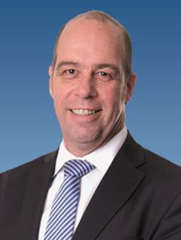

# Brett Hudson

| | |
|---|---|
| **Party** | New Zealand National Party |
| **Status** | Former MP |
| **Now (Oct 2026)** | Lost his seat in 2020. Moved to Dunedin to study economics; board member of the Waitaki Whitestone Geopark Trust (since 2021) and the mental-health charity Able Minds. |
| **Electorate(s)** | List MP (2014–2020); contested Ōhāriu 2014, 2017, 2020 |
| **Parliaments** | 51st, 52nd |
| **First elected** | 2014 |
| **Born** | 1965 |
| **Wikipedia** | [Brett Hudson (politician)](https://en.wikipedia.org/wiki/Brett_Hudson_(politician)) |

## Current status

Former MP. After 2020 he moved to Dunedin and returned to study economics. He has sat on the board of the Waitaki Whitestone Geopark Trust since 2021, and chairs the audit and risk committee of the mental-health charity Able Minds.

## Biography

- **Early life:** born in 1965 and raised in Porirua, where he attended Mana College.
- **Education:** BA in history and psychology from Victoria University (1990).
- **IT career:** business development and sales roles at IBM, Oracle, TelstraClear and the consultancy StarFish.
- **Personal:** partner Lindsay Renwick; three adult daughters.

## Political career

- **2011:** stood at #73 on National's list; not elected.
- **List MP (2014–20):** contested Ōhāriu against Peter Dunne in 2014 but entered Parliament on the list.
- **Spokesperson (2018–20):** police, commerce and consumer affairs, and government digital services.
- **2020:** lost Ōhāriu by nearly 12,000 votes and was not returned on the list.

**Roles held:**

- List MP (2014–2020)
- National spokesperson for police; government digital services; commerce and consumer affairs (2018–2020)

## Record & notable actions

- **Conscience votes:** a social liberal; voted for abortion decriminalisation, the End of Life Choice Bill and local Easter trading.
- **Law and order:** a conservative. As police spokesperson he backed an anti-gang squad modelled on New South Wales's Strike Force Raptor.

**Conscience votes** (recorded third-reading votes):

| Bill | Vote |
|---|---|
| [End of Life Choice Bill — third reading, 13 Nov 2019](https://en.wikipedia.org/wiki/End_of_Life_Choice_Act_2019) | for |
| [Abortion Legislation Bill — third reading, 18 Mar 2020](https://en.wikipedia.org/wiki/Abortion_Legislation_Act_2020) | for |

## Sources

- <https://en.wikipedia.org/wiki/Brett_Hudson>
- <https://www.whitestonegeopark.nz/>
- <https://www.electionresults.govt.nz/electionresults_2020/>
- <https://en.wikipedia.org/wiki/Brett_Hudson_(politician)>
- Photo: <https://commons.wikimedia.org/wiki/File:Brett_Hudson_MP.jpg> — Licensed by the Clerk of the House of Representatives and/or the Parliamentary Corporation on behalf of Parliamentary Service for re-use under the Creative Commons Attribution 4.0 International licence — https://www.parliament.nz/en/mps-and-electorates/former-members-of-parliament/hudson-brett/ (CC BY 4.0)
