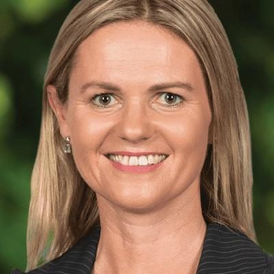

# Catherine Wedd

| | |
|---|---|
| **Party** | New Zealand National Party |
| **Status** | Current MP — standing in 2026 |
| **Now (Oct 2026)** | MP for Tukituki (since 2023); chair of the Environment Committee; Parliamentary Private Secretary for Cyclone Recovery; #36 on National's 2026 list and re-contesting Tukituki. |
| **Electorate(s)** | Tukituki (2023–) |
| **Parliaments** | 54th |
| **First elected** | 2023 |
| **2026 election** | list #36, standing in Tukituki |
| **Wikipedia** | [Catherine Wedd](https://en.wikipedia.org/wiki/Catherine_Wedd) |

> **List rank note:** policy.nz (in the 2026 candidacy section below) gives #37. The Electoral Commission's official National list gives **#36**. From #14 down, policy.nz's numbering appears to still include Chris Penk, who withdrew. ([Electoral Commission](https://vote.nz/2026-general-election/voting-in-the-election/party-lists))

## Current status

MP for Tukituki since 2023. She chairs the Environment Committee and is Parliamentary Private Secretary to Mark Mitchell for Cyclone Recovery. She is #36 on National's 2026 list.

## Biography

- **Early life:** born and raised near Taumarunui. She attended rural schools and then Nga Tawa School in Marton.
- **Education:** LLB/BA in political science and English, and a postgraduate diploma in journalism, all from the University of Canterbury.
- **Career:** television journalist, then joint director of Attn Marketing PR with Anna Lorck, the Labour MP she later defeated.
- **Family:** her grandfather, Bill Tolhurst, was National MP for Whanganui (1969–72).
- **Personal:** married to Henry; four children.

## Political career

- **2023:** selected in January 2023. She beat incumbent Anna Lorck by 10,118 votes. ([Electoral Commission](https://archive.electionresults.govt.nz/electionresults_2023/electorate-details-54.html))
- **Campaign themes:** criticised the Cyclone Gabrielle response, backed deregulating horticulture and called for a gang crackdown.

**Roles held:**

- MP for Tukituki (2023–)
- Chair, Environment Committee
- Parliamentary Private Secretary (Cyclone Recovery)
- Chair, NZ Parliamentarians' Group on Population and Development
- Deputy Chair, Finance and Expenditure Committee (earlier in term)

## Record & notable actions

- **Social Media (Age-Restricted Users) Bill (May 2025):** her member's bill would bar under-16s from social media. It went forward as a member's bill rather than a government bill because ACT would not support it. Labour signalled interest. ([NZ Herald](https://www.nzherald.co.nz/nz/politics/social-media-ban-act-blocks-nationals-bid-for-govt-consensus-on-members-bill/QADXWQUT3JCHDHFPDD4WXUMBOI/))
- **Pae Ora (Healthy Futures) (3 Day Postnatal Stay) Amendment Bill (December 2024):** would give new mothers at least 72 hours of postnatal inpatient care. It was prompted partly by her own traumatic birth. ([NZ Herald](https://www.nzherald.co.nz/nz/national-mp-catherine-wedd-shares-traumatic-birth-story-bill-drawn-to-give-new-mums-longer-hospital-stays/ZXSUNJHKRFBL5FE7N2WKP7TWRU/))
- Chairs the cross-party group on sexual and reproductive health and rights.
- She was not in Parliament for the 2013–2022 conscience votes.

## Controversies

- None recorded in the sources consulted.

<!-- GENERATED:2026-candidacy START -->
## 2026 candidacy

- **Electorate:** Tukituki
- **List ranking:** 37

_Source: candidate questionnaire answers published on [policy.nz](https://policy.nz/2026/party-vote/parties/national-party), retrieved Oct 2026._
<!-- GENERATED:2026-candidacy END -->

## Sources

- <https://www.nzherald.co.nz/hawkes-bay-today/news/catherine-wedd-selected-as-nationals-candidate-in-tukituki/AA6SQQBUOVBTZIQLDKHU3CNPWY/>
- <https://archive.electionresults.govt.nz/electionresults_2023/electorate-details-54.html>
- <https://www.nzherald.co.nz/hawkes-bay-today/news/tukituki-election-2023-results-first-time-mp-catherine-wedd-follows-in-grandfathers-footsteps-vows-to-strengthen-horticulture-sector-in-hawkes-bay/4ENFFFRK7ZGP3BAT5FHQLZKQEI/>
- <https://www.nzherald.co.nz/nz/national-mp-catherine-wedd-shares-traumatic-birth-story-bill-drawn-to-give-new-mums-longer-hospital-stays/ZXSUNJHKRFBL5FE7N2WKP7TWRU/>
- <https://www.nzherald.co.nz/nz/politics/social-media-ban-act-blocks-nationals-bid-for-govt-consensus-on-members-bill/QADXWQUT3JCHDHFPDD4WXUMBOI/>
- <https://en.wikipedia.org/wiki/Catherine_Wedd>
- <https://policy.nz/2026/party-vote/parties/national-party>
- Photo: <https://cdn.sanity.io/images/ubdwo62y/production/3d49171619c51a807281282b0dfcbb35ed50d8eb-1024x1024.jpg> — Supplied to policy.nz by the candidate/party (Not stated (candidate photo supplied to policy.nz; used for identification))
