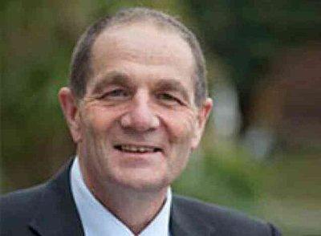

# Chester Borrows

| | |
|---|---|
| **Party** | New Zealand National Party |
| **Status** | Deceased (former MP) |
| **Electorate(s)** | Whanganui (2005–2017) |
| **Parliaments** | 48th, 49th, 50th, 51st |
| **First elected** | 2005 |
| **Born** | 1957-06-20 — Nelson, New Zealand |
| **Died** | 2023-02-27 |
| **Wikipedia** | [Chester Borrows](https://en.wikipedia.org/wiki/Chester_Borrows) |

## Political career

**Offices held** (from the Wikipedia infobox; dates are years):

- Deputy Speaker of the New Zealand House of Representatives (2014–2017)
- Minister for Courts (2011–2014)

## Record & notable actions

**Conscience votes** (recorded third-reading votes):

| Bill | Vote |
|---|---|
| [Marriage (Definition of Marriage) Amendment Bill — third reading, 17 Apr 2013](https://en.wikipedia.org/wiki/Marriage_(Definition_of_Marriage)_Amendment_Act_2013) | against |

## Sources

- <https://en.wikipedia.org/wiki/Chester_Borrows>
- Photo: <https://commons.wikimedia.org/wiki/File:Chester_Borrows.jpg> — New Zealand Government — https://www.govt.nz/organisations/ministry-of-justice/ (CC BY 3.0 nz)
