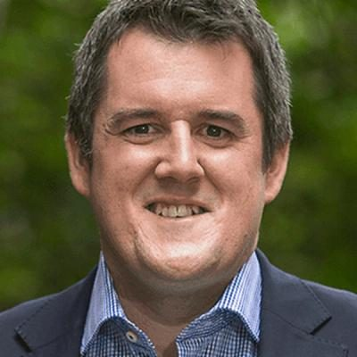

# Chris Bishop

| | |
|---|---|
| **Party** | New Zealand National Party |
| **Status** | Current MP — standing in 2026 |
| **Now (Oct 2026)** | Attorney-General (since 7 Apr 2026), Minister for Housing, Minister for Infrastructure, Minister Responsible for RMA Reform and Minister of Transport; MP for Hutt South; #3 on National's 2026 list and re-contesting Hutt South. |
| **Electorate(s)** | Hutt South (2017–2020); Hutt South (2023–) |
| **Parliaments** | 51st, 52nd, 53rd, 54th |
| **First elected** | 2014 |
| **Born** | 1983-09-04 — Lower Hutt, New Zealand |
| **2026 election** | list #3, standing in Hutt South |
| **Wikipedia** | [Chris Bishop](https://en.wikipedia.org/wiki/Chris_Bishop) |

## Current status

One of the government's most senior ministers. He has been Attorney-General since 7 April 2026 and also holds Housing, Infrastructure, RMA Reform and Transport (Transport since January 2025). He is MP for Hutt South, and is #3 on the 2026 list while re-contesting the seat.

In the 2 April 2026 reshuffle he gave up Leader of the House (to Louise Upston) and National's campaign chair (to Simeon Brown). Media widely interpreted this as a demotion linked to leadership tensions; Bishop and Luxon denied that. Stuff reported in November 2025 that Bishop had sounded out support for a leadership challenge, which he denied. In August 2026 he called rumours that he had backed Chris Penk's challenge "completely unfounded". ([Stuff](https://www.stuff.co.nz/politics/360903682/anatomy-failed-coup), [Beehive](https://www.beehive.govt.nz/release/pm-refreshes-ministerial-team))

## Biography

- **Early life:** born on 4 September 1983 and raised in Lower Hutt; attended Hutt International Boys' School. His father, John Bishop, was a political journalist who co-founded the Taxpayers' Union; his mother, Rosemary Dixon, is an environmental lawyer.
- **Education:** law (first-class honours) and a BA in history and politics from Victoria University of Wellington. He was a prolific intervarsity debater.
- **Career before Parliament:**
  - Adviser to Gerry Brownlee after 2008.
  - Corporate affairs manager for Philip Morris New Zealand (2011–13).
  - Senior adviser to Steven Joyce (2013–14). ([Scoop](https://community.scoop.co.nz/2014/05/national-selects-chris-bishop-as-hutt-south-candidate/))
- **Personal:** married to Jenna Raeburn; two children (born 2022 and 2024).

## Political career

- **2014:** stood in Hutt South, cutting Trevor Mallard's majority from 4,825 to 709, and entered Parliament as a list MP. His maiden speech called him an "unashamed economic and social liberal". ([Scoop](https://www.scoop.co.nz/stories/PA1410/S00111/chris-bishop-maiden-speech.htm))
- **2017:** won Hutt South by 1,530 votes over Ginny Andersen. He was the first National MP ever to hold the seat.
- **2020:**
  - In May, he was one of Todd Muller's "numbers men" in the leadership change.
  - He became Collins' Shadow Leader of the House.
  - At the election he lost Hutt South to Andersen by 3,777 votes and returned on the list.
- **August 2021:** Collins removed him as Shadow Leader of the House. Stuff reported this followed his push for a conscience vote on the conversion-practices bill. ([Stuff](https://www.stuff.co.nz/national/politics/300393586/national-party-reshuffle-judith-collins-strips-chris-bishop-of-key-portfolio))
- **Under Luxon:**
  - December 2021: ranked #4 and restored as Shadow Leader of the House.
  - March 2022: housing and infrastructure spokesperson.
  - From September 2022: chaired National's 2023 campaign.
- **2023:** regained Hutt South from Andersen, by 1,332 votes on election night. He then became Housing, Infrastructure, RMA Reform, Sport and Recreation minister, Leader of the House, and Associate Finance minister. ([RNZ](https://www.rnz.co.nz/news/political/503156/cabinet-lineup-for-new-government-unveiled-who-gets-what))
- **Since then:** gained Transport (2025) and became Attorney-General (2026). The Post named him its 2025 "politician of the year". ([The Post](https://www.thepost.co.nz/politics/360916370/posts-political-awards-politician-year-rookie-rise-and-rest))

**Roles held:**

- Attorney-General (2026–)
- Minister of Transport (2025–)
- Minister for Housing (2023–)
- Minister for Infrastructure (2023–)
- Minister Responsible for RMA Reform (2023–)
- Associate Minister of Finance (2023–)
- Leader of the House (2023–2026)
- Minister for Sport and Recreation (2023–2025)
- Chair, National Party 2023 election campaign
- Shadow Leader of the House (2020–2021, 2021–2023)
- National spokesperson for COVID-19 response (2020–2022); housing and infrastructure (2022–2023); transport (2019–2021)
- MP for Hutt South (2017–2020, 2023–)
- List MP (2014–2017, 2020–2023)

## Record & notable actions

- **Member's bill:** the Compensation for Live Organ Donors Act 2016 passed unanimously. It removes a financial barrier to live organ donation.
- **Resource management:**
  - First removed or eased a range of RMA rules (2024).
  - Then led the replacement of the RMA with a Planning Act and a Natural Environment Act. These were introduced in December 2025, passed their third readings on 22 September 2026, and are due to take effect around 2029. They include compensation for landowners affected by regulation and fewer regional plans. ([RNZ](https://www.rnz.co.nz/news/politics/1524236/rma-replacement-laws-pass-in-parliament))
- **Housing:**
  - Ordered Kāinga Ora to take a tougher line on disruptive tenants and rent arrears (2024).
  - Kept Labour-era Medium Density Residential Standards, reversing National's earlier plan to make them optional.
  - Took powers to override councils that block growth (2025).
  - Rejected most of Christchurch City Council's requested exemptions from intensification rules (June 2025).
  - Cut Auckland's intensification target from 2 million to 1.6 million homes (Feb 2026). ([RNZ](https://www.rnz.co.nz/news/political/564457/government-to-give-itself-power-to-override-councils-on-housing-in-rma-changes))
- **Infrastructure:** released New Zealand's first 30-year National Infrastructure Plan (Feb 2026). Labour and the Greens supported it in Parliament in June 2026. ([RNZ](https://www.rnz.co.nz/news/politics/598348/30-year-infrastructure-plan-backed-by-parliament))
- **Local government:** with Simon Watts, announced plans to abolish elected regional councils (Nov 2025) and gave councils a deadline to draw up amalgamation plans (May 2026).
- **Transport:** driver-licensing overhaul that removes the full-licence test from January 2027, plus consultation on road-rule changes.
- **Sport:** asked Sport NZ to revise its transgender-inclusion guidelines (Oct 2024), in line with the National–NZ First coalition agreement.
- **Leader of the House:**
  - Defended heavy use of urgency in the government's first 100 days and quit the Free Speech Union over its criticism.
  - Moved the motion that deferred, and then led to, the suspension of three Te Pāti Māori MPs (2025).
- **Positions:** a leading social liberal in National.
  - Voted for the End of Life Choice and abortion bills (see table).
  - Member of the cross-party Rainbow network.
  - Voted against the first reading of the conversion-practices bill under the party line, saying privately he "hated" doing so, then voted for it once a conscience vote was allowed.

**Conscience votes** (recorded third-reading votes):

| Bill | Vote |
|---|---|
| [End of Life Choice Bill — third reading, 13 Nov 2019](https://en.wikipedia.org/wiki/End_of_Life_Choice_Act_2019) | for |
| [Abortion Legislation Bill — third reading, 18 Mar 2020](https://en.wikipedia.org/wiki/Abortion_Legislation_Act_2020) | for |
| Conversion Practices Prohibition Legislation Bill — third reading, 15 Feb 2022 | not among the 8 National MPs recorded as opposed (25 National MPs voted in favour) |

## Controversies

- **Tobacco lobbying:** his work for Philip Morris drew scrutiny when he was selected in 2014. He said he supported National's tobacco excise and plain-packaging policies. ([Stuff](https://www.stuff.co.nz/dominion-post/news/10074746/Hutt-South-candidate-downplays-his-tobacco-past))
- **Snapchat (2018):** criticised for messaging constituents, including teenagers, on Snapchat. He stopped using it for constituent contact. ([RNZ](https://www.rnz.co.nz/news/political/350145/national-mp-stops-communicating-with-youth-on-snapchat))
- **COVID quarantine (2020):** Health Minister David Clark said Bishop had lobbied for the early release of two women from managed isolation who later tested positive. Bishop said he had only passed on their concerns.
- **Hamas email (2023):** Luxon spoke to him about a strongly worded email comparing the 7 October attack to the Holocaust. ([RNZ](https://www.rnz.co.nz/news/national/501414/chris-bishop-spoken-to-by-christopher-luxon-on-strongly-worded-email-comparing-hamas-attack-to-holocaust))
- **Aotearoa Music Awards (May 2025):** he was filmed calling a Stan Walker performance with tino rangatiratanga and Toitū te Tiriti flags "a load of crap". He said he should have kept the view to himself but did not apologise. He admitted drinking but denied being drunk. ([Stuff](https://www.stuff.co.nz/nz-news/360708467/national-mp-chris-bishop-calls-stan-walkers-toitu-te-tiriti-performance-load-crap))

<!-- GENERATED:2026-candidacy START -->
## 2026 candidacy

- **Electorate:** Hutt South
- **List ranking:** 3
- **Before politics:** Ministerial Advisor
- **Residence:** Eastbourne
- **Age:** 43
- **Public email:** chris.bishop@national.org.nz
- **Website:** https://www.national.org.nz/team/chrisbishop
- **Facebook:** www.facebook.com/chrisbishopmp
- **Instagram:** www.instagram.com/cjsbishop
- **Twitter:** https://x.com/cjsbishop

_Source: candidate questionnaire answers published on [policy.nz](https://policy.nz/2026/party-vote/parties/national-party), retrieved Oct 2026._
<!-- GENERATED:2026-candidacy END -->

## Sources

- <https://community.scoop.co.nz/2014/05/national-selects-chris-bishop-as-hutt-south-candidate/>
- <https://www.stuff.co.nz/dominion-post/news/10074746/Hutt-South-candidate-downplays-his-tobacco-past>
- <https://www.scoop.co.nz/stories/PA1410/S00111/chris-bishop-maiden-speech.htm>
- <http://www.legislation.govt.nz/act/public/2016/0096/25.0/DLM4297829.html>
- <https://www.stuff.co.nz/national/politics/97320970/insight-how-did-chris-bishop-snatch-hutt-south-from-labours-perennial-grasp>
- <https://www.electionresults.govt.nz/electionresults_2020/electorate-details-14.html>
- <https://www.electionresults.govt.nz/electionresults_2023/electorate-details-14.html>
- <https://www.stuff.co.nz/national/politics/300393586/national-party-reshuffle-judith-collins-strips-chris-bishop-of-key-portfolio>
- <https://www.rnz.co.nz/news/political/503156/cabinet-lineup-for-new-government-unveiled-who-gets-what>
- <https://www.newshub.co.nz/home/politics/2024/03/national-s-chris-bishop-blasts-letter-from-free-speech-union-asks-to-cancel-my-membership.html>
- <https://www.rnz.co.nz/news/political/522094/kainga-ora-evictions-rise-in-crackdown-on-unruly-tenants>
- <https://www.rnz.co.nz/news/political/564457/government-to-give-itself-power-to-override-councils-on-housing-in-rma-changes>
- <https://www.rnz.co.nz/news/political/579978/no-more-regional-councils-major-shake-up-of-local-government-announced>
- <https://www.rnz.co.nz/news/political/581294/landowners-to-get-more-compensation-from-councils-as-major-rma-overhaul-revealed>
- <https://www.rnz.co.nz/news/politics/1524236/rma-replacement-laws-pass-in-parliament>
- <https://www.rnz.co.nz/news/political/587072/new-zealand-s-first-national-infrastructure-plan-unveiled>
- <https://www.rnz.co.nz/news/politics/598348/30-year-infrastructure-plan-backed-by-parliament>
- <https://www.beehive.govt.nz/release/changes-driver-licensing-system-announced>
- <https://www.beehive.govt.nz/release/sport-nz-asked-update-transgender-inclusion-guiding-principles>
- <https://www.nzherald.co.nz/nz/auckland/chris-bishop-to-slash-auckland-housing-plan-from-2m-to-16m-homes/B4YIUGQVWNBWDN3AWY2ITXXM64/>
- <https://www.stuff.co.nz/nz-news/360708467/national-mp-chris-bishop-calls-stan-walkers-toitu-te-tiriti-performance-load-crap>
- <https://www.rnz.co.nz/news/political/350145/national-mp-stops-communicating-with-youth-on-snapchat>
- <https://www.rnz.co.nz/news/national/501414/chris-bishop-spoken-to-by-christopher-luxon-on-strongly-worded-email-comparing-hamas-attack-to-holocaust>
- <https://www.stuff.co.nz/politics/360903682/anatomy-failed-coup>
- <https://www.beehive.govt.nz/release/pm-refreshes-ministerial-team>
- <https://www.thepost.co.nz/politics/360916370/posts-political-awards-politician-year-rookie-rise-and-rest>
- <https://en.wikipedia.org/wiki/Chris_Bishop>
- <https://policy.nz/2026/party-vote/parties/national-party>
- Photo: <https://cdn.sanity.io/images/ubdwo62y/production/97e7170bc2b95a84da4377df1834bd59624ffc29-1024x1024.jpg> — Supplied to policy.nz by the candidate/party (Not stated (candidate photo supplied to policy.nz; used for identification))
