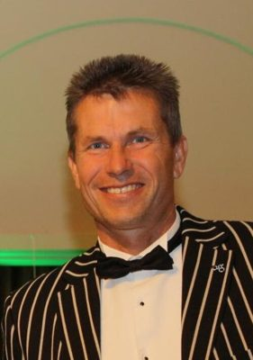

# Chris Tremain

| | |
|---|---|
| **Party** | New Zealand National Party |
| **Status** | Former MP |
| **Now (Oct 2026)** | Retired at the 2014 election (resigned ministerial posts 28 Jan 2014); Hawke's Bay businessman (real estate, travel). Current activities not detailed in the sources consulted. |
| **Electorate(s)** | Napier (2005–2014) |
| **Parliaments** | 48th, 49th, 50th |
| **First elected** | 2005 |
| **Born** | 1966 — Napier, New Zealand |
| **Wikipedia** | [Chris Tremain](https://en.wikipedia.org/wiki/Chris_Tremain) |

## Current status

Former MP. He announced in September 2013 that he would not stand in 2014, and resigned his ministerial posts on 28 January 2014. He returned to business in Hawke's Bay; his current activities are not detailed in the sources consulted.

## Biography

- Born in Napier in 1966. Son of All Black Kel Tremain.
- BBS in accounting from Massey University.
- Owned Tremain Real Estate, Tremain Travel and a Colliers franchise.
- Married to Angela; three children.

## Political career

- **Napier:** won the seat in 2005, the first National win there in more than 50 years, and held it until 2014.
- **Chief whip:** 2008–11.
- **Ministerial career:**
  - Minister outside Cabinet (2011): Civil Defence and Consumer Affairs.
  - Cabinet (April 2012): Internal Affairs and Local Government.

**Roles held:**

- Minister of Internal Affairs (2012–2014)
- Minister of Local Government (2012–2013)
- Minister of Civil Defence; Consumer Affairs (2011–2012)
- National chief whip (2008–2011)
- MP for Napier (2005–2014)

## Record & notable actions

- **Conscience votes:** voted for marriage equality (2013).

**Conscience votes** (recorded third-reading votes):

| Bill | Vote |
|---|---|
| [Marriage (Definition of Marriage) Amendment Bill — third reading, 17 Apr 2013](https://en.wikipedia.org/wiki/Marriage_(Definition_of_Marriage)_Amendment_Act_2013) | for |

## Controversies

- None of significance recorded in the sources consulted.

## Sources

- <https://en.wikipedia.org/wiki/Chris_Tremain>
- Photo: <https://commons.wikimedia.org/wiki/File:Chris_Tremain.jpg> — Chris_Tremain_49.jpg: Alastair Smith derivative work: Schwede66 — This file was derived from: Chris Tremain 49.jpg: (CC BY-SA 2.0)
