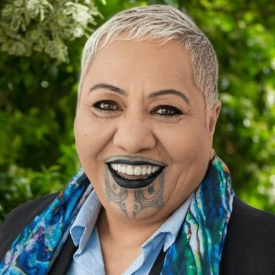

# Coral Raukawa

| | |
|---|---|
| **Party** | New Zealand National Party |
| **Status** | 2026 candidate (not an MP) |
| **Now (Oct 2026)** | National Party 2026 candidate — standing in Te Tai Hauāuru; #55 on the official party list. Has not served as an MP. |
| **2026 election** | list #55, standing in Te Tai Hauāuru |

> **List rank note:** policy.nz (in the 2026 candidacy section below) gives #56. The Electoral Commission's official National list gives **#55**. From #14 down, policy.nz's numbering appears to still include Chris Penk, who withdrew. ([Electoral Commission](https://vote.nz/2026-general-election/voting-in-the-election/party-lists))

## Current status

Standing for National at the 7 November 2026 election in **Te Tai Hauāuru**, ranked **#55** on the party list published by the Electoral Commission. Not a current or former MP.

## Biography

Sources: [National Party candidate profile](https://www.national.org.nz/team/coralraukawa). The party profile is self-published, so the details below are as the party describes them.

- **Local government:** Rangitīkei District Councillor.
- **Background:** born and raised in Marton. Her whakapapa includes Ngā Wairiki Ngāti Apa, Ngāti Tamakōpiri, Tamaupoko, Ngāti Tūwharetoa and Ngāti Kahungunu.
- **Career:** has spent 12 years placing rangatahi into education, training or employment, across Whanganui, Taranaki, Rangitīkei and Palmerston North.

<!-- GENERATED:2026-candidacy START -->
## 2026 candidacy

- **Electorate:** Te Tai Hauāuru
- **List ranking:** 56

_Source: candidate questionnaire answers published on [policy.nz](https://policy.nz/2026/party-vote/parties/national-party), retrieved Oct 2026._
<!-- GENERATED:2026-candidacy END -->

## Sources

- <https://www.national.org.nz/team/coralraukawa>
- <https://vote.nz/2026-general-election/voting-in-the-election/party-lists>
- <https://policy.nz/2026/party-vote/parties/national-party>
- Photo: <https://cdn.sanity.io/images/ubdwo62y/production/0c4a14310ac40393c7ea6270762a744e02db7b67-1024x1024.jpg> — Supplied to policy.nz by the candidate/party (Not stated (candidate photo supplied to policy.nz; used for identification))
