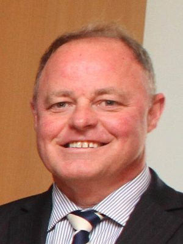

# Craig Foss

| | |
|---|---|
| **Party** | New Zealand National Party |
| **Status** | Former MP |
| **Now (Oct 2026)** | Retired from Parliament at the 2017 election; elected to the Hawke's Bay Regional Council in 2019 (current local-government role after 2022/2025 elections not confirmed in the sources consulted). |
| **Electorate(s)** | Tukituki (2005–2017) |
| **Parliaments** | 48th, 49th, 50th, 51st |
| **First elected** | 2005 |
| **Born** | 1963-07-04 — Lower Hutt, Wellington |
| **Wikipedia** | [Craig Foss](https://en.wikipedia.org/wiki/Craig_Foss) |

## Current status

Former MP. He announced his retirement in December 2016 and left Parliament at the 2017 election. He was elected to the Hawke's Bay Regional Council in 2019, alongside his former Labour rival Rick Barker. The sources consulted do not confirm whether he held the seat after the 2022 and 2025 local elections.

## Biography

- Born 4 July 1963 in Lower Hutt; attended Naenae College.
- BCA from Victoria University of Wellington.
- Banking career:
  - Chief dealer at BNZ.
  - Interest-rate risk manager for Credit Suisse Financial Products in London and Tokyo.
- Owns a small farm and tourist accommodation.
- Married to Kristal; two daughters.

## Political career

- **Tukituki:** lost to Labour's Rick Barker in 2002, won the seat in 2005, and held it until 2017.
- **Select committee:** chaired the Finance and Expenditure Committee from 2008 to 2011.
- **Ministerial career:**
  - 2011: minister outside Cabinet for Civil Defence, Racing and Senior Citizens.
  - 2011–14: in Cabinet as Minister of Commerce and Broadcasting.
  - 2014–16: Small Business, Statistics and Veterans' Affairs, outside Cabinet.

**Roles held:**

- Minister of Commerce; Broadcasting (2011–2014)
- Minister of Consumer Affairs (2013–2014)
- Minister for Small Business; Statistics; Veterans' Affairs (2014–2016)
- Minister of Civil Defence; Racing; Senior Citizens (2011)
- Associate Minister of Education (responsible for Novopay, 2011–2013)
- Chair, Finance and Expenditure Committee (2008–2011)
- MP for Tukituki (2005–2017)
- Hawke's Bay Regional Councillor (from 2019)

## Record & notable actions

- **Novopay:** as Associate Education Minister he was responsible for the failed Novopay teacher-payroll rollout. It was taken off him in January 2013. ([NZ Herald](https://www.nzherald.co.nz/hawkes-bay-today/news/novopay-debacle-costs-craig-foss/D6QQPKK4EH7QYQMKV3SKIGID5Y/))
- **Conscience votes:** voted for marriage equality (2013).

**Conscience votes** (recorded third-reading votes):

| Bill | Vote |
|---|---|
| [Marriage (Definition of Marriage) Amendment Bill — third reading, 17 Apr 2013](https://en.wikipedia.org/wiki/Marriage_(Definition_of_Marriage)_Amendment_Act_2013) | for |

## Controversies

- **Novopay (2012–13):** the Novopay failures (see above) were the main controversy of his ministerial career.

## Sources

- <https://www.nzherald.co.nz/hawkes-bay-today/news/novopay-debacle-costs-craig-foss/D6QQPKK4EH7QYQMKV3SKIGID5Y/>
- <https://cdn.hbapp.co.nz/news/1044>
- <https://en.wikipedia.org/wiki/Craig_Foss>
- Photo: <https://commons.wikimedia.org/wiki/File:Craig_Foss_(cropped).jpg> — Department of Foreign Affairs and Trade — http://trademinister.gov.au/photos/Pages/DisplayAlbum.aspx?w=O%2F%2FeXE%2BIYc3HpsIRhVl0XA%3D%3D&amp;Album=CER%20Ministerial%20Meeting%2C%20November%202013 Source file: http://trademinister.gov.au/_layouts/download.aspx?SourceUrl=/MediaLibrary/CER%20Ministerial%20Meeting,%20November%202013/2936023640.jpg (CC BY 4.0)
