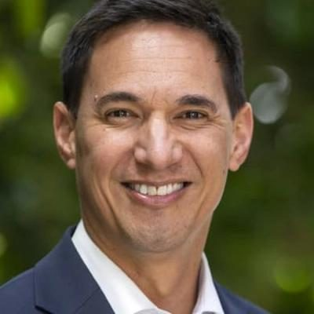

# Dan Bidois

| | |
|---|---|
| **Party** | New Zealand National Party |
| **Status** | Current MP — standing in 2026 |
| **Now (Oct 2026)** | Backbench MP for Northcote (2018–2020, and again since 2023); deputy chair of the Transport and Infrastructure Committee; #30 on National's 2026 list and re-contesting Northcote. |
| **Electorate(s)** | Northcote (2018 by-election–2020; 2023–) |
| **Parliaments** | 52nd, 54th |
| **First elected** | 2018 (Northcote by-election) |
| **Born** | 1983-02-24 — Auckland, New Zealand |
| **2026 election** | list #30, standing in Northcote |
| **Wikipedia** | [Dan Bidois](https://en.wikipedia.org/wiki/Dan_Bidois) |

> **List rank note:** policy.nz (in the 2026 candidacy section below) gives #31. The Electoral Commission's official National list gives **#30**. From #14 down, policy.nz's numbering appears to still include Chris Penk, who withdrew. ([Electoral Commission](https://vote.nz/2026-general-election/voting-in-the-election/party-lists))

## Current status

Backbench MP for Northcote since 2023. He previously held the seat from 2018 to 2020. He is #30 on National's 2026 list and is re-contesting Northcote.

## Biography

- **Early life:** born in 1983 and adopted at nine months by Mike and Leah Bidois. He grew up in Howick and is of Māori (Ngāpuhi, Ngāti Maniapoto) and European descent. In 2021 he met his birth mother for the first time.
- **Illness:** left school at 15 for a butchery apprenticeship. He was then diagnosed with Ewing sarcoma, recovered, and finished his training with Woolworths.
- **Education:**
  - Bridging course at Manukau Institute of Technology.
  - BA/BCom and BCom (Hons) in economics from the University of Auckland, where he was president of the Auckland University Students' Association in 2006.
  - Fulbright scholar and Master of Public Policy, Harvard (2012).
- **Career:**
  - Deloitte and the NZ Institute.
  - OECD economist in Paris.
  - Adviser to the Malaysian government.
  - Strategy manager at Foodstuffs.
  - After 2020, consultant and Accenture engagement manager.
- **Personal:** married to Courtney Simpson (2023); one son.

## Political career

- **2017:** list-only candidate at #72.
- **Northcote by-election, 9 June 2018:** won with 50.7% after Jonathan Coleman resigned. ([Electoral Commission](https://www.elections.org.nz/news-media/northcote-election-official-results))
- **2020:** lost Northcote to Labour's Shanan Halbert by 2,534 votes; his list ranking was too low to return.
- **2023:** regained Northcote with a 9,270 majority. ([Electoral Commission](https://www.electionresults.govt.nz/electionresults_2023/electorate-details-31.html))

**Roles held:**

- MP for Northcote (2018–2020, 2023–)
- Chair, Māori Affairs Committee (54th Parliament, earlier in the term)
- Deputy Chair, Transport and Infrastructure Committee
- National associate spokesperson for workplace relations and safety (2018–2020)

## Record & notable actions

- **Gift cards:** took over Melissa Lee's Fair Trading (Gift Card Expiry) Amendment Bill, which passed on 11 September 2024. It sets a three-year minimum expiry for most gift cards. ([legislation.govt.nz](https://legislation.govt.nz/act/public/2024/35/en/latest/#LMS950325))
- **Unions:** as associate workplace relations spokesperson in 2018–20, he said in Parliament that New Zealand should not have trade unions.
- **Conscience votes:** voted against the End of Life Choice Act, citing safeguards and suicide-prevention concerns, and for the Abortion Legislation Act (see table).
- **Committees:** chaired the Māori Affairs Committee in the 54th Parliament.

**Conscience votes** (recorded third-reading votes):

| Bill | Vote |
|---|---|
| [End of Life Choice Bill — third reading, 13 Nov 2019](https://en.wikipedia.org/wiki/End_of_Life_Choice_Act_2019) | against |
| [Abortion Legislation Bill — third reading, 18 Mar 2020](https://en.wikipedia.org/wiki/Abortion_Legislation_Act_2020) | for |

## Controversies

- **Anti-union comments:** these drew criticism from the left.
- No other controversies are recorded in the sources consulted.

<!-- GENERATED:2026-candidacy START -->
## 2026 candidacy

- **Electorate:** Northcote
- **List ranking:** 31
- **Before politics:** Strategy Manager - Foodstuffs
- **Age:** 43
- **Public email:** dan.bidois@parliament.govt.nz
- **Website:** https://www.national.org.nz/team/danbidois
- **Facebook:** https://www.facebook.com/DanBidoisMP/
- **Instagram:** https://www.instagram.com/danbidoismp/
- **Twitter:** https://x.com/dan_bidois

_Source: candidate questionnaire answers published on [policy.nz](https://policy.nz/2026/party-vote/parties/national-party), retrieved Oct 2026._
<!-- GENERATED:2026-candidacy END -->

## Sources

- <https://www.elections.org.nz/news-media/northcote-election-official-results>
- <https://www.electionresults.govt.nz/electionresults_2020/electorate-details-31.html>
- <https://www.electionresults.govt.nz/electionresults_2023/electorate-details-31.html>
- <https://bills.parliament.nz/v/6/3ca21699-2ee9-4fa9-82b3-e9cefd493724?Tab=history>
- <https://legislation.govt.nz/act/public/2024/35/en/latest/#LMS950325>
- <https://en.wikipedia.org/wiki/Dan_Bidois>
- <https://policy.nz/2026/party-vote/parties/national-party>
- Photo: <https://cdn.sanity.io/images/ubdwo62y/production/fd32f048731155d4aad00de6b72af3dab3e1aabe-1024x1024.jpg> — Supplied to policy.nz by the candidate/party (Not stated (candidate photo supplied to policy.nz; used for identification))
