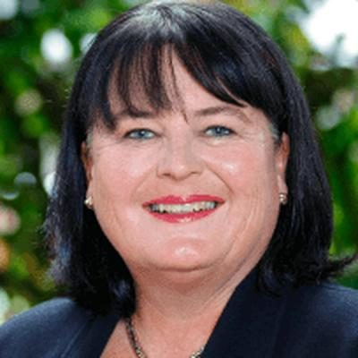

# Dana Kirkpatrick

| | |
|---|---|
| **Party** | New Zealand National Party |
| **Status** | Current MP — standing in 2026 |
| **Now (Oct 2026)** | Backbench MP for East Coast (since 2023); #32 on National's 2026 list and contesting East Cape (the redrawn East Coast seat). |
| **Electorate(s)** | East Coast (2023–) |
| **Parliaments** | 54th |
| **First elected** | 2023 |
| **2026 election** | list #32, standing in East Cape |
| **Wikipedia** | [Dana Kirkpatrick](https://en.wikipedia.org/wiki/Dana_Kirkpatrick) |

> **List rank note:** policy.nz (in the 2026 candidacy section below) gives #33. The Electoral Commission's official National list gives **#32**. From #14 down, policy.nz's numbering appears to still include Chris Penk, who withdrew. ([Electoral Commission](https://vote.nz/2026-general-election/voting-in-the-election/party-lists))

## Current status

Backbench MP for East Coast since 2023. She is #32 on National's 2026 list and is standing in East Cape, the successor seat after the boundary review.

## Biography

- **Early life:** born and raised in Gisborne, from a farming family that has lived in Tairāwhiti for four generations. She is of Māori descent.
- **Media and communications:** former *Gisborne Herald* journalist, then an executive and communications professional.
- **Sport administration:** general manager and then CEO of Equestrian Sports New Zealand (2014–21). She led membership-fee and structure reforms, introduced drug and alcohol testing, and carried out financial reforms.
- **Personal:** two children.

## Political career

- **2023:** list #44. She won East Coast by 3,199 votes over Labour list MP Tāmati Coffey; the incumbent, Kiri Allan, did not stand. ([Electoral Commission](https://archive.electionresults.govt.nz/electionresults_2023/electorate-details-09.html))

**Roles held:**

- MP for East Coast (2023–)
- CEO, Equestrian Sports New Zealand (2014–2021)

## Record & notable actions

- Named Cyclone Gabrielle recovery as her first priority and promised to reduce the regulatory burden on farmers and food producers.
- She was not in Parliament for the 2013–2022 conscience votes.

## Controversies

- None recorded in the sources consulted.

<!-- GENERATED:2026-candidacy START -->
## 2026 candidacy

- **Electorate:** East Cape
- **List ranking:** 33

_Source: candidate questionnaire answers published on [policy.nz](https://policy.nz/2026/party-vote/parties/national-party), retrieved Oct 2026._
<!-- GENERATED:2026-candidacy END -->

## Sources

- <https://thespinoff.co.nz/politics/17-10-2023/who-are-the-new-national-and-labour-mps>
- <https://archive.electionresults.govt.nz/electionresults_2023/electorate-details-09.html>
- <https://en.wikipedia.org/wiki/Dana_Kirkpatrick>
- <https://policy.nz/2026/party-vote/parties/national-party>
- Photo: <https://cdn.sanity.io/images/ubdwo62y/production/5319855d84a7e1d07b5a424be36246c9516cad10-1024x1024.jpg> — Supplied to policy.nz by the candidate/party (Not stated (candidate photo supplied to policy.nz; used for identification))
