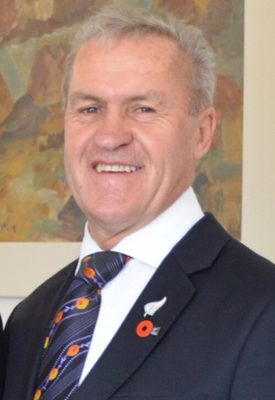

# David Carter

| | |
|---|---|
| **Party** | New Zealand National Party |
| **Status** | Former MP |
| **Now (Oct 2026)** | Retired at the 2020 election. Knighted (KNZM, 2021). Chair of the Canterbury A&P Association board (since Aug 2024). Briefly on National's board (2020–21), resigning after failed challenges to president Peter Goodfellow. |
| **Electorate(s)** | Selwyn (1994 by-election–1996); Banks Peninsula (1996–1999); list MP 1999–2020 |
| **Parliaments** | 44th, 45th, 46th, 47th, 48th, 49th, 50th, 51st, 52nd |
| **First elected** | 1994 |
| **Born** | 1952-04-03 — Christchurch, New Zealand |
| **Wikipedia** | [David Carter (politician)](https://en.wikipedia.org/wiki/David_Carter_(politician)) |

## Current status

Sir David Carter retired at the 2020 election and was knighted (KNZM) in 2021. Since August 2024 he has chaired the Canterbury A&P Association board. In 2020–21 he sat on National's board. He resigned in August 2021 after twice failing to unseat party president Peter Goodfellow, saying he had "zero confidence" in Goodfellow.

## Biography

- **Early life:** born 3 April 1952 in Christchurch, son of long-serving councillor Maurice Carter. Matt Doocey is his nephew.
- **Farming:** St Bede's College and a Bachelor of Agricultural Science from Lincoln University. He farmed sheep and cattle, and in 1974 founded New Zealand's first commercial cattle-embryo transplant company.

## Political career

- **Electorates:** won the 1994 Selwyn by-election and Banks Peninsula in 1996. He was a list MP from 1999 to 2020.
- **First ministry (1998–99):** Senior Citizens, plus associate roles.
- **Fifth National Government:**
  - Agriculture, Biosecurity and Forestry (2008–11).
  - Primary Industries (2011–13).
- **Speaker:** elected Speaker on 31 January 2013, beating Trevor Mallard 62–52. He served until November 2017. ([Stuff](http://www.stuff.co.nz/the-press/national/politics/8246741/Carter-elected-Speaker-of-the-House))

**Roles held:**

- Speaker of the House (2013–2017)
- Minister for Primary Industries (2011–2013)
- Minister of Agriculture; Biosecurity; Forestry (2008–2011)
- Minister of Local Government (2012–2013)
- Minister for Senior Citizens (1998–1999)
- MP for Selwyn (1994–1996)
- MP for Banks Peninsula (1996–1999)
- List MP (1999–2020)

## Record & notable actions

- **Waka-jumping law:** in 2020 he introduced a member's bill to repeal the Electoral (Integrity) Amendment Act 2018. It was later taken over by Nick Smith.
- **Ejecting the PM:** as Speaker, he ejected Prime Minister John Key from the chamber in May 2016.
- **Conscience votes:**
  - Voted for marriage equality (2013) and abortion reform (2020).
  - Voted against the End of Life Choice Bill (see table).

**Conscience votes** (recorded third-reading votes):

| Bill | Vote |
|---|---|
| [Marriage (Definition of Marriage) Amendment Bill — third reading, 17 Apr 2013](https://en.wikipedia.org/wiki/Marriage_(Definition_of_Marriage)_Amendment_Act_2013) | for |
| [End of Life Choice Bill — third reading, 13 Nov 2019](https://en.wikipedia.org/wiki/End_of_Life_Choice_Act_2019) | against |
| [Abortion Legislation Bill — third reading, 18 Mar 2020](https://en.wikipedia.org/wiki/Abortion_Legislation_Act_2020) | for |

## Controversies

- **Kosher slaughter ban (2010):** as Agriculture Minister he banned kosher slaughter against official advice, while holding shares in a meat-export firm whose managers had lobbied for the ban.
- **Squid quota (2012):** approved a 140% increase in the SQU6T squid quota, despite warnings about the threat to endangered sea lions.
- **"Backing rapists" (2015):** as Speaker he declined to act on John Key's remark that opposition MPs were "backing rapists". He then ejected women MPs who rose to say they were survivors of sexual abuse.

## Sources

- <http://www.stuff.co.nz/the-press/national/politics/8246741/Carter-elected-Speaker-of-the-House>
- <http://www.parliament.nz/en-NZ/PB/Debates/Debates/0/6/1/50HansD_20130131_00000004-Election-of-Speaker.htm>
- <https://www.newshub.co.nz/home/politics/2017/11/trevor-mallard-sworn-in-as-speaker.html>
- <https://en.wikipedia.org/wiki/David_Carter_(politician)>
- Photo: <https://commons.wikimedia.org/wiki/File:David_Carter_2014.jpg> — Government of NZ — source (CC BY 3.0 nz)
