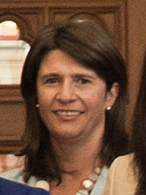

# Denise Lee

| | |
|---|---|
| **Party** | New Zealand National Party |
| **Status** | Former MP |
| **Now (Oct 2026)** | Lost Maungakiekie in 2020. Elected an Entrust trustee in 2021 (per Wikipedia); later activities not verified. |
| **Electorate(s)** | Maungakiekie (2017–2020) |
| **Parliaments** | 52nd, 53rd |
| **First elected** | 2017 |
| **Born** | 1970-12-04 — Paeroa, New Zealand |
| **Wikipedia** | [Denise Lee](https://en.wikipedia.org/wiki/Denise_Lee) |

## Current status

Former MP. She lost Maungakiekie in 2020. She was elected an Entrust (Auckland electricity trust) trustee in 2021.

## Biography

- **Early life:** born on 4 December 1970 in Paeroa, daughter of former National MP Graeme Lee.
- **Name:** known earlier as Denise Krum.
- **United Future:** party president; contested Maungakiekie for the party in 2008 before joining National.
- **Maiden speech:** said the death of her son was what drove her into politics.

## Political career

- **Auckland Council (2013–17):** elected for Maungakiekie-Tāmaki, defeating Richard Northey. She was re-elected in 2016 and became deputy chair of the planning committee.
- **Maungakiekie (2017):** won the seat by almost 2,000 votes.
- **2020:** led on election night but lost to Priyanca Radhakrishnan by 635 votes on final results.

**Roles held:**

- MP for Maungakiekie (2017–2020)
- Auckland Councillor, Maungakiekie-Tāmaki ward (2013–2017)
- President of United Future (c. 2008)

## Record & notable actions

- **Committees:** Education and Workforce.
- **Conscience votes:** voted against the End of Life Choice and abortion bills.

**Conscience votes** (recorded third-reading votes):

| Bill | Vote |
|---|---|
| [End of Life Choice Bill — third reading, 13 Nov 2019](https://en.wikipedia.org/wiki/End_of_Life_Choice_Act_2019) | against |
| [Abortion Legislation Bill — third reading, 18 Mar 2020](https://en.wikipedia.org/wiki/Abortion_Legislation_Act_2020) | against |

## Controversies

None significant identified in the sources consulted.

## Sources

- <https://en.wikipedia.org/wiki/Denise_Lee>
- <https://www.electionresults.govt.nz/electionresults_2020/>
- Photo: <https://commons.wikimedia.org/wiki/File:Denise_Lee.jpg> — Office of the Clerk of the House of Representatives of New Zealand — https://www.parliament.nz/en/get-involved/features/new-zealand-women-mps-continuing-to-break-barriers/ (CC BY 4.0)
