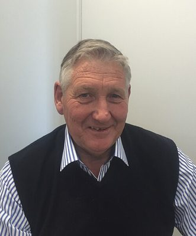

# Eric Roy

| | |
|---|---|
| **Party** | New Zealand National Party |
| **Status** | Former MP |
| **Electorate(s)** | Awarua (1993–1996); Invercargill (2005–2014) |
| **Parliaments** | 43th, 44th, 45th, 46th, 47th, 48th, 49th, 50th |
| **First elected** | 1993 |
| **Born** | 1948-06-27 — Gore, New Zealand |
| **Wikipedia** | [Eric Roy (politician)](https://en.wikipedia.org/wiki/Eric_Roy_(politician)) |

## Record & notable actions

**Conscience votes** (recorded third-reading votes):

| Bill | Vote |
|---|---|
| [Marriage (Definition of Marriage) Amendment Bill — third reading, 17 Apr 2013](https://en.wikipedia.org/wiki/Marriage_(Definition_of_Marriage)_Amendment_Act_2013) | against |

## Sources

- <https://en.wikipedia.org/wiki/Eric_Roy_(politician)>
- Photo: <https://commons.wikimedia.org/wiki/File:Eric_Roy_in_2018.jpg> — EricRoy1948 — Own work (CC BY-SA 4.0)
