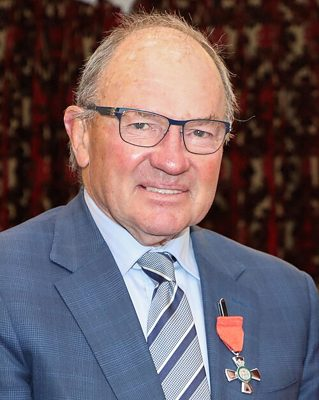

# Ian McKelvie

| | |
|---|---|
| **Party** | New Zealand National Party |
| **Status** | Former MP |
| **Electorate(s)** | Rangitīkei (2011–2023) |
| **Parliaments** | 50th, 51st, 52nd, 53rd |
| **First elected** | 2011 |
| **Wikipedia** | [Ian McKelvie](https://en.wikipedia.org/wiki/Ian_McKelvie) |

## Political career

**Offices held** (from the Wikipedia infobox; dates are years):

- Third Assistant Speaker of the New Zealand House of Representatives (2022–2023)
- Mayor of Manawatu (2002–2011)

## Record & notable actions

**Conscience votes** (recorded third-reading votes):

| Bill | Vote |
|---|---|
| [Marriage (Definition of Marriage) Amendment Bill — third reading, 17 Apr 2013](https://en.wikipedia.org/wiki/Marriage_(Definition_of_Marriage)_Amendment_Act_2013) | against |
| [End of Life Choice Bill — third reading, 13 Nov 2019](https://en.wikipedia.org/wiki/End_of_Life_Choice_Act_2019) | against |
| [Abortion Legislation Bill — third reading, 18 Mar 2020](https://en.wikipedia.org/wiki/Abortion_Legislation_Act_2020) | against |
| Conversion Practices Prohibition Legislation Bill — third reading, 15 Feb 2022 | not among the 8 National MPs recorded as opposed (25 National MPs voted in favour) |

## Sources

- <https://en.wikipedia.org/wiki/Ian_McKelvie>
- Photo: <https://commons.wikimedia.org/wiki/File:Ian_McKelvie_MNZM_(cropped).jpg> — Government House, Department of the Prime Minister and Cabinet — https://gg.govt.nz/image-galleries/10743/media?page=6 (CC0)
