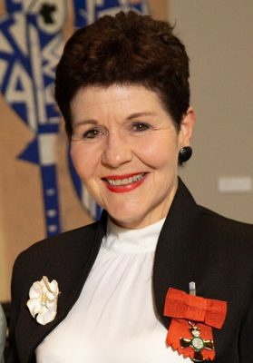

# Jackie Blue

| | |
|---|---|
| **Party** | Formerly National (list MP 2005–2013); joined The Opportunity Party (TOP) in March 2026 |
| **Status** | Former MP |
| **Now (Oct 2026)** | Former National list MP (2005–2013) and EEO Commissioner (2013–2018). Quit National in March 2026 over pay-equity changes and joined The Opportunity Party to mentor its leader Qiulae Wong. |
| **Electorate(s)** | List MP (2005–2013); contested Mt Roskill 2005, 2008, 2011 |
| **Parliaments** | 48th, 49th, 50th |
| **First elected** | 2005 |
| **Born** | 1956-06-02 — Hamilton, New Zealand |
| **Wikipedia** | [Jackie Blue](https://en.wikipedia.org/wiki/Jackie_Blue) |

## Current status

She quit National in March 2026, calling the government's pay-equity changes her "breaking point", and joined **The Opportunity Party** (TOP) to mentor its leader, Qiulae Wong. ([RNZ](https://www.rnz.co.nz/news/political/588802/former-mp-jackie-blue-quits-national-to-join-opportunity-party)) In May 2025 she took part in the unofficial cross-party "People's Select Committee" on pay equity, led by Marilyn Waring.

## Biography

- **Early life:** born on 2 June 1956 in Hamilton. She attended Selwyn College.
- **Medicine:** BSc and MB ChB from the University of Auckland. She was a pioneering breast physician and sits on the Breast Cancer Research Trust's scientific panel.
- **Honours:** MNZM (2019) for services to women and the State.
- **Personal:** married (Jacqueline Miller); two children.

## Political career

- **List MP (2005–13):** contested Mt Roskill against Phil Goff in 2005, 2008 and 2011. She was spokesperson for women's affairs and associate health in opposition.
- **2008:** lost the Auckland Central selection to Nikki Kaye.
- **Resignation (2013):** left Parliament in May 2013 to become EEO Commissioner. Paul Foster-Bell replaced her.

**Roles held:**

- List MP (2005–2013)
- Equal Employment Opportunities Commissioner, Human Rights Commission (2013–2018)

## Record & notable actions

- **Breast cancer:** campaigned for wider Herceptin funding.
- **Member's bills:**
  - Human Tissue (Organ Donation) Amendment Bill: defeated at second reading.
  - Consumer Guarantees Amendment Bill (2010): extended the Act to online auctions.
- **EEO Commissioner (2013–18):** told a UN committee in 2018 that successive governments had failed women on domestic violence.
- **Conscience votes:** voted for marriage equality (2013).

**Conscience votes** (recorded third-reading votes):

| Bill | Vote |
|---|---|
| [Marriage (Definition of Marriage) Amendment Bill — third reading, 17 Apr 2013](https://en.wikipedia.org/wiki/Marriage_(Definition_of_Marriage)_Amendment_Act_2013) | for |

## Controversies

None significant identified in the sources consulted.

## Sources

- <https://www.rnz.co.nz/news/political/588802/former-mp-jackie-blue-quits-national-to-join-opportunity-party>
- <https://en.wikipedia.org/wiki/Jackie_Blue>
- Photo: <https://commons.wikimedia.org/wiki/File:Jackie_Blue_MNZM_(cropped).jpg> — New Zealand Government, Office of the Governor-General — https://gg.govt.nz/image-galleries/8408/media?page=4 (CC BY 4.0)
