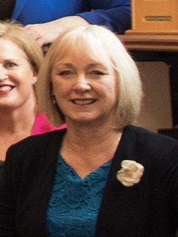

# Jacqui Dean

| | |
|---|---|
| **Party** | New Zealand National Party |
| **Status** | Former MP |
| **Electorate(s)** | Otago (2005–2008); Waitaki (2008–2023) |
| **Parliaments** | 48th, 49th, 50th, 51st, 52nd, 53rd |
| **First elected** | 2005 |
| **Born** | 1957-05-13 — Palmerston North, New Zealand |
| **Wikipedia** | [Jacqui Dean](https://en.wikipedia.org/wiki/Jacqui_Dean) |

## Political career

**Offices held** (from the Wikipedia infobox; dates are years):

- Second Assistant Speaker of the House of Representatives (2020–2023)
- Minister of Commerce and Consumer Affairs (2016–2017)
- Minister for Small Business (2016–2017)

## Record & notable actions

**Conscience votes** (recorded third-reading votes):

| Bill | Vote |
|---|---|
| [Marriage (Definition of Marriage) Amendment Bill — third reading, 17 Apr 2013](https://en.wikipedia.org/wiki/Marriage_(Definition_of_Marriage)_Amendment_Act_2013) | for |
| [End of Life Choice Bill — third reading, 13 Nov 2019](https://en.wikipedia.org/wiki/End_of_Life_Choice_Act_2019) | against |
| [Abortion Legislation Bill — third reading, 18 Mar 2020](https://en.wikipedia.org/wiki/Abortion_Legislation_Act_2020) | against |
| Conversion Practices Prohibition Legislation Bill — third reading, 15 Feb 2022 | not among the 8 National MPs recorded as opposed (25 National MPs voted in favour) |

## Sources

- <https://en.wikipedia.org/wiki/Jacqui_Dean>
- Photo: <https://commons.wikimedia.org/wiki/File:Jacqui_Dean_(cropped).jpg> — Office of the Clerk of the House of Representatives of New Zealand — https://www.parliament.nz/en/get-involved/features/new-zealand-women-mps-continuing-to-break-barriers/ (CC BY 4.0)
