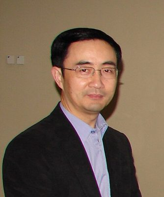

# Jian Yang

| | |
|---|---|
| **Party** | New Zealand National Party |
| **Status** | Former MP |
| **Now (Oct 2026)** | Retired from Parliament at the 2020 election. Current activities not detailed in sources consulted. |
| **Electorate(s)** | List MP (2011–2020) |
| **Parliaments** | 50th, 51st, 52nd |
| **First elected** | 2011 |
| **Born** | 1962-10 — Jiangxi, China |
| **Wikipedia** | [Jian Yang (politician)](https://en.wikipedia.org/wiki/Jian_Yang_(politician)) |

## Current status

Former MP. He retired at the 2020 election. His activities since then are not detailed in the sources consulted.

## Biography

- **Early life:** born in October 1962 and raised in Jiangxi Province, China.
- **Chinese military institutions:** studied and taught at the PLA Air Force Engineering College and the Luoyang PLA University of Foreign Languages.
- **Academic career:** MA and PhD in international relations from the Australian National University. He became a senior lecturer in political studies at the University of Auckland in 1999.
- **Citizenship:** NZ citizen since 2004.

## Political career

- **2011:** entered Parliament at #36 on National's list, the highest new candidate, seen as succeeding Pansy Wong.
- **Re-elected:** on the list in 2014 and 2017.
- **Committees:** chaired Education and Science (2014–17) and Governance and Administration (2017–20).
- **Other roles:** statistics spokesperson in opposition.
- **Retirement (July 2020):** although re-selected in March 2020, he announced his retirement in July. ([RNZ](https://www.rnz.co.nz/news/political/420913/national-mp-jian-yang-who-admitted-to-training-chinese-spies-retires-from-politics))

**Roles held:**

- List MP (2011–2020)
- Chair, Education and Science Committee (2014–2017)
- Chair, Governance and Administration Committee (2017–2020)
- National spokesperson for statistics (2017–2020)

## Record & notable actions

- **Conscience votes:** voted against marriage equality (2013) and for the End of Life Choice and abortion bills (see table).

**Conscience votes** (recorded third-reading votes):

| Bill | Vote |
|---|---|
| [Marriage (Definition of Marriage) Amendment Bill — third reading, 17 Apr 2013](https://en.wikipedia.org/wiki/Marriage_(Definition_of_Marriage)_Amendment_Act_2013) | against |
| [End of Life Choice Bill — third reading, 13 Nov 2019](https://en.wikipedia.org/wiki/End_of_Life_Choice_Act_2019) | for |
| [Abortion Legislation Bill — third reading, 18 Mar 2020](https://en.wikipedia.org/wiki/Abortion_Legislation_Act_2020) | for |

## Controversies

- **Newsroom/Financial Times investigation (2017):**
  - Revealed he had taught English at a PLA institution that trains linguists to intercept foreign communications.
  - Yang acknowledged he had been a Chinese Communist Party member, inactive since 1994, and conceded he "could be seen" as having taught spies. He denied being a spy.
  - The NZ Herald reported he had listed "partner" universities instead of the military institutions in his citizenship applications. ([Newsroom](https://www.newsroom.co.nz/@summer-newsroom/2017/09/12/46657?slug=newsroom-investigation-national-mp-trained-by-chinese-spies))
- **English-language interviews:** criticised for refusing them after 2017.
- **Bridges–Guo Shengkun meeting (2019):** arranged a meeting in China between Simon Bridges and security chief Guo Shengkun.
- **Reported deal (2021):** media reported that his and Labour MP Raymond Huo's 2020 retirements followed intelligence-agency concerns and an arrangement between Ardern and Muller. Both parties declined to comment. ([Politik](https://www.politik.co.nz/2021/05/26/the-cooling-of-relations-with-china-why-two-mps-retired-last-year/), [RNZ](https://www.rnz.co.nz/news/political/443477/labour-national-tight-lipped-on-former-kiwi-chinese-mps-departure))

## Sources

- <https://www.rnz.co.nz/news/political/420913/national-mp-jian-yang-who-admitted-to-training-chinese-spies-retires-from-politics>
- <https://www.newsroom.co.nz/@summer-newsroom/2017/09/12/46657?slug=newsroom-investigation-national-mp-trained-by-chinese-spies>
- <https://www.politik.co.nz/2021/05/26/the-cooling-of-relations-with-china-why-two-mps-retired-last-year/>
- <https://www.rnz.co.nz/news/political/443477/labour-national-tight-lipped-on-former-kiwi-chinese-mps-departure>
- <https://en.wikipedia.org/wiki/Jian_Yang_(politician)>
- Photo: <https://commons.wikimedia.org/wiki/File:Jian_Yang.jpg> — US Embassy in New Zealand — Cropped from https://www.flickr.com/photos/46907600@N02/4873982740 (Public domain)
