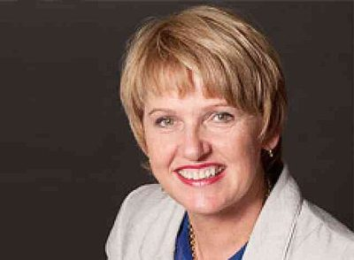

# Jo Goodhew

| | |
|---|---|
| **Party** | New Zealand National Party |
| **Status** | Former MP |
| **Now (Oct 2026)** | Retired from Parliament at the 2017 election; elected to the South Canterbury District Health Board in 2019 (DHBs were abolished in 2022). Current activities not detailed in the sources consulted. |
| **Electorate(s)** | Aoraki (2005–2008); Rangitata (2008–2017) |
| **Parliaments** | 47th, 48th, 49th, 50th, 51st |
| **First elected** | 2005 |
| **Born** | 1961 — Temuka, New Zealand |
| **Wikipedia** | [Jo Goodhew](https://en.wikipedia.org/wiki/Jo_Goodhew) |

## Current status

Former MP. She retired at the 2017 election. In 2019 she was elected to the South Canterbury DHB; district health boards were abolished in 2022. Her current activities are not detailed in the sources consulted.

## Biography

- Born 1961; grew up in Timaru and attended Timaru Girls' High School.
- Trained as a nurse at Otago Polytechnic and later tutored in health sciences at Aoraki Polytechnic.

## Political career

- **Aoraki:** won the seat in 2005.
- **Rangitata:** won the new seat in 2008 with a larger majority and held it until 2017.
- **Junior whip:** from 2009.
- **Minister outside Cabinet (2011–16):** Community and Voluntary Sector, Senior Citizens, Women's Affairs, Food Safety, and associate Social Development and Primary Industries.
- **Retirement:** she lost her portfolios in Bill English's December 2016 reshuffle and announced her retirement in January 2017. Andrew Falloon succeeded her.

**Roles held:**

- Minister for the Community and Voluntary Sector (2011–2016)
- Minister for Food Safety (2014–2016)
- Minister for Senior Citizens; Women's Affairs (2011–2014)
- National junior whip (2009–2011)
- MP for Aoraki (2005–2008)
- MP for Rangitata (2008–2017)

## Record & notable actions

- **Conscience votes:** voted for marriage equality (2013).

**Conscience votes** (recorded third-reading votes):

| Bill | Vote |
|---|---|
| [Marriage (Definition of Marriage) Amendment Bill — third reading, 17 Apr 2013](https://en.wikipedia.org/wiki/Marriage_(Definition_of_Marriage)_Amendment_Act_2013) | for |

## Controversies

- None recorded in the sources consulted.

## Sources

- <https://en.wikipedia.org/wiki/Jo_Goodhew>
- Photo: <https://commons.wikimedia.org/wiki/File:Jo_Goodhew.jpg> — New Zealand Government — https://www.govt.nz/organisations/ministry-of-health/ (CC BY 3.0 nz)
