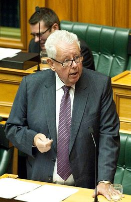

# John Hayes

| | |
|---|---|
| **Party** | New Zealand National Party |
| **Status** | Former MP |
| **Now (Oct 2026)** | Retired at the 2014 election after losing the Wairarapa selection challenge to Alastair Scott; came third for South Wairarapa mayor in 2016. Current activities not verified. |
| **Electorate(s)** | Wairarapa (2005–2014) |
| **Parliaments** | 48th, 49th, 50th |
| **First elected** | 2005 |
| **Born** | 1948-03-15 |
| **Wikipedia** | [John Hayes (New Zealand politician)](https://en.wikipedia.org/wiki/John_Hayes_(New_Zealand_politician)) |

## Current status

Former MP and diplomat. He left Parliament in 2014 after Alastair Scott challenged him for the Wairarapa nomination. He came third for South Wairarapa mayor in 2016.

## Biography

- **Early life:** born on 15 March 1948. He attended Rongotai College and earned a BAgSc from Lincoln College, where he was student president in 1970.
- **Diplomatic career (MFAT):**
  - Postings in Singapore, India, Bahrain and Saudi Arabia.
  - Principal private secretary to Mike Moore.
  - High Commissioner to Papua New Guinea (1989–93) and Ambassador to Iran (1993–95).
  - Headed MFAT's South Pacific division.
  - Helped negotiate the Bougainville peace process; his helicopter was shot at by the BRA. He was made an Officer of the NZ Order of Merit (ONZM) in 1999.
- **After MFAT:** retired from the ministry in 2003 and became an orchardist and property developer in Greytown.
- **Personal:** married to Helen; two adult children.

## Political career

- **Wairarapa (2005):** won the seat by 2,752 votes and held it in 2008 and 2011.
- **Foreign affairs:**
  - Chaired the Foreign Affairs, Defence and Trade Committee (2008–14).
  - Parliamentary private secretary to Murray McCully (2011–14).
  - Promoted the first Pacific Parliamentary and Political Leaders Forum (2013).

**Roles held:**

- MP for Wairarapa (2005–2014)
- Chair, Foreign Affairs, Defence and Trade Committee (2008–2014)
- Parliamentary Private Secretary to the Minister of Foreign Affairs (2011–2014)
- NZ Ambassador to Iran (1993–1995)
- NZ High Commissioner to Papua New Guinea (1989–1993)

## Record & notable actions

- **Pacific policy:** a critic of aid spending and of self-government arrangements for Niue, Tokelau and the Cook Islands, calling for a "rethink" (2009).
- **Social issues:** a conservative. He supported corporal punishment and raising the drinking age, opposed cannabis reform, and voted against marriage equality (2013).

**Conscience votes** (recorded third-reading votes):

| Bill | Vote |
|---|---|
| [Marriage (Definition of Marriage) Amendment Bill — third reading, 17 Apr 2013](https://en.wikipedia.org/wiki/Marriage_(Definition_of_Marriage)_Amendment_Act_2013) | against |

## Controversies

- **Climate change (2006):** said he was "not inclined to agree [that] there is a scientific consensus on climate change".

## Sources

- <https://en.wikipedia.org/wiki/John_Hayes_(New_Zealand_politician)>
- <https://www.dpmc.govt.nz/publications/queens-birthday-honours-list-1999>
- Photo: <https://commons.wikimedia.org/wiki/File:John_Hayes_2013.jpg> — Rachel Park, NZDF Photographer — https://mfatimages.smugmug.com/CompleteLibrary/Approved-Images/i-PSx6QT2 (CC BY 3.0)
