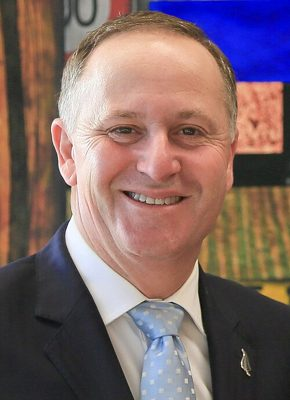

# John Key

| | |
|---|---|
| **Party** | New Zealand National Party |
| **Status** | Former MP |
| **Now (Oct 2026)** | Retired from politics (left Parliament 14 Apr 2017). Company director: chairman of Crimson Education (from Feb 2026); director of Palo Alto Networks (from 2019); former chair of ANZ Bank New Zealand (appointed 2017) and former Air NZ director (2017–2020). Publicly supported and informally advised Christopher Luxon during the 2026 leadership speculation. |
| **Electorate(s)** | Helensville (2002–2017) |
| **Parliaments** | 47th, 48th, 49th, 50th, 51st |
| **First elected** | 2002 |
| **Born** | 1961-08-09 — Auckland, New Zealand |
| **Wikipedia** | [John Key](https://en.wikipedia.org/wiki/John_Key) |

## Current status

Sir John Key is retired from politics. Since February 2026 he has chaired Crimson Education, and he has sat on the board of Palo Alto Networks since 2019. His earlier roles were chair of ANZ Bank New Zealand (from 2017) and Air New Zealand director (2017–2020). He was knighted (GNZM) in 2017. In 2026 he publicly backed his friend Christopher Luxon amid leadership speculation and was reported to be advising him. In September 2025 he attended Beijing's Victory Day parade with Helen Clark and met Xi Jinping. ([NZ Herald](https://www.nzherald.co.nz/business/crimson-education-names-sir-john-key-as-chairman-hints-at-ipo-more-acquisitions/premium/EEELXVKM6REZDLXM7DTJ73IFOA/))

## Biography

- **Early life:**
  - Born 9 August 1961 in Auckland.
  - His father, an English immigrant and war veteran, died when John was eight. His mother, an Austrian-Jewish refugee, raised him and his two sisters in a state house in Bryndwr, Christchurch.
  - Attended Burnside High School and earned a BCom from the University of Canterbury (1981).
- **Finance career:**
  - Foreign-exchange dealer at Elders Finance and Bankers Trust.
  - Joined Merrill Lynch in 1995 and became its global head of foreign exchange in London.
  - Member of the New York Federal Reserve's Foreign Exchange Committee (1999–2001).
  - Left finance wealthy. He was estimated to be worth about US$35m in 2016.
- **Family:** married to Bronagh; two children.

## Political career

- **Helensville:** won the new seat in 2002, National's worst-ever election, by 1,705 votes. His share rose to 73% by 2008.
- **Opposition:**
  - Finance spokesperson from 2004.
  - Became leader unopposed on 27 November 2006 after Don Brash resigned.
- **Prime Minister, 2008–2016:**
  - National won in 2008, 2011 and 2014.
  - His governments relied on confidence-and-supply deals with ACT, United Future and the Māori Party.
- **Resignation:** resigned unexpectedly on 5 December 2016 (effective 12 December), saying he had "never seen [himself] as a career politician". Bill English succeeded him. Key left Parliament on 14 April 2017. ([Guardian](https://www.theguardian.com/world/2016/dec/05/john-key-resigns-new-zealand-prime-minister-to-quit))

**Roles held:**

- Prime Minister of New Zealand (2008–2016)
- Leader of the National Party (2006–2016)
- Leader of the Opposition (2006–2008)
- Minister of Tourism (2008–2016)
- Minister of National Security and Intelligence (2014–2016)
- Minister Responsible for the GCSB and NZSIS (2008–2014)
- National finance spokesperson (2004–2006)
- Chairman, International Democrat Union (2014–2018)
- MP for Helensville (2002–2017)

## Record & notable actions

- **Economy:**
  - Personal tax cuts (top rate cut to 33%) and a rise in GST from 12.5% to 15% in 2010, despite earlier saying GST would not rise.
  - Spending restraint during the GFC.
  - Partial sale of five state-owned enterprises (the "mixed ownership model"). Voters opposed this about 2:1 in a citizens-initiated referendum.
- **Christchurch earthquakes:** set up CERA after the February 2011 quake, which killed 185 people.
- **Foreign policy:**
  - Signed the Wellington Declaration with the US (2010).
  - Led New Zealand's successful 2015–16 UN Security Council campaign.
  - Withdrew troops from Afghanistan.
  - Championed the TPP, signed in Auckland in February 2016.
  - Won a citizenship pathway for New Zealanders in Australia (2016).
- **Other:**
  - National Cycleway (Ngā Haerenga).
  - The 2015–16 flag referendums, in which voters kept the current flag. Critics called them a costly vanity project.
- **Social policy:** described as socially liberal. He voted for marriage equality (2013) and brokered the 2007 compromise on the anti-smacking law with Helen Clark.

**Conscience votes** (recorded third-reading votes):

| Bill | Vote |
|---|---|
| [Marriage (Definition of Marriage) Amendment Bill — third reading, 17 Apr 2013](https://en.wikipedia.org/wiki/Marriage_(Definition_of_Marriage)_Amendment_Act_2013) | for |

## Controversies

- **GCSB and Kim Dotcom (2012):** apologised after the GCSB was found to have illegally spied on Kim Dotcom, a permanent resident. He also faced criticism for "forgetting" that he had phoned childhood acquaintance Ian Fletcher to suggest he apply to head the GCSB. ([Stuff](http://www.stuff.co.nz/national/9103159/GCSB-acted-illegally-on-Kim-Dotcom))
- **"Teapot tape" (2011):** complained to police over a recording of his café conversation with ACT's John Banks.
- **Credit-rating claim (2011):** made a claim about S&P that the agency contradicted.
- **Ministerial BMWs (2011):** apologised for the "sloppy" replacement of ministerial BMWs.
- **"Ponytail-gate" (2015):** apologised after repeatedly pulling a café waitress's ponytail. ([Stuff](http://www.stuff.co.nz/national/politics/67975327/ponytailpulling-prime-minister-john-key-makes-world-headlines))
- **Housing:** criticised for calling soaring house prices a "challenge" rather than a crisis. Average prices roughly doubled during his tenure. ([RNZ](https://www.rnz.co.nz/news/political/308084/housing-%27challenge%27-still-not-a-%27crisis%27))
- **Dirty Politics (2014):** Nicky Hager's book alleged his office had links to blogger Cameron Slater. It led to Judith Collins' resignation; Key denied any wrongdoing.

## Sources

- <http://electionresults.org.nz/electionresults_2002/electorate-17.html>
- <http://2008.electionresults.govt.nz/electionresults_2008/electorate-15.html>
- <https://www.theguardian.com/world/2016/dec/05/john-key-resigns-new-zealand-prime-minister-to-quit>
- <http://www.stuff.co.nz/national/9103159/GCSB-acted-illegally-on-Kim-Dotcom>
- <http://www.3news.co.nz/Keys-faulty-memory-on-GCSB-an-excuse---Shearer/tabid/1607/articleID/292940/Default.aspx>
- <http://www.stuff.co.nz/national/politics/67975327/ponytailpulling-prime-minister-john-key-makes-world-headlines>
- <http://www.stuff.co.nz/national/politics/10528332/Kiwis-could-vote-on-flag-next-year>
- <https://www.rnz.co.nz/news/political/308084/housing-%27challenge%27-still-not-a-%27crisis%27>
- <https://www.stuff.co.nz/business/industries/118249092/john-key-to-stand-down-as-air-new-zealand-director-in-march>
- <https://www.nzherald.co.nz/business/crimson-education-names-sir-john-key-as-chairman-hints-at-ipo-more-acquisitions/premium/EEELXVKM6REZDLXM7DTJ73IFOA/>
- <http://www.stuff.co.nz/national/politics/93326903/former-pm-john-key-tops-queens-birthday-honours-with-knighthood-for-services-to-the-state>
- <https://en.wikipedia.org/wiki/April_2026_New_Zealand_National_Party_leadership_election>
- <https://en.wikipedia.org/wiki/John_Key>
- Photo: <https://commons.wikimedia.org/wiki/File:John_Key_February_2015.jpg> — US Embassy NZ — This image has been extracted from another file (CC BY 4.0)
