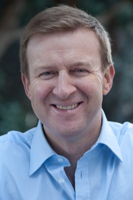

# Jonathan Coleman

| | |
|---|---|
| **Party** | New Zealand National Party |
| **Status** | Former MP |
| **Electorate(s)** | Northcote (2005–2018) |
| **Parliaments** | 48th, 49th, 50th, 51st, 52nd |
| **First elected** | 2005 |
| **Born** | 1966-09-23 — Auckland, New Zealand |
| **Wikipedia** | [Jonathan Coleman (politician)](https://en.wikipedia.org/wiki/Jonathan_Coleman_(politician)) |

## Political career

**Offices held** (from the Wikipedia infobox; dates are years):

- Minister of Health (2014–2017)
- Minister for Sport and Recreation (2014–2017)
- Minister of Defence (2011–2014)
- Minister of State Services (2011–2014)
- Minister of Immigration (2008–2011)

## Record & notable actions

**Conscience votes** (recorded third-reading votes):

| Bill | Vote |
|---|---|
| [Marriage (Definition of Marriage) Amendment Bill — third reading, 17 Apr 2013](https://en.wikipedia.org/wiki/Marriage_(Definition_of_Marriage)_Amendment_Act_2013) | against |

## Sources

- <https://en.wikipedia.org/wiki/Jonathan_Coleman_(politician)>
- Photo: <https://commons.wikimedia.org/wiki/File:Jonathan_Coleman_3by2.png> — User:Cotton00 — This image has been extracted from another file (CC BY-SA 4.0)
