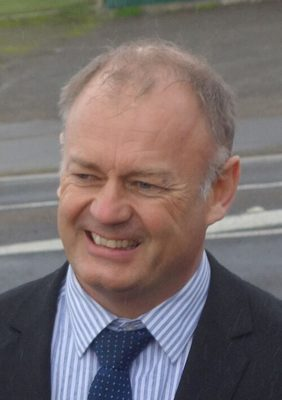

# Jono Naylor

| | |
|---|---|
| **Party** | New Zealand National Party |
| **Status** | Former MP |
| **Parliaments** | 51st |
| **First elected** | 2014 |
| **Wikipedia** | [Jono Naylor](https://en.wikipedia.org/wiki/Jono_Naylor) |

## Political career

**Offices held** (from the Wikipedia infobox; dates are years):

- Mayor of Palmerston North (2007–2014)

## Sources

- <https://en.wikipedia.org/wiki/Jono_Naylor>
- Photo: <https://commons.wikimedia.org/wiki/File:Jono_Naylor_491.jpg> — Axel Wilke — Cropped from Flickr version: https://www.flickr.com/photos/axel-wilke/19336478942/ (CC BY-SA 2.0)
