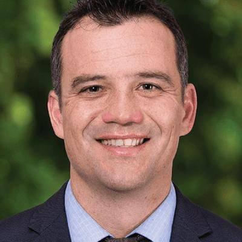

# Joseph Mooney

| | |
|---|---|
| **Party** | New Zealand National Party |
| **Status** | Current MP — standing in 2026 |
| **Now (Oct 2026)** | Backbench MP for Southland (since 2020); #49 on National's 2026 list and re-contesting Southland. |
| **Electorate(s)** | Southland (2020–) |
| **Parliaments** | 53rd, 54th |
| **First elected** | 2020 |
| **Born** | 1979 |
| **2026 election** | list #49, standing in Southland |
| **Wikipedia** | [Joseph Mooney (New Zealand politician)](https://en.wikipedia.org/wiki/Joseph_Mooney_(New_Zealand_politician)) |

> **List rank note:** policy.nz (in the 2026 candidacy section below) gives #50. The Electoral Commission's official National list gives **#49**. From #14 down, policy.nz's numbering appears to still include Chris Penk, who withdrew. ([Electoral Commission](https://vote.nz/2026-general-election/voting-in-the-election/party-lists))

## Current status

Backbench MP for Southland since 2020. He is #49 on National's 2026 list and is re-contesting the seat. During the August 2026 leadership crisis he was one of the MPs who explicitly backed Luxon.

## Biography

- **Early life:** born in 1979 and raised in poverty in Hawke's Bay. At 11, he and his younger brother left home and lived on the streets of Wellington for a week. He left school without qualifications and worked in orchards, forestry, fishing, building and on skifields.
- **Law:**
  - Later earned an honours degree in law and became a senior trial lawyer.
  - Member of the Southland branch council of the Law Society.
  - Appointed to the Crown Prosecution Panel for Invercargill in 2017.
  - Youth Advocate.
- **Service:** volunteer firefighter and Army reservist.
- **Personal:** married to Silvia; three children. Former Labour MP Bill Fox was his great-great-uncle.

## Political career

- **2020:** selected for the new Southland seat after Hamish Walker withdrew over a patient-data leak. He won by 5,645 votes, although Labour won the party vote in the electorate. ([Electoral Commission](https://www.electionresults.govt.nz/electionresults_2020/electorate-details-46.html))
- **Spokesperson roles:** Treaty negotiations and associate defence (2020); water and space (from December 2021).
- **2023:** held Southland by 17,211 votes.

**Roles held:**

- MP for Southland (2020–)
- National spokesperson for Treaty of Waitangi negotiations, water, space; associate defence (2020–2023)

## Record & notable actions

- Pushed for more seasonal workers to meet Central Otago's fruit-picking needs.
- **Conscience votes:** in Parliament for the 2022 conversion-practices vote and not among the eight National MPs recorded as opposed.

## Controversies

- **Te Tiriti tweet (April 2023):** tweeted that Te Tiriti o Waitangi promised tino rangatiratanga to every New Zealander. Luxon said he "got it wrong", and historian Dame Claudia Orange said the argument had "no substance". ([RNZ](https://www.rnz.co.nz/news/political/488242/luxon-has-great-confidence-in-national-mp-despite-te-tiriti-o-waitangi-comments))

<!-- GENERATED:2026-candidacy START -->
## 2026 candidacy

- **Electorate:** Southland
- **List ranking:** 50

_Source: candidate questionnaire answers published on [policy.nz](https://policy.nz/2026/party-vote/parties/national-party), retrieved Oct 2026._
<!-- GENERATED:2026-candidacy END -->

## Sources

- <https://www.stuff.co.nz/national/politics/122317307/queenstown-lawyer-joseph-mooney-selected-to-replace-hamish-walker-as-southland-electorate-candidate>
- <https://www.electionresults.govt.nz/electionresults_2020/electorate-details-46.html>
- <https://archive.electionresults.govt.nz/electionresults_2023/electorate-details-46.html>
- <https://www.rnz.co.nz/news/political/488242/luxon-has-great-confidence-in-national-mp-despite-te-tiriti-o-waitangi-comments>
- <https://en.wikipedia.org/wiki/August_2026_New_Zealand_National_Party_leadership_election>
- <https://en.wikipedia.org/wiki/Joseph_Mooney_(New_Zealand_politician)>
- <https://policy.nz/2026/party-vote/parties/national-party>
- Photo: <https://cdn.sanity.io/images/ubdwo62y/production/006a01c9798e3762ef510c455668d6e333930d12-1024x1024.jpg> — Supplied to policy.nz by the candidate/party (Not stated (candidate photo supplied to policy.nz; used for identification))
