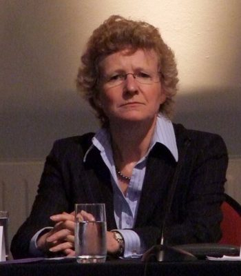

# Kate Wilkinson

| | |
|---|---|
| **Party** | New Zealand National Party |
| **Status** | Former MP |
| **Electorate(s)** | Waimakariri (2011–2014) |
| **Parliaments** | 48th, 49th, 50th |
| **First elected** | 2005 |
| **Born** | 1957-08-03 — Rakaia, New Zealand |
| **Wikipedia** | [Kate Wilkinson (politician)](https://en.wikipedia.org/wiki/Kate_Wilkinson_(politician)) |

## Record & notable actions

**Conscience votes** (recorded third-reading votes):

| Bill | Vote |
|---|---|
| [Marriage (Definition of Marriage) Amendment Bill — third reading, 17 Apr 2013](https://en.wikipedia.org/wiki/Marriage_(Definition_of_Marriage)_Amendment_Act_2013) | for |

## Sources

- <https://en.wikipedia.org/wiki/Kate_Wilkinson_(politician)>
- Photo: <https://commons.wikimedia.org/wiki/File:Kate_Wilkinson_crop.jpg> — New Zealand Tertiary Education Union — File:John Key, Kate Wilkinson and Peter Conway (4032968502).jpg / Flickr (CC BY-SA 2.0)
