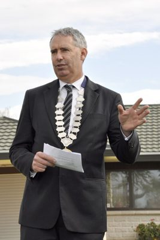

# Lawrence Yule

| | |
|---|---|
| **Party** | New Zealand National Party |
| **Status** | Former MP |
| **Now (Oct 2026)** | Lost Tukituki to Labour's Anna Lorck in 2020. Current activities not detailed in sources consulted. |
| **Electorate(s)** | Tukituki (2017–2020) |
| **Parliaments** | 52nd |
| **First elected** | 2017 |
| **Born** | 1963 |
| **Wikipedia** | [Lawrence Yule](https://en.wikipedia.org/wiki/Lawrence_Yule) |

## Current status

Former MP. He lost Tukituki to Labour's Anna Lorck by 1,590 votes in 2020. His activities since are not detailed in the sources consulted.

## Biography

- **Early life:** born in 1963.
- **Other roles:** Justice of the Peace.
- **Personal:** married to Kerryn; four adult children.

## Political career

- **Mayor of Hastings (2001–17):** the city's youngest mayor at election; he served six terms.
- **Local Government NZ:** president.
- **Tukituki (2017):** succeeded Craig Foss as National's candidate and beat Anna Lorck, whom he had once hired as a PR consultant. He resigned the mayoralty after winning.

**Roles held:**

- MP for Tukituki (2017–2020)
- Mayor of Hastings (2001–2017)
- President, Local Government New Zealand

## Record & notable actions

- **Havelock North (2016):** was mayor during the campylobacter drinking-water outbreak, which made thousands ill.
- **Conscience votes:** voted against the End of Life Choice and abortion bills.

**Conscience votes** (recorded third-reading votes):

| Bill | Vote |
|---|---|
| [End of Life Choice Bill — third reading, 13 Nov 2019](https://en.wikipedia.org/wiki/End_of_Life_Choice_Act_2019) | against |
| [Abortion Legislation Bill — third reading, 18 Mar 2020](https://en.wikipedia.org/wiki/Abortion_Legislation_Act_2020) | against |

## Controversies

- **Havelock North outbreak:** the 2016 outbreak happened under his council's watch; it led to a government inquiry into drinking-water safety.

## Sources

- <https://en.wikipedia.org/wiki/Lawrence_Yule>
- <https://www.electionresults.govt.nz/electionresults_2020/>
- Photo: <https://commons.wikimedia.org/wiki/File:Lawrence_Yule_2013.jpg> — Hastings District Council — https://www.flickr.com/photos/62286240@N04/9522222076/ (CC BY 2.0)
