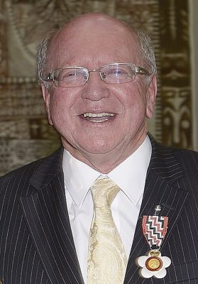

# Lindsay Tisch

| | |
|---|---|
| **Party** | New Zealand National Party |
| **Status** | Former MP |
| **Electorate(s)** | Karapiro (1999–2002); Piako (2002–2008); Waikato (2008–2017) |
| **Parliaments** | 45th, 46th, 47th, 48th, 49th, 50th, 51st |
| **First elected** | 1999 |
| **Born** | 1947-10-09 — Auckland, New Zealand |
| **Wikipedia** | [Lindsay Tisch](https://en.wikipedia.org/wiki/Lindsay_Tisch) |

## Record & notable actions

**Conscience votes** (recorded third-reading votes):

| Bill | Vote |
|---|---|
| [Marriage (Definition of Marriage) Amendment Bill — third reading, 17 Apr 2013](https://en.wikipedia.org/wiki/Marriage_(Definition_of_Marriage)_Amendment_Act_2013) | against |

## Sources

- <https://en.wikipedia.org/wiki/Lindsay_Tisch>
- Photo: <https://commons.wikimedia.org/wiki/File:Lindsay_Tisch_QSO_(cropped).jpg> — New Zealand Government, Office of the Governor-General — https://gg.govt.nz/image-galleries/7635/media?page=2 (CC BY 4.0)
