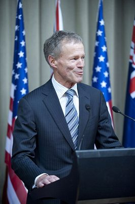

# Lockwood Smith

| | |
|---|---|
| **Party** | New Zealand National Party |
| **Status** | Former MP |
| **Now (Oct 2026)** | Left Parliament in Feb 2013; NZ High Commissioner to the UK 2013–2017. Current activities not detailed in sources consulted. |
| **Electorate(s)** | Kaipara (1984–1996); Rodney (1996–2011); List (2011–2013) |
| **Parliaments** | 41th, 42th, 43th, 44th, 45th, 46th, 47th, 48th, 49th, 50th |
| **First elected** | 1984 |
| **Born** | 1948-11-13 — Paparoa, New Zealand |
| **Wikipedia** | [Lockwood Smith](https://en.wikipedia.org/wiki/Lockwood_Smith) |

## Current status

Former MP, Speaker and diplomat. He left Parliament in February 2013 and was High Commissioner to the UK from March 2013 to March 2017; Sir Jerry Mateparae succeeded him. He was knighted (KNZM) in 2013. His current activities are not detailed in the sources consulted.

## Biography

- **Early life:** born on 13 November 1948 in Paparoa, Northland. He attended Auckland Grammar.
- **Education:** BAgSc and MAgSc from Massey, and a PhD in animal science from Adelaide (1980).
- **Television:** quizmaster on *W3* and *It's Academic*.
- **Career:** Dairy Board marketing manager for Asia (1980–84).
- **Personal:** married Alexandra Lang in Parliament's Legislative Council Chamber in 2009.

## Political career

- **Electorates:** won Kaipara in 1984, then held Rodney from 1996. He stood list-only in 2011, making way for Mark Mitchell in Rodney.
- **Minister of Education (1990–96):**
  - Shifted fee-setting to tertiary institutions, which led to steep fee rises.
  - Introduced means-testing of student allowances.
- **Trade and agriculture (1996–99):** as trade minister he negotiated the NZ–Singapore Closer Economic Partnership.
- **Speaker (2008–13):** elected unanimously in 2008. He was noted for pressing ministers to actually answer oral questions.

**Roles held:**

- Speaker of the House of Representatives (2008–2013)
- High Commissioner to the United Kingdom (2013–2017)
- Minister of Education (1990–1996)
- Minister of Agriculture; International Trade; Associate Finance (1996–1999)
- MP for Kaipara (1984–1996); Rodney (1996–2011); List (2011–2013)

## Record & notable actions

- **Valedictory regret:** in his 2013 valedictory he named voting against the 1986 Homosexual Law Reform Bill as his biggest regret.
- **Conscience votes:** as Speaker he did not take part in the 2012–13 marriage-equality debates; he had left before the third reading.

## Controversies

- **Seasonal-worker remarks (October 2008):** said some Pacific workers had to be taught to use a toilet or shower, and that Asian workers were better pruners because "their hands are smaller". Tariana Turia called the remarks racist and Helen Clark called them "absolutely daft". He expressed regret, saying he had been repeating employers' views.

## Sources

- <https://en.wikipedia.org/wiki/Lockwood_Smith>
- <https://www.dpmc.govt.nz/publications/queens-birthday-honours-list-2013>
- Photo: <https://commons.wikimedia.org/wiki/File:Lockwood_Smith_70th_Anniversary_of_the_arrival_of_US_Forces_in_New_Zealand.jpg> — US Embassy — Flickr: 70th Anniversary of the arrival of US Forces in New Zealand - Parliament Reception (CC BY-SA 2.0)
