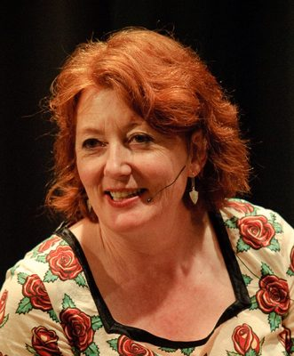

# Maggie Barry

| | |
|---|---|
| **Party** | New Zealand National Party |
| **Status** | Former MP |
| **Now (Oct 2026)** | Did not seek re-election in 2020 (announced Nov 2019). Broadcaster and long-time NZ Listener gardening columnist; current activities not otherwise verified. |
| **Parliaments** | 50th, 51st, 52nd |
| **Born** | 1959-10-05 — Thorndon, Wellington, New Zealand |
| **Wikipedia** | [Maggie Barry](https://en.wikipedia.org/wiki/Maggie_Barry) |

## Current status

Former MP and minister. She announced in November 2019 that she would not stand in 2020. ([TVNZ](https://www.tvnz.co.nz/one-news/new-zealand/national-mp-maggie-barry-leave-parliament-in-2020)) She is a long-time broadcaster and gardening writer. Her activities since 2020 are not verified in the sources consulted.

## Biography

- **Early life:** born on 5 October 1959 in Wellington and raised Catholic. She attended Erskine College.
- **Broadcasting:**
  - RNZ *Morning Report* and *Nine to Noon*; TV2's *Counterpoint* and *Primetime*.
  - Presented *Maggie's Garden Show* on TV One (1991–2003).
  - Radio Live Drive host (2009–10).
  - NZ Listener columnist.
- **Honours:** made an Officer of the NZ Order of Merit (ONZM) in 1996 for services to broadcasting. A rose is named after her.
- **Personal:** married to lawyer Grant Kerr; one son.

## Political career

- **North Shore (2011):** succeeded Wayne Mapp and held the seat until 2020.
- **Cabinet (2014–17):** Conservation, Arts, Culture and Heritage, and Senior Citizens. Under Bill English she also took on broadcasting within the arts portfolio.
- **Opposition:**
  - Endorsed Amy Adams for leader in 2018. Under Bridges she was demoted, losing conservation to take seniors, veterans and associate health, and later disability issues.
  - Deputy chair of the Justice Committee.

**Roles held:**

- Minister of Conservation (2014–2017)
- Minister for Arts, Culture and Heritage (2014–2017)
- Minister for Senior Citizens (2014–2017)
- MP for North Shore (2011–2020)
- Chair, Local Government and Environment Committee (2014)

## Record & notable actions

- **Predator Free 2050 (2016):** launched the programme as Conservation Minister. ([DOC](http://www.doc.govt.nz/predator-free-2050))
- **WW100:** oversaw the First World War centenary commemorations.
- **End of Life Choice:** strongly opposed the bill. She was accused of bias toward submitters during the select committee hearings.
- **Conscience votes:** voted for marriage equality (2013) and against the End of Life Choice and abortion bills (see table).

**Conscience votes** (recorded third-reading votes):

| Bill | Vote |
|---|---|
| [Marriage (Definition of Marriage) Amendment Bill — third reading, 17 Apr 2013](https://en.wikipedia.org/wiki/Marriage_(Definition_of_Marriage)_Amendment_Act_2013) | for |
| [End of Life Choice Bill — third reading, 13 Nov 2019](https://en.wikipedia.org/wiki/End_of_Life_Choice_Act_2019) | against |
| [Abortion Legislation Bill — third reading, 18 Mar 2020](https://en.wikipedia.org/wiki/Abortion_Legislation_Act_2020) | against |

## Controversies

- **Bullying allegations (2018):**
  - Former staff alleged she bullied staff and had parliamentary staff do party work. She denied the claims.
  - A Parliamentary Service review in July 2019 cleared her on the misuse of staff.
  - ([RNZ](https://www.radionz.co.nz/news/political/377515/maggie-barry-bullying-claims-ex-staffer-speaks-out))
- **Confrontation with Ruth Dyson (Sept 2019):** Assistant Speaker Ruth Dyson said Barry had yelled at her in the chamber. Barry apologised in the House. ([Newshub](https://www.newshub.co.nz/home/politics/2019/09/national-mp-maggie-barry-accused-of-bullying-physically-challenging-behaviour-in-parliament.html))
- **Paid parental leave debate (2012):** criticised for suggesting that Jacinda Ardern, then childless, could not speak with authority on the issue.

## Sources

- <https://www.tvnz.co.nz/one-news/new-zealand/national-mp-maggie-barry-leave-parliament-in-2020>
- <https://www.radionz.co.nz/news/political/377515/maggie-barry-bullying-claims-ex-staffer-speaks-out>
- <https://www.newshub.co.nz/home/politics/2019/09/national-mp-maggie-barry-accused-of-bullying-physically-challenging-behaviour-in-parliament.html>
- <http://www.doc.govt.nz/predator-free-2050>
- <https://en.wikipedia.org/wiki/Maggie_Barry>
- Photo: <https://commons.wikimedia.org/wiki/File:Maggie_Barry_crop.png> — Mark Tantrum — File:Maggie Barry 2010 Book Awards.jpg / Flickr (CC BY 2.0)
