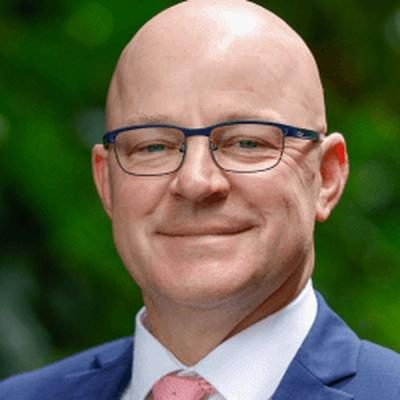

# Matt Doocey

| | |
|---|---|
| **Party** | New Zealand National Party |
| **Status** | Current MP — standing in 2026 |
| **Now (Oct 2026)** | Minister for Mental Health (New Zealand's first, since Nov 2023) and Associate Minister of Health (rural health); MP for Waimakariri; #12 on National's 2026 list and re-contesting Waimakariri. |
| **Electorate(s)** | Waimakariri (2014–) |
| **Parliaments** | 51st, 52nd, 53rd, 54th |
| **First elected** | 2014 |
| **Born** | 1972 — Canterbury |
| **2026 election** | list #12, standing in Waimakariri |
| **Wikipedia** | [Matt Doocey](https://en.wikipedia.org/wiki/Matt_Doocey) |

## Current status

New Zealand's first Minister for Mental Health (since November 2023) and Associate Minister of Health with responsibility for rural health. He is MP for Waimakariri (since 2014) and #12 on National's 2026 list. In the January 2025 reshuffle he lost ACC, Tourism and Youth.

## Biography

- **Early life and family:** born in 1972 and grew up in Christchurch, attending St Bede's College. He belongs to the Carter family: his grandfather was long-serving Christchurch city councillor Maurice Carter, and former Speaker David Carter is his uncle.
- **Education:** studied counselling psychology at WelTec. Holds a BSc (Hons) in social policy, an MA in healthcare management (Kingston University, London) and an MSc in global politics (Birkbeck).
- **Career:** worked in mental-health services and health management in New Zealand and the UK, including as a manager at the Canterbury District Health Board.

## Political career

- **2013 Christchurch East by-election:** finished second to Labour's Poto Williams.
- **2014:** succeeded Kate Wilkinson in Waimakariri, beating Clayton Cosgrove.
- **Re-elections:** majority of 10,766 in 2017 (reported as the largest increase in a personal vote), 1,507 in 2020 and 13,010 in 2023.
- **Whip:** third government whip (2014–17), junior whip (2017–20), senior whip (2020–21).
- **Front bench:** joined Luxon's front bench in December 2021. Named Stuff's Backbencher of the Year in 2020.

**Roles held:**

- Minister for Mental Health (2023–)
- Associate Minister of Health (2023–)
- Associate Minister of Transport (appointed 2023)
- Minister for ACC (2023–2025)
- Minister of Tourism and Hospitality (2023–2025)
- Minister for Youth (2023–2025)
- Senior Whip, National Party (2020–2021)
- Junior Whip (2017–2020); third Government Whip (2014–2017)
- National spokesperson for mental health (2018–2023)
- MP for Waimakariri (2014–)

## Record & notable actions

- **Mental health in opposition:**
  - In 2018, as National's first mental health spokesperson, proposed a cross-party approach to mental health. Labour and the Greens declined.
  - Co-founded the cross-party Mental Health and Addictions Wellbeing group with John Kirwan (2019).
- **As minister:**
  - NZ$36m suicide-prevention plan (2025). ([Stuff](https://www.stuff.co.nz/politics/360726465/matt-doocey-outlines-36-million-suicide-prevention-and-support))
  - Crisis-response package (November 2025): 40 more frontline clinical staff, peer-led acute alternatives to inpatient care, and crisis cafés. ([RNZ](https://www.rnz.co.nz/news/political/577877/government-announces-61-point-6-million-boost-for-crisis-response-services))
  - Mental-health co-response teams working alongside Police.
  - Widened who can diagnose ADHD and start treatment (2026). ([Chris Lynch Media](https://www.chrislynchmedia.com/news-items/changes-promise-faster-access-to-adhd-diagnosis-and-treatment/))
  - More compassionate registration of stillbirths.
- **Tourism:** with Tama Potaka, raised the International Visitor Levy to NZ$100 (2024). National had opposed the levy in opposition. Tourism Industry Aotearoa opposed the rise.
- **Conscience votes:** voted for the End of Life Choice and abortion bills (see table).

**Conscience votes** (recorded third-reading votes):

| Bill | Vote |
|---|---|
| [End of Life Choice Bill — third reading, 13 Nov 2019](https://en.wikipedia.org/wiki/End_of_Life_Choice_Act_2019) | for |
| [Abortion Legislation Bill — third reading, 18 Mar 2020](https://en.wikipedia.org/wiki/Abortion_Legislation_Act_2020) | for |
| Conversion Practices Prohibition Legislation Bill — third reading, 15 Feb 2022 | not among the 8 National MPs recorded as opposed (25 National MPs voted in favour) |

## Controversies

- **Abuse in care interim report (2024):** in May 2024 he admitted to survivors of abuse at the Hospitaller Brothers of St John of God in Christchurch that he had not read the Royal Commission's interim report on their case. He was criticised for this.

<!-- GENERATED:2026-candidacy START -->
## 2026 candidacy

- **Electorate:** Waimakariri
- **List ranking:** 12

_Source: candidate questionnaire answers published on [policy.nz](https://policy.nz/2026/party-vote/parties/national-party), retrieved Oct 2026._
<!-- GENERATED:2026-candidacy END -->

## Sources

- <http://electionresults.govt.nz/electionresults_2014/electorate-57.html>
- <https://archive.electionresults.govt.nz/electionresults_2017/electorate-details-57.html>
- <https://www.electionresults.govt.nz/electionresults_2020/electorate-details-57.html>
- <https://archive.electionresults.govt.nz/electionresults_2023/electorate-details-57.html>
- <https://www.stuff.co.nz/national/politics/300472085/national-elects-chris-penk-senior-whip-maureen-pugh-to-keep-junior-role>
- <https://www.stuff.co.nz/politics/360726465/matt-doocey-outlines-36-million-suicide-prevention-and-support>
- <https://www.rnz.co.nz/news/political/577877/government-announces-61-point-6-million-boost-for-crisis-response-services>
- <https://www.chrislynchmedia.com/news-items/changes-promise-faster-access-to-adhd-diagnosis-and-treatment/>
- <https://www.odt.co.nz/regions/north-otago/mental-health-crisis-service-introduction-announced>
- <https://en.wikipedia.org/wiki/Matt_Doocey>
- <https://policy.nz/2026/party-vote/parties/national-party>
- Photo: <https://cdn.sanity.io/images/ubdwo62y/production/a0a266232dc2c92a1c3441014e6712ab069e85ad-1024x1024.jpg> — Supplied to policy.nz by the candidate/party (Not stated (candidate photo supplied to policy.nz; used for identification))
