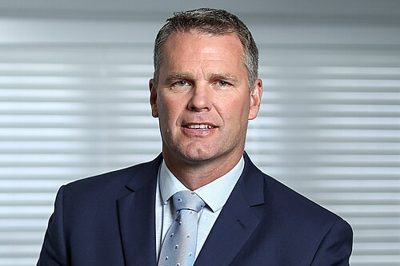

# Matt King

| | |
|---|---|
| **Party** | New Zealand National Party |
| **Status** | Former MP |
| **Electorate(s)** | Northland (2017–2020) |
| **Parliaments** | 52nd |
| **First elected** | 2017 |
| **Wikipedia** | [Matt King (politician)](https://en.wikipedia.org/wiki/Matt_King_(politician)) |

## Political career

**Offices held** (from the Wikipedia infobox; dates are years):

- Leader of DemocracyNZ (2022–2024)

## Record & notable actions

**Conscience votes** (recorded third-reading votes):

| Bill | Vote |
|---|---|
| [End of Life Choice Bill — third reading, 13 Nov 2019](https://en.wikipedia.org/wiki/End_of_Life_Choice_Act_2019) | for |
| [Abortion Legislation Bill — third reading, 18 Mar 2020](https://en.wikipedia.org/wiki/Abortion_Legislation_Act_2020) | against |

## Sources

- <https://en.wikipedia.org/wiki/Matt_King_(politician)>
- Photo: <https://commons.wikimedia.org/wiki/File:MattKingMP.jpg> — Tincandrum — Own work (CC BY-SA 4.0)
