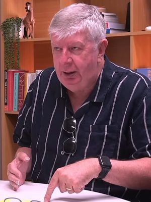

# Maurice Williamson

| | |
|---|---|
| **Party** | New Zealand National Party |
| **Status** | Former MP |
| **Electorate(s)** | Pakuranga (1987–2017) |
| **Parliaments** | 43th, 44th, 45th, 46th, 47th, 48th, 49th, 50th, 51st |
| **First elected** | 1987 |
| **Born** | 1951-03-06 — Auckland, New Zealand |
| **Wikipedia** | [Maurice Williamson](https://en.wikipedia.org/wiki/Maurice_Williamson) |

## Record & notable actions

**Conscience votes** (recorded third-reading votes):

| Bill | Vote |
|---|---|
| [Marriage (Definition of Marriage) Amendment Bill — third reading, 17 Apr 2013](https://en.wikipedia.org/wiki/Marriage_(Definition_of_Marriage)_Amendment_Act_2013) | for |

## Sources

- <https://en.wikipedia.org/wiki/Maurice_Williamson>
- Photo: <https://commons.wikimedia.org/wiki/File:Maurice_Williamson_March_2025_(cropped_wider).jpg> — mortgagehq — https://www.youtube.com/watch?v=XLwfMUny2JI (CC BY 3.0)
