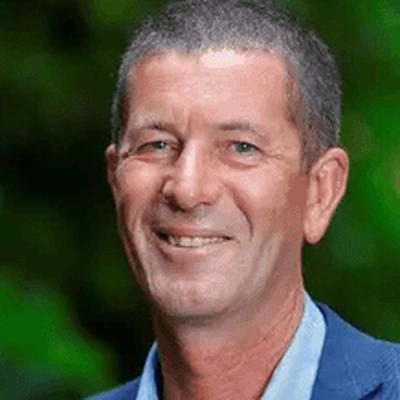

# Mike Butterick

| | |
|---|---|
| **Party** | New Zealand National Party |
| **Status** | Current MP — standing in 2026 |
| **Now (Oct 2026)** | Minister for Land Information and Associate Minister of Agriculture (since Apr 2026); MP for Wairarapa; sheep and beef farmer; #20 on National's 2026 list and re-contesting Wairarapa. |
| **Electorate(s)** | Wairarapa (2023–) |
| **Parliaments** | 54th |
| **First elected** | 2023 |
| **2026 election** | list #20, standing in Wairarapa |
| **Wikipedia** | [Mike Butterick](https://en.wikipedia.org/wiki/Mike_Butterick) |

> **List rank note:** policy.nz (in the 2026 candidacy section below) gives #21. The Electoral Commission's official National list gives **#20**. From #14 down, policy.nz's numbering appears to still include Chris Penk, who withdrew. ([Electoral Commission](https://vote.nz/2026-general-election/voting-in-the-election/party-lists))

## Current status

Minister for Land Information and Associate Minister of Agriculture since the April 2026 reshuffle. He is MP for Wairarapa and #20 on National's 2026 list.

## Biography

- **Early life and farming:** grew up in mid-Canterbury and started out as a shepherd. He moved to Wairarapa in 1990 and has farmed sheep and beef there since 1995.
- **Rural roles:**
  - Meat and wool chair of Wairarapa Federated Farmers.
  - Director of Wings Over Wairarapa.
  - Spokesperson for "50 Shades of Green", a group campaigning against the conversion of sheep farms to forestry. He later sold one of his own farms to a forestry company after attempts to sell it as a farm or create a park failed.
- **Personal:** married to Rachel; four children.

## Political career

- **2020:** lost Wairarapa to Labour's Kieran McAnulty, taking 34.4% of the vote; list #58.
- **2023:** beat McAnulty by 2,816 votes. ([Electoral Commission](https://archive.electionresults.govt.nz/electionresults_2023/electorate-details-58.html))
- **April 2026:** became a minister outside Cabinet.

**Roles held:**

- Minister for Land Information (2026–)
- Associate Minister of Agriculture (2026–)
- MP for Wairarapa (2023–)

## Record & notable actions

- Outspoken on farm-to-forestry conversion as a rural campaigner.
- He was not in Parliament for the 2013–2022 conscience votes.

## Controversies

- **School "swag bags" (June 2026):** parents complained after he gave National-branded merchandise to students at Wairarapa schools. The Ministry of Education reminded schools that political promotion is not allowed on school grounds. Butterick denied campaigning and said the Speaker had approved the items. ([RNZ](https://www.rnz.co.nz/news/political/597416/wairarapa-mp-mike-butterick-s-national-party-swag-bags-upset-parents))

<!-- GENERATED:2026-candidacy START -->
## 2026 candidacy

- **Electorate:** Wairarapa
- **List ranking:** 21

_Source: candidate questionnaire answers published on [policy.nz](https://policy.nz/2026/party-vote/parties/national-party), retrieved Oct 2026._
<!-- GENERATED:2026-candidacy END -->

## Sources

- <https://electionresults.govt.nz/electionresults_2020/electorate-details-58.html>
- <https://archive.electionresults.govt.nz/electionresults_2023/electorate-details-58.html>
- <https://www.1news.co.nz/2026/04/02/christopher-luxon-reveals-cabinet-shake-up/>
- <https://www.beehive.govt.nz/release/pm-refreshes-ministerial-team>
- <https://www.rnz.co.nz/news/political/597416/wairarapa-mp-mike-butterick-s-national-party-swag-bags-upset-parents>
- <https://en.wikipedia.org/wiki/Mike_Butterick>
- <https://policy.nz/2026/party-vote/parties/national-party>
- Photo: <https://cdn.sanity.io/images/ubdwo62y/production/cc4be4347e302204da229fe0a0fab44f45b4ae9b-1024x1024.jpg> — Supplied to policy.nz by the candidate/party (Not stated (candidate photo supplied to policy.nz; used for identification))
