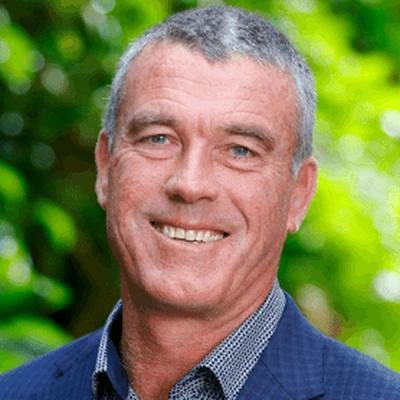

# Miles Anderson

| | |
|---|---|
| **Party** | New Zealand National Party |
| **Status** | Current MP — standing in 2026 |
| **Now (Oct 2026)** | Backbench MP for Waitaki (since 2023); sheep farmer; #46 on National's 2026 list and re-contesting Waitaki. |
| **Electorate(s)** | Waitaki (2023–) |
| **Parliaments** | 54th |
| **First elected** | 2023 |
| **2026 election** | list #46, standing in Waitaki |
| **Wikipedia** | [Miles Anderson (politician)](https://en.wikipedia.org/wiki/Miles_Anderson_(politician)) |

> **List rank note:** policy.nz (in the 2026 candidacy section below) gives #47. The Electoral Commission's official National list gives **#46**. From #14 down, policy.nz's numbering appears to still include Chris Penk, who withdrew. ([Electoral Commission](https://vote.nz/2026-general-election/voting-in-the-election/party-lists))

## Current status

Backbench MP for Waitaki since 2023. He is #46 on National's 2026 list and is re-contesting Waitaki. In 2026 he is up against Labour's Damien O'Connor, who moved to Waitaki after boundary changes.

## Biography

- **Early life:** grew up at Southburn in the Waimate district, where his family has farmed for generations. Boarded at St Kevin's College in Oamaru.
- **Education:** Bachelor of Agriculture from Massey University (1992).
- **Career:**
  - Co-founded a livestock ultrasound-scanning business (1992), which expanded to South Australia. He was involved with it for 20 years.
  - Took over the family sheep farm in 2004. He has leased it out since entering Parliament.
- **Federated Farmers:**
  - Chaired South Canterbury Meat & Fibre (2016), then the national Meat & Wool group (2017–20).
  - Rural security spokesperson. He supported the 2019 post-Christchurch gun reforms but sought exemptions for semi-automatic rifles used in pest control.

## Political career

- **2023:** succeeded Jacqui Dean in safe Waitaki; list #59.
- **Result:** won by 12,151 votes on the final count. ([Electoral Commission](https://archive.electionresults.govt.nz/electionresults_2023/electorate-details-59.html))

**Roles held:**

- MP for Waitaki (2023–)
- National chair, Federated Farmers Meat & Wool (2017–2020)

## Record & notable actions

- Backbench MP with a rural and farming focus.
- He was not in Parliament for the 2013–2022 conscience votes.

## Controversies

- None recorded in the sources consulted.

<!-- GENERATED:2026-candidacy START -->
## 2026 candidacy

- **Electorate:** Waitaki
- **List ranking:** 47

_Source: candidate questionnaire answers published on [policy.nz](https://policy.nz/2026/party-vote/parties/national-party), retrieved Oct 2026._
<!-- GENERATED:2026-candidacy END -->

## Sources

- <https://ruralnewsgroup.co.nz/rural-news/rural-general-news/former-fed-aims-for-parliament>
- <https://www.stuff.co.nz/timaru-herald/133118000/nationals-miles-anderson-secures-waitaki-electorate-with-solid-lead>
- <https://archive.electionresults.govt.nz/electionresults_2023/electorate-details-59.html>
- <https://en.wikipedia.org/wiki/Miles_Anderson_(politician)>
- <https://policy.nz/2026/party-vote/parties/national-party>
- Photo: <https://cdn.sanity.io/images/ubdwo62y/production/0b98fdb0e7ccbc53fa320350ddbd5757efcab1f7-1024x1024.jpg> — Supplied to policy.nz by the candidate/party (Not stated (candidate photo supplied to policy.nz; used for identification))
