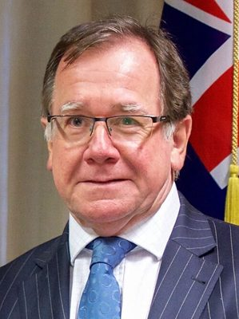

# Murray McCully

| | |
|---|---|
| **Party** | New Zealand National Party |
| **Status** | Former MP |
| **Parliaments** | 50th, 51st |
| **Born** | 1953-02-19 — Whangārei, New Zealand |
| **Wikipedia** | [Murray McCully](https://en.wikipedia.org/wiki/Murray_McCully) |

## Political career

**Offices held** (from the Wikipedia infobox; dates are years):

- Member of the New Zealand Parliament; for East Coast Bays; (1996–2002) (1987–2017)

## Record & notable actions

**Conscience votes** (recorded third-reading votes):

| Bill | Vote |
|---|---|
| [Marriage (Definition of Marriage) Amendment Bill — third reading, 17 Apr 2013](https://en.wikipedia.org/wiki/Marriage_(Definition_of_Marriage)_Amendment_Act_2013) | against |

## Sources

- <https://en.wikipedia.org/wiki/Murray_McCully>
- Photo: <https://commons.wikimedia.org/wiki/File:Murray_McCully_November_2016.jpg> — U.S. Department of State from United States — Secretary Kerry Stands With New Zealand Foreign Minister McCully Before Their Meeting in Christchurch (Public domain)
