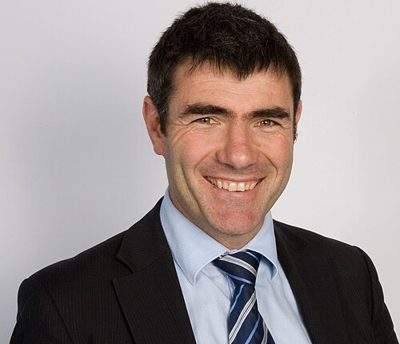

# Nathan Guy

| | |
|---|---|
| **Party** | New Zealand National Party |
| **Status** | Former MP |
| **Now (Oct 2026)** | Retired at the 2020 election. Chair of the Meat Industry Association (since Aug 2022) and chair of Apiculture New Zealand (since Jul 2022); Horowhenua dairy farmer. |
| **Electorate(s)** | Ōtaki (2008–2020) |
| **Parliaments** | 48th, 49th, 50th, 51st, 52nd |
| **First elected** | 2005 |
| **Born** | 1970 |
| **Wikipedia** | [Nathan Guy](https://en.wikipedia.org/wiki/Nathan_Guy) |

## Current status

Former MP. He retired at the 2020 election. He has chaired the Meat Industry Association since August 2022 and Apiculture New Zealand since July 2022. In 2020 he stood unsuccessfully for the Fonterra board. ([NZ Herald](https://www.nzherald.co.nz/the-country/news/nathan-guy-new-chair-of-meat-industry-association/IUQZULO257O5UAGB24F6FEYMIM/))

## Biography

- Born in 1970. A dairy farmer near Levin, who studied farming at Massey University and took over his father's farm.
- Horowhenua district councillor (1998–2005).
- Comes from a local-government family: his father, Malcolm Guy, was the first Mayor of Horowhenua.

## Political career

- **Ōtaki:** lost the seat to Labour's Darren Hughes by 382 votes in 2005 and entered Parliament on the list. He won Ōtaki in 2008 and held it until 2020.
- **Whip:** junior and then senior whip.
- **Ministerial career:**
  - Minister of Internal Affairs (from June 2009), during which he merged the National Library and Archives NZ into the DIA.
  - Immigration, Racing and Veterans' Affairs (2011–13).
  - Primary Industries (2013–17), including the response to the 2013 Fonterra botulism scare.
- **Retirement:** announced in July 2019. ([Newshub](https://www.newshub.co.nz/home/rural/2019/07/national-party-reshuffle-after-nathan-guy-announces-retirement-from-politics.html))

**Roles held:**

- Minister for Primary Industries (2013–2017)
- Minister of Immigration (2011–2013)
- Minister for Racing; Veterans' Affairs (2011–2013)
- Minister of Internal Affairs (2009–2011)
- National senior whip (2008–2009); junior whip (2006–2008)
- National agriculture spokesperson (2018–2019)
- MP for Ōtaki (2008–2020)
- List MP (2005–2008)
- Horowhenua District Councillor (1998–2005)

## Record & notable actions

- **Conscience votes:** voted against marriage equality, End of Life Choice and abortion reform (see table).

**Conscience votes** (recorded third-reading votes):

| Bill | Vote |
|---|---|
| [Marriage (Definition of Marriage) Amendment Bill — third reading, 17 Apr 2013](https://en.wikipedia.org/wiki/Marriage_(Definition_of_Marriage)_Amendment_Act_2013) | against |
| [End of Life Choice Bill — third reading, 13 Nov 2019](https://en.wikipedia.org/wiki/End_of_Life_Choice_Act_2019) | against |
| [Abortion Legislation Bill — third reading, 18 Mar 2020](https://en.wikipedia.org/wiki/Abortion_Legislation_Act_2020) | against |

## Controversies

- **Peter Thiel citizenship (revealed 2017):** as Internal Affairs Minister in 2011, he granted citizenship to US billionaire Peter Thiel under "exceptional circumstances" after only 12 days' residence. Thiel was the first adult granted citizenship without meeting the residency requirement. ([RNZ](https://www.rnz.co.nz/news/political/326696/thiel's-nz-citizenship-one-of-a-kind))

## Sources

- <https://www.nzherald.co.nz/the-country/news/nathan-guy-new-chair-of-meat-industry-association/IUQZULO257O5UAGB24F6FEYMIM/>
- <https://www.rnz.co.nz/news/political/326696/thiel's-nz-citizenship-one-of-a-kind>
- <https://www.newshub.co.nz/home/rural/2019/07/national-party-reshuffle-after-nathan-guy-announces-retirement-from-politics.html>
- <https://en.wikipedia.org/wiki/Nathan_Guy>
- Photo: <https://commons.wikimedia.org/wiki/File:Minister_Nathan_Guy_-_photo.jpg> — Office of Nathan Guy. — Sent and authorised by Phil Rennie, Private Secretary to Hon. Nathan Guy. (CC0)
