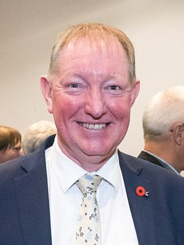

# Nick Smith

| | |
|---|---|
| **Party** | New Zealand National Party |
| **Status** | Former MP |
| **Electorate(s)** | Tasman (1990–1996); Nelson (1996–2020) |
| **Parliaments** | 43th, 44th, 45th, 46th, 47th, 48th, 49th, 50th, 51st, 52nd, 53rd |
| **First elected** | 1990 |
| **Born** | 1964-12-24 — Rangiora, Canterbury Region, New Zealand |
| **Wikipedia** | [Nick Smith (New Zealand politician)](https://en.wikipedia.org/wiki/Nick_Smith_(New_Zealand_politician)) |

## Political career

**Offices held** (from the Wikipedia infobox; dates are years):

- Deputy Leader of the National Party (2003–2003)

## Record & notable actions

**Conscience votes** (recorded third-reading votes):

| Bill | Vote |
|---|---|
| [Marriage (Definition of Marriage) Amendment Bill — third reading, 17 Apr 2013](https://en.wikipedia.org/wiki/Marriage_(Definition_of_Marriage)_Amendment_Act_2013) | against |
| [End of Life Choice Bill — third reading, 13 Nov 2019](https://en.wikipedia.org/wiki/End_of_Life_Choice_Act_2019) | against |
| [Abortion Legislation Bill — third reading, 18 Mar 2020](https://en.wikipedia.org/wiki/Abortion_Legislation_Act_2020) | against |

## Sources

- <https://en.wikipedia.org/wiki/Nick_Smith_(New_Zealand_politician)>
- Photo: <https://commons.wikimedia.org/wiki/File:Nick_Smith_at_Lincoln_University,_2016.jpg> — David Hollander — https://livingheritage.lincoln.ac.nz/nodes/view/11961 (CC BY-SA 3.0 nz)
