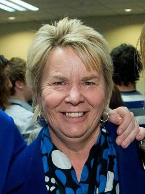

# Nicky Wagner

| | |
|---|---|
| **Party** | New Zealand National Party |
| **Status** | Former MP |
| **Now (Oct 2026)** | Retired at the 2020 election. Current activities not detailed in sources consulted. |
| **Electorate(s)** | List (2005–2011); Christchurch Central (2011–2017); List (2017–2020) |
| **Parliaments** | 48th, 49th, 50th, 51st, 52nd |
| **First elected** | 2005 |
| **Born** | 1953-07-23 — Christchurch, New Zealand |
| **Wikipedia** | [Nicky Wagner](https://en.wikipedia.org/wiki/Nicky_Wagner) |

## Current status

Former MP and minister. She retired at the 2020 election. Her activities since are not detailed in the sources consulted.

## Biography

- **Early life:** born on 23 July 1953 in Christchurch and raised in Cashmere. She attended St Margaret's College.
- **Education:** teaching qualification, a BA from Canterbury and an MBA from Massey.
- **Career:** teacher, then fashion and internet-marketing entrepreneur. She founded the websites FashioNZ and GardenNZ.
- **Personal:** two children.

## Political career

- **2002:** lost Christchurch Central to Tim Barnett.
- **Environment Canterbury:** councillor from a 2003 by-election until 2007.
- **List MP (2005):** entered Parliament at #28 on the list.
- **Christchurch Central (2011):** won by 47 votes on specials, the first time National had held the seat. She increased her majority to 2,420 in 2014.
- **Minister (2014–17):**
  - Customs, Statistics, Associate Conservation and Associate Canterbury Earthquake Recovery (from May 2014).
  - Disability Issues from 2014.
  - Greater Christchurch Regeneration from 2017.
- **2017:** lost the seat to Labour's Duncan Webb but remained a list MP until 2020.

**Roles held:**

- Minister for Disability Issues (2014–2017)
- Minister of Customs (2014–2017)
- Minister supporting Greater Christchurch Regeneration (2017)
- Associate Minister for Canterbury Earthquake Recovery; Conservation; Health; Tourism
- MP for Christchurch Central (2011–2017)
- List MP (2005–2011, 2017–2020)
- Environment Canterbury councillor (2003–2007)

## Record & notable actions

- **Conscience votes:**
  - Voted for the 2005 bill to define marriage as between a man and a woman, but for marriage equality in 2013.
  - Against End of Life Choice; for abortion reform (see table).

**Conscience votes** (recorded third-reading votes):

| Bill | Vote |
|---|---|
| [Marriage (Definition of Marriage) Amendment Bill — third reading, 17 Apr 2013](https://en.wikipedia.org/wiki/Marriage_(Definition_of_Marriage)_Amendment_Act_2013) | for |
| [End of Life Choice Bill — third reading, 13 Nov 2019](https://en.wikipedia.org/wiki/End_of_Life_Choice_Act_2019) | against |
| [Abortion Legislation Bill — third reading, 18 Mar 2020](https://en.wikipedia.org/wiki/Abortion_Legislation_Act_2020) | for |

## Controversies

- **"Rather be out on the harbour" (June 2017):** as Disability Issues Minister she tweeted that she would "rather be out on the harbour" while at disability meetings. Labour and Green MPs criticised the tweet. ([Newshub](http://www.newshub.co.nz/home/politics/2017/06/rather-be-out-on-the-harbour-national-party-mp-tweets-from-disability-meetings.html))
- **Simon Lusk (2014):** defended employing the strategist, who was named in *Dirty Politics*.

## Sources

- <https://en.wikipedia.org/wiki/Nicky_Wagner>
- <http://www.newshub.co.nz/home/politics/2017/06/rather-be-out-on-the-harbour-national-party-mp-tweets-from-disability-meetings.html>
- Photo: <https://commons.wikimedia.org/wiki/File:Nicky_Wagner_(cropped).jpg> — TEDx Christchurch — https://www.flickr.com/photos/tedxchch/7941681566/ (CC BY 2.0)
