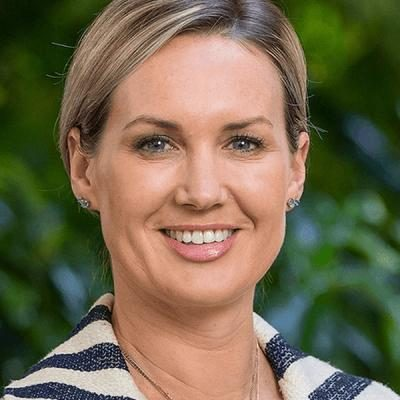

# Nicola Grigg

| | |
|---|---|
| **Party** | New Zealand National Party |
| **Status** | Current MP — standing in 2026 |
| **Now (Oct 2026)** | Minister for the Environment (since 7 Apr 2026), Minister for Women, Minister of State for Trade and Investment and Associate Minister of Agriculture/ACC; MP for Selwyn; #16 on National's 2026 list and re-contesting Selwyn. |
| **Electorate(s)** | Selwyn (2020–) |
| **Parliaments** | 53rd, 54th |
| **First elected** | 2020 |
| **2026 election** | list #16, standing in Selwyn |
| **Wikipedia** | [Nicola Grigg](https://en.wikipedia.org/wiki/Nicola_Grigg) |

> **List rank note:** policy.nz (in the 2026 candidacy section below) gives #17. The Electoral Commission's official National list gives **#16**. From #14 down, policy.nz's numbering appears to still include Chris Penk, who withdrew. ([Electoral Commission](https://vote.nz/2026-general-election/voting-in-the-election/party-lists))

## Current status

Minister for the Environment since the 2 April 2026 reshuffle. She also holds Minister for Women and Minister of State for Trade and Investment, both since November 2023, and associate roles in Agriculture and ACC. She is MP for Selwyn and #16 on National's 2026 list.

## Biography

- **Early life:** born and raised in Mount Somers, Mid Canterbury.
- **Family:** her great-grandparents Arthur Grigg and Mary Grigg were both MPs for Mid-Canterbury. Mary Grigg, who completed Arthur's term after his death, was National's first woman MP. She is also descended from Premier Sir John Hall.
- **Career:**
  - Journalist at Newstalk ZB and RNZ.
  - Press secretary and adviser to Bill English (as finance minister and Prime Minister) and to Simon Bridges.
  - Worked at New Zealand Trade and Enterprise.
- **Personal:** lives in Prebbleton with her partner Phil. They have a son, born around the end of 2023 (she announced the pregnancy in October 2023).

## Political career

- **Selection:** chosen in November 2019 on the first ballot for Selwyn, described as National's safest seat. ([Stuff](https://www.stuff.co.nz/national/politics/117306482/national-puts-former-journalist-nicola-grigg-forward-for-safest-seat-in-nz))
- **Elections:** won Selwyn by 4,968 votes in 2020 and by 19,782 in 2023. ([Electoral Commission](https://archive.electionresults.govt.nz/electionresults_2023/electorate-details-45.html))
- **Opposition spokesperson:** women; trade and export growth; then rural communities, animal welfare, biosecurity and food safety.
- **Ministerial appointments:** became a minister outside Cabinet on 27 November 2023. Environment was added in April 2026.

**Roles held:**

- Minister for the Environment (2026–)
- Minister for Women (2023–)
- Minister of State for Trade and Investment (2023–)
- Associate Minister of Agriculture (2023–)
- Associate Minister for ACC
- National spokesperson for women; trade and export growth; rural communities, animal welfare, biosecurity (2020–2023)
- MP for Selwyn (2020–)

## Record & notable actions

- **Trade:** represented New Zealand at ASEAN economic ministers' meetings (2024), PACER Plus (2024) and the Pacific Islands Forum trade ministers' meeting (2025). She also joined prime ministerial trade missions.
- **Women:** launched a gender pay-gap toolkit, the "Free to Lead" online-harm toolkit and the BoardConnector governance database. ([Beehive](https://www.beehive.govt.nz/release/pay-gap-calculator-toolkit-launched))
- **Environment:** introduced the Hazardous Substances and New Organisms Amendment Bill (May 2026), intended to streamline HSNO approvals. ([Beehive](https://www.beehive.govt.nz/release/amendment-proposed-streamline-hazardous-substance-and-new-organism-approvals))
- **Positions:** supported the 2022 abortion "safe areas" law, arguing it would reduce harassment of women. ([Newshub](https://www.newshub.co.nz/home/politics/2021/03/how-mps-voted-on-law-change-that-would-allow-safe-zones-around-abortion-clinics.html))
- **Conscience votes:** she was in Parliament for the 2022 conversion-practices vote and was not among the eight National MPs recorded as opposed.

## Controversies

- None recorded in the sources consulted.

<!-- GENERATED:2026-candidacy START -->
## 2026 candidacy

- **Electorate:** Selwyn
- **List ranking:** 17

_Source: candidate questionnaire answers published on [policy.nz](https://policy.nz/2026/party-vote/parties/national-party), retrieved Oct 2026._
<!-- GENERATED:2026-candidacy END -->

## Sources

- <https://www.stuff.co.nz/national/politics/117306482/national-puts-former-journalist-nicola-grigg-forward-for-safest-seat-in-nz>
- <https://www.electionresults.govt.nz/electionresults_2020/electorate-details-45.html>
- <https://archive.electionresults.govt.nz/electionresults_2023/electorate-details-45.html>
- <https://www.rnz.co.nz/news/political/503156/cabinet-lineup-for-new-government-unveiled-who-gets-what>
- <https://www.newshub.co.nz/home/politics/2021/03/how-mps-voted-on-law-change-that-would-allow-safe-zones-around-abortion-clinics.html>
- <https://www.beehive.govt.nz/release/pay-gap-calculator-toolkit-launched>
- <https://www.beehive.govt.nz/release/new-tools-help-women-navigate-online-harm>
- <https://www.beehive.govt.nz/release/upgraded-womens-leadership-database-launched>
- <https://www.beehive.govt.nz/release/amendment-proposed-streamline-hazardous-substance-and-new-organism-approvals>
- <https://www.1news.co.nz/2026/04/02/christopher-luxon-reveals-cabinet-shake-up/>
- <https://en.wikipedia.org/wiki/Nicola_Grigg>
- <https://policy.nz/2026/party-vote/parties/national-party>
- Photo: <https://cdn.sanity.io/images/ubdwo62y/production/443b05a6a7a0a67c8924195624eca5a20cb5c520-1024x1024.jpg> — Supplied to policy.nz by the candidate/party (Not stated (candidate photo supplied to policy.nz; used for identification))
