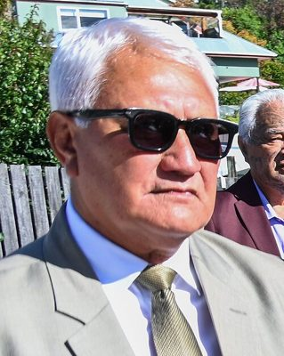

# Nuk Korako

| | |
|---|---|
| **Party** | New Zealand National Party |
| **Status** | Former MP |
| **Parliaments** | 51st, 52nd |
| **First elected** | 2014 |
| **Wikipedia** | [Nuk Korako](https://en.wikipedia.org/wiki/Nuk_Korako) |

## Sources

- <https://en.wikipedia.org/wiki/Nuk_Korako>
- Photo: <https://commons.wikimedia.org/wiki/File:Nuk_Korako_2025_(cropped).jpg> — Government House, Department of the Prime Minister and Cabinet — https://gg.govt.nz/image-galleries/10539/media?page=0 (CC0)
