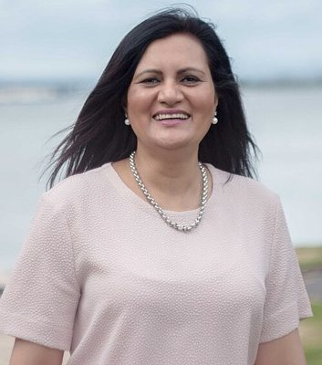

# Parmjeet Parmar

> **This person's current profile is under [act](../../../act/people/parmjeet-parmar/README.md).** They sat as a national MP; this page is kept for their national-era history and is not counted separately.

| | |
|---|---|
| **Party** | ACT New Zealand (current MP since 2023); formerly National (list MP 2014–2020) |
| **Status** | Former MP |
| **Now (Oct 2026)** | Current ACT list MP (since Oct 2023) and ACT education spokesperson; ACT 2026 candidate for Pakuranga. Former National list MP 2014–2020. Her current-party profile: ../../../act/people/parmjeet-parmar/. |
| **Electorate(s)** | List MP (National 2014–2020; ACT 2023–); contested Mount Roskill 2014, 2016 by-election, 2017 |
| **Parliaments** | 51st, 52nd, 54th |
| **First elected** | 2014 |
| **Born** | 1970 |
| **Wikipedia** | [Parmjeet Parmar](https://en.wikipedia.org/wiki/Parmjeet_Parmar) |

## Current status

A **current ACT MP**. She switched from National to ACT in May 2023 and was elected on ACT's list in October 2023. She is ACT's education spokesperson and its 2026 candidate for Pakuranga. Her ACT profile is at [`parties/act/people/parmjeet-parmar`](../../../act/people/parmjeet-parmar/). This page covers her National years, 2014–2020.

## Biography

- **Early life:** born 1970 in India, where her father served in the Indian Air Force. She took a master's in biochemistry and moved to New Zealand in 1995.
- **Science career:** PhD in biological sciences from the University of Auckland (2003), then worked as a scientist.
- **Business and media:** director of a confectionery company and a Radio Tarana host.
- **Government appointments:** Film and Video Labelling Body, and the Families Commission board.
- **Personal:** married to Ravinder Parmar; two sons.

## Political career

- **National list MP (2014–20):** the first Indian woman MP to represent a party. She contested Mount Roskill in 2014, at the 2016 by-election and in 2017.
- **Opposition roles:** research, science and innovation spokesperson (2017–20) and chair of the Education and Workforce Committee (2018–20).
- **2020:** lost her seat.
- **Move to ACT:** missed out on National selections for 2023 and joined ACT.

**Roles held:**

- ACT list MP (2023–)
- National list MP (2014–2020)
- Chair, Education and Workforce Committee (2018–2020)
- National spokesperson for research, science and innovation (2017–2020)

## Record & notable actions

- **Newborn Enrolment with General Practice Bill (2017):** her member's bill passed its first reading unanimously but was voted down at second reading in 2018.
- **Conscience votes:** voted against the End of Life Choice and abortion bills (see table).

**Conscience votes** (recorded third-reading votes):

| Bill | Vote |
|---|---|
| [End of Life Choice Bill — third reading, 13 Nov 2019](https://en.wikipedia.org/wiki/End_of_Life_Choice_Act_2019) | against |
| [Abortion Legislation Bill — third reading, 18 Mar 2020](https://en.wikipedia.org/wiki/Abortion_Legislation_Act_2020) | against |

## Controversies

- **Families Commission (2014):** questions were raised about her staying on the board while being touted as a National candidate. She resigned when selected.

## Sources

- <https://en.wikipedia.org/wiki/Parmjeet_Parmar>
- Photo: <https://commons.wikimedia.org/wiki/File:Parmjeet_Parmar.jpg> — Parmjeet Parmar MP — http://www.parmjeetparmar.co.nz/ (CC BY 3.0)
